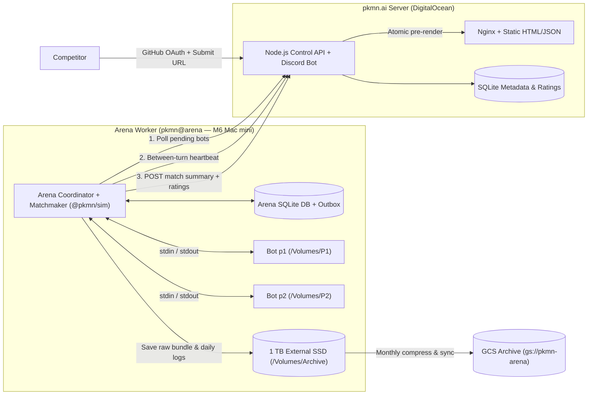
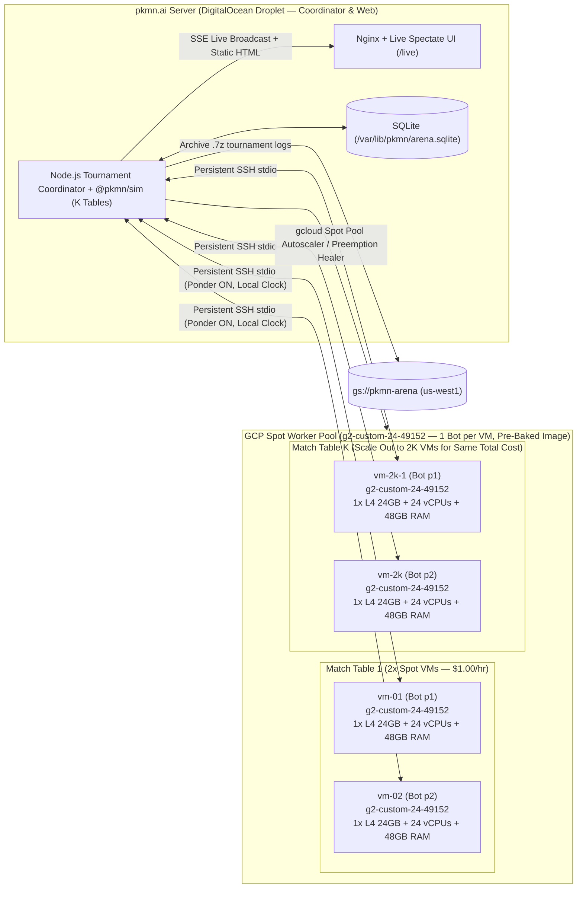

# pkmn.ai Arena & Server Implementation Specification

> [!WARNING]
> While written in concert with and reviewed by human, do not take this document as gospel as it was 100% written by an LLM and thus is at _best_ 98% accurate.

This document is the complete, self-contained technical specification for **pkmn.ai**'s automated Pokémon AI battling arena. It contains every architectural decision, hardware sandbox script, protocol rule, mathematical formula, TypeScript algorithm, SQLite schema, and API contract required to implement both machines from scratch.

---

## Table of Contents
1. [System Overview, Naming & Storage Inventory](#1-system-overview-naming--storage-inventory)
2. [Ladders, Rulesets & Team Pool Harvesting](#2-ladders-rulesets--team-pool-harvesting)
3. [Arena Hardware, Sandbox & Full Setup Script](#3-arena-hardware-sandbox--full-setup-script)
4. [Packaging Rules, 500 MB Uncompressed Cap & OCI Inspection](#4-packaging-rules-500-mb-uncompressed-cap--oci-inspection)
5. [Battle Loop, `|utm|` Protocol & Time-Sliced Arbiter](#5-battle-loop-utm-protocol--time-sliced-arbiter)
6. [Rating System, Matchmaking & Model Augmentations](#6-rating-system-matchmaking--model-augmentations)
7. [Competitor Registration, Submissions & Version Lifecycle](#7-competitor-registration-submissions--version-lifecycle)
8. [Competitor Integration Guide & Gotchas](#8-competitor-integration-guide--gotchas)
9. [Database Schemas & API Specifications](#9-database-schemas--api-specifications)
10. [Static Page Generation, Leaderboard UI & Log Archival](#10-static-page-generation-leaderboard-ui--log-archival)
11. [Local Laptop End-to-End Testing & Pre-Launch Checklist](#11-local-laptop-end-to-end-testing--pre-launch-checklist)
12. [Appendices: Cold-Storage Bot Swapping & Competitor-Supplied Team Pools](#12-appendices-cold-storage-bot-swapping--competitor-supplied-team-pools)
13. [Live Cloud GPU Tournaments (TCEC / CCC Mode)](#13-live-cloud-gpu-tournaments-tcec--ccc-mode)

---

## 1. System Overview, Naming & Storage Inventory

**pkmn.ai** runs across two dedicated machines with a strict separation between public web serving and isolated battle execution:

- **`pkmn.ai` Server (DigitalOcean Droplet, Ubuntu LTS)**: Serves the static website via Nginx behind Cloudflare, handles developer GitHub OAuth2 login for version submissions, syncs registered bots from `static/projects.yml`, mirrors match summaries and ratings in SQLite, runs a Discord role bot, and pre-generates static leaderboard HTML/JSON after each match. Zero battle logs and zero bot archives ever touch the droplet's disk.
- **`arena` Worker (Apple M6 Mac mini, headless macOS)**: Owns canonical matchmaking and Davidson MAP rating computation, pulls approved bot artifacts, isolates them in either Linux ARM64 OCI containers or native macOS ARM64 Seatbelt sandboxes, runs 2-game blind-pair matches using [`@pkmn/sim`](https://github.com/pkmn/ps/tree/main/sim) over `stdin`/`stdout`, wipes memory and `/tmp` scratch volumes between games, writes uncompressed daily logs and bot archives to an external 1 TB SSD (`/Volumes/Archive`), compresses monthly `.tar` archives to Google Cloud Storage (`gs://pkmn-arena`), and pushes match summaries and ratings outbound to `pkmn.ai`.



### Master Inventory of Hostnames, Users, Volumes, Paths & Services

#### A. Hostnames, Users & Groups
| Machine | Entity Type | Name / ID | Purpose |
| :--- | :--- | :--- | :--- |
| **`pkmn.ai` (Ubuntu Droplet)** | Hostname | `pkmn.ai` | Public web server and control plane (`ssh pkmn@pkmn.ai`). |
| **`pkmn.ai` (Ubuntu Droplet)** | Admin / App User | `pkmn` | Owns `/home/pkmn/ai` and runs `pkmn.ai-server.service`. |
| **`pkmn.ai` (Ubuntu Droplet)** | Web User | `www-data` (in group `pkmn`) | Runs Nginx serving `/home/pkmn/ai/public`. |
| **`arena` (M6 Mac mini)** | Hostname | `arena` | Dedicated headless M6 Mac mini (`ssh pkmn@arena`). |
| **`arena` (M6 Mac mini)** | Admin / Coordinator User | `pkmn` | Owns `/opt/arena` and runs `ai.pkmn.arena` coordinator on E-cores. |
| **`arena` (M6 Mac mini)** | Bot Slot 1 User | `p1` (UID `591`, GID `590`) | Unprivileged user executing native Player 1 bot inside Seatbelt. |
| **`arena` (M6 Mac mini)** | Bot Slot 2 User | `p2` (UID `592`, GID `590`) | Unprivileged user executing native Player 2 bot inside Seatbelt. |
| **`arena` (M6 Mac mini)** | Bot Sandbox Group | `bots` (GID `590`) | Shared primary group for `p1` and `p2`. |

#### B. File Paths, Volumes, Databases & Cloud Storage
| Location | Path / URI | Medium / Quota | Contents & Lifecycle |
| :--- | :--- | :--- | :--- |
| **`pkmn.ai` Droplet** | `/home/pkmn/ai/` | Droplet SSD | Git checkout of `pkmn/ai` (`static/`, `server/`, `config/`, `deploy`). |
| **`pkmn.ai` Droplet** | `/home/pkmn/ai/static/projects.yml` | Droplet SSD | Canonical registry of all Pokémon AI projects and registered `arena:` bots. |
| **`pkmn.ai` Droplet** | `/home/pkmn/ai/static/avatars/<slug>.png` | Droplet SSD | $96 \times 96$ bot avatars committed via registration PRs. |
| **`pkmn.ai` Droplet** | `/home/pkmn/ai/public/` | Droplet SSD | Pre-rendered static HTML/JSON served directly by Nginx (`leaderboard/`, `api/live.json`). |
| **`pkmn.ai` Droplet** | `/var/lib/pkmn/arena.sqlite` | Droplet SSD | Control-plane SQLite DB (`developers`, `bots`, `bot_versions`, `ladder_entries`, `matches`, `pair_aggregates`, `rating_snapshots`). |
| **`arena` Internal SSD** | `/opt/arena/app/` | 256 GB Internal SSD | Deployed Arena coordinator & `@pkmn/sim` code. |
| **`arena` Internal SSD** | `/opt/arena/bin/arena` | 256 GB Internal SSD | Unified lifecycle controller (`arena run|pause|resume|cleanup p1|p2 ...`). |
| **`arena` Internal SSD** | `/opt/arena/bin/limit` | 256 GB Internal SSD | Compiled C supervisor (`limit.c`) enforcing 14 GiB XNU `ri_phys_footprint` cap. |
| **`arena` Internal SSD** | `/opt/arena/bin/unpack` | 256 GB Internal SSD | Python stream unpacker enforcing 500 MB resident cap + APFS `cp -c` CAS deduplication. |
| **`arena` Internal SSD** | `/opt/arena/etc/sandbox.sb` | 256 GB Internal SSD | macOS Seatbelt MAC profile for native `darwin/arm64` bundles. |
| **`arena` Internal SSD** | `/opt/arena/state/arena.sqlite` | 256 GB Internal SSD | Operational SQLite DB (active rosters, match states, Davidson ratings, `outbox`). |
| **`arena` Internal SSD** | `/opt/arena/state/p{1,2}.{mode,pgid,peak}` | 256 GB Internal SSD | Per-slot runtime mode, process group ID, and peak RAM telemetry files. |
| **`arena` Internal SSD** | `/opt/arena/teams/<ladder>.txt` | 256 GB Internal SSD | Harvested, validated, and canonicalized packed team pools. |
| **`arena` Internal SSD** | `/opt/arena/bots/<slug>-<ver>/` | 256 GB Internal SSD | Unpacked active native bundles ($\le 500\text{ MB}$ each, `root:wheel` read-only). |
| **`arena` Internal SSD** | `/opt/arena/cas/<xx>/<sha256>` | 256 GB Internal SSD | Content-addressed store for APFS `clonefile(2)` block deduplication across bundles. |
| **`arena` Internal SSD** | `/opt/arena/logs/` | 256 GB Internal SSD | Coordinator daemon stdout/stderr logs (`arena.out.log`, `arena.err.log`). |
| **`arena` APFS Volume** | `/Volumes/P1` | **4 GB APFS quota** | Ephemeral `/tmp` & `$XDG_CACHE_HOME` for Player 1; wiped before and after every game. |
| **`arena` APFS Volume** | `/Volumes/P2` | **4 GB APFS quota** | Ephemeral `/tmp` & `$XDG_CACHE_HOME` for Player 2; wiped before and after every game. |
| **`arena` APFS Volume** | `/Volumes/Staging` | **1 GB APFS quota** | Ephemeral staging volume for safe bundle/image downloads and unpacking. |
| **`arena` External SSD** | `/Volumes/Archive/bots/<slug>/<ver>/` | **1 TB External SSD** | Permanent cold archive of every submitted bot bundle (`.tar.gz`/`.tar.zst`) or OCI image (`.oci.tar`). |
| **`arena` External SSD** | `/Volumes/Archive/logs/YYYY-MM/<format>/<YYYY-MM-DD>/` | **1 TB External SSD** | Uncompressed daily battle logs (`battle-<format>-<N>.log.json`), compressed daily to `.7z` and monthly to `/Volumes/Archive/logs/YYYY-MM.tar`. |
| **`arena` External SSD** | `/Volumes/Archive/db/` | **1 TB External SSD** | Daily snapshots of `/opt/arena/state/arena.sqlite`. |
| **Google Cloud Storage** | `gs://pkmn-arena` | GCS `ARCHIVE` (`us-west1`) | Long-term off-site backup (`gs://pkmn-arena/bots/`, `gs://pkmn-arena/logs/YYYY-MM.tar`, `gs://pkmn-arena/db/`). |

#### C. Services, Daemons & Virtual Machines
| Machine | Unit / Daemon Name | Path | Purpose |
| :--- | :--- | :--- | :--- |
| **`pkmn.ai` Droplet** | `pkmn.ai-server.service` | `/home/pkmn/ai/config/pkmn.ai-server.service` | Runs the Node.js control API and static page builder. |
| **`pkmn.ai` Droplet** | `pkmn.ai-backup.timer` | `/home/pkmn/ai/config/pkmn.ai-backup.timer` | Nightly SQLite backup synced to `gs://pkmn-arena/db/`. |
| **`arena` Mac mini** | `ai.pkmn.arena` | `/Library/LaunchDaemons/ai.pkmn.arena.plist` | Runs the Arena coordinator as user `pkmn` on the 2 E-cores (`taskpolicy -b`). |
| **`arena` Mac mini** | `ai.pkmn.pf` | `/Library/LaunchDaemons/ai.pkmn.pf.plist` | Loads `/etc/pf.anchors/ai.pkmn.arena` at boot to block all network packets from `p1` and `p2`. |
| **`arena` Mac mini** | Podman VM `arena` | `podman machine inspect arena` | `libkrun` micro-VM (10 vCPUs, 28 GiB ceiling, 500 MB overlay cap) running `linux/arm64` OCI bots. |

---

## 2. Ladders, Rulesets & Team Pool Harvesting

### Supported Ladders, Display Names & `1500` Elo Scale Anchors

Each ladder has an isolated rating pool, uses a concise display name on `pkmn.ai`, and anchors its rating scale (`1500` Elo) to `v1` of a known strong open-source bot for that format:

| Ladder ID | Display Name | Underlying PS Format | Team Preview | Team Source | `1500` Elo Anchor Bot (`v1`) |
| :--- | :--- | :--- | :---: | :--- | :--- |
| `gen1ou` | **`RBY`** | `[Gen 1] OU` | No | Harvested PS high-ladder logs | `Metamon` (`v1`) |
| `gen3ou` | **`ADV`** | `[Gen 3] OU` | No | Harvested PS high-ladder logs | `Foul Play` (`v1`) |
| `gen9ou` | **`SINGLES`** | `[Gen 9] OU` | Yes | Harvested PS high-ladder logs | `Foul Play` (`v1`) |
| `gen9doublesou` | **`DOUBLES`** | `[Gen 9] Doubles OU` | Yes | Harvested PS high-ladder logs | `nessie` or `mikumiku` (`v1`) |
| `gen9randbats` | **`RANDOM`** | `[Gen 9] Random Battle` | No | `@pkmn/sim` `Teams.generate()` | `Foul Play` (`v1`) |

### Fixed Format Snapshots & Custom Rule Modifications
- **Pinned Simulator Version**: All 5 ladders are pinned to a fixed `@pkmn/sim` package version / Pokémon Showdown commit so mechanics, base stats, and learnsets never shift underneath frozen bot binaries.
- **Custom Format Rules**: Each ladder's format definition can apply explicit custom rule modifications on top of the base Showdown format (for example, banning Illusion species via `['[Gen 9] OU', '-Zoroark', '-Zoroark-Hisui']` via `Dex.formats.get()`).
- **Strict Validation**: Every harvested team is validated against the Arena's exact custom format ruleset (`new TeamValidator(customFormat).validateTeam(team)`) before entering the team pool, guaranteeing that banned Pokémon, items, moves, or abilities (such as Zoroark) never appear in any match.

### Harvesting & Canonicalizing Teams from Pokémon Showdown Logs

- **Archive Format**:
  - Monthly archives (`YYYY-MM.tar` or `YYYY-MM.tar.xz`) live locally at `/Volumes/SSD2/battles/main/days` (`2017-10.tar` through `2023-06.tar`) and from Pokémon Showdown staff (`2024-05.tar.xz` through `2025-04.tar.xz` and newer).
  - Each monthly tar contains `<format>/<YYYY-MM-DD>.7z` solid LZMA2 archives created by [`@pkmn/stats/tools/compress`](file:///Users/kjs/Code/src/github.com/pkmn/stats/tools/compress).
  - Each `.7z` archive contains one JSON file per battle (`<format>-<battle_id>.log.json`) with keys:
    `winner`, `seed`, `turns`, `p1`, `p2`, `p1team`, `p2team`, `score`, `inputLog`, `log`, `p1rating`, `p2rating`, `endType`, `timestamp`, `roomid`, `format`.
- **Snapshot Window Selection**:
  - For each constructed ladder (`RBY`, `ADV`, `SINGLES`, `DOUBLES`), select a multi-month period free of major tier shifts or DLC drops so the pool represents a coherent metagame snapshot.
- **Why Naive Single-Battle Rating Filtering Fails**:
  - Simply collecting `(pilot_elo, team)` from every battle, sorting by `pilot_elo`, and keeping the top 10–20% lets **bad or meme teams piloted by elite players** pollute the pool: a 1900-Elo player who tests an unviable gimmick team and goes `0–4` still has a 1840–1900 rating during those losses, so naive filtering harvests their losing experiment.
  - Conversely, each format has a completely different rating distribution (`gen9ou` active peaks exceed `2000+` Elo while `gen1ou` or `gen3ou` have much tighter distributions and different `gxe` curves), so fixed Elo cutoffs cannot be reused across ladders.
- **Two-Pass "Proven-Pilot & Verifiable Contribution" Harvesting (`arena/scripts/harvest-teams.ts`)**:
  - **Pass 1 — Format-Specific Empirical Rating Distribution & Proven Pilot Identification**:
    1. Stream all `<format>/<YYYY-MM-DD>.7z` archives in the snapshot window (`7z x -so <archive.7z>`), ignoring battles with `turns < 5` (to filter instant forfeits/disconnects) or missing `p1rating` / `p2rating`.
    2. Collect the empirical distribution of pre/post-battle ratings (`elo = r.elo ?? r.oldacre` and `gxe = r.gxe`) across all valid battle sides in that format, and compute the exact format-specific percentiles:
       - **$E_X = P_X(\text{elo})$**: The **Proven Pilot Threshold** at the $X$-th percentile (default $X = 90$, configurable $80\text{–}90$).
       - **$E_{X-10} = P_{X-10}(\text{elo})$**: The **Qualifying Battle Floor** at the $(X - 10)$-th percentile (e.g., $80\text{th}$ percentile when $X = 90$, or $70\text{th}$ percentile when $X = 80$).
    3. Simultaneously track each normalized player ID (`toID(username)`) across the window: total rated battles played and peak rating achieved (`peakElo`, `peakGxe`).
    4. Define the set of **Proven High-Ladder Pilots** $\mathcal{U}_{\text{proven}}$ as players who played at least $M_{\text{pilot}} \ge 15$ rated battles in the window and reached $\text{peakElo}(u) \ge E_X$ (and $\text{peakGxe}(u) \ge P_X(\text{gxe})$) at some point in their run.
  - **Pass 2 — Early `@pkmn/sets` Canonicalization & Trajectory Tracking in $\ge P_{X-10}$ Battles**:
    1. Stream the window a second time, filtering to battle sides where the pilot $u \in \mathcal{U}_{\text{proven}}$ and the battle takes place at or above the $(X - 10)$-th percentile ($\text{elo}_{u} \ge E_{X-10}$ and opponent $\text{elo}_{\text{opp}} \ge E_{X-15}$).
    2. **Validate & Canonicalize *Before* Aggregating Wins (`@pkmn/sets`)**:
       - Validate the raw `p1team` / `p2team` against the Arena's pinned format ruleset (including custom bans like `-Zoroark`) via `new TeamValidator(customFormat).validateTeam(team)`.
       - Immediately pass the validated team through [`Team.canonicalize(team, gen)`](file:///Users/kjs/Code/src/github.com/pkmn/ps/sets/src/teams.ts#L78-L90) from `@pkmn/sets` (which calls `Sets.canonicalize(set, gen)` on each Pokémon to strip cosmetic nicknames/shiny flags, normalize IVs/DVs/Hidden Power, sort moves alphabetically, and **reverse-calculate the minimal EVs needed to produce the exact same in-game stats at that level/nature**).
       - For non-Team-Preview formats (`RBY`, `ADV`), preserve slot 1 (lead) and sort slots 2–6 by species ID; for Team-Preview formats (`SINGLES`, `DOUBLES`), sort all 6 canonicalized sets by species ID to produce a deterministic `canonicalKey`.
       - **Why canonicalizing before aggregation matters**: High-ladder players frequently change nicknames, reorder slots in Team Preview, or shift 2 wasted EVs mid-climb. Canonicalizing first ensures all battles with the same functional 6-Pokémon team merge into a single `(pilot, canonicalKey)` trajectory.
    3. For each `(pilot u, canonicalKey H)` trajectory in the $\ge E_{X-10}$ bracket, accumulate:
       - `wins`, `losses`, `ties`
       - `netEloDelta`: cumulative rating change $\sum (\text{elo}_{\text{after}} - \text{elo}_{\text{before}})$ (or Elo-expected score surplus $\sum (S_k - \mathbb{E}[S_k])$ when post-battle Elo is omitted) while piloting $H$
       - `maxEloWon`: highest rating at which pilot $u$ won a battle using team $H$
  - **Verifiable Contribution Criteria & Diversity-Capped Selection**:
    1. A `(pilot u, team H)` trajectory qualifies as **verifiably contributing to a high-percentile climb** if and only if all three conditions hold:
       - **Minimum High-Ladder Wins**: $\text{wins}_{u,H} \ge N_{\min}$ (default $N_{\min} = 4$, configurable $3\text{–}5$).
       - **Strictly Positive Win Rate & Confidence**: Raw win rate $\frac{\text{wins}_{u,H}}{\text{wins}_{u,H} + \text{losses}_{u,H}} \ge 0.55$ (equivalently, Laplace-smoothed win rate $\frac{\text{wins}_{u,H} + 1}{\text{games}_{u,H} + 2} > 0.52$), rejecting teams that a strong pilot spammed at a negative or 50/50 record.
       - **Upward Rating Contribution**: $\text{netEloDelta}_{u,H} > 0$ (the team was a net rating gainer in the $\ge P_{X-10}$ bracket) **or** $\text{maxEloWon}_{u,H} \ge E_X$ (the pilot actively won with this team inside the top $X$-th percentile).
    2. **Per-Pilot & 6-Species Core Diversity Caps**:
       - Score each qualifying trajectory by its **Climb Contribution Score**:
         $$\text{score}(u, H) = (\text{wins}_{u,H} - \text{losses}_{u,H}) \cdot \max\!\left(1.0,\; \frac{\text{maxEloWon}_{u,H} - E_{X-10}}{E_X - E_{X-10}}\right)$$
       - **Per-Pilot Cap ($K_{\text{pilot}} = 5$)**: Keep at most the top $5$ distinct canonical teams per pilot $u$ (ranked by $\text{score}(u, H)$) so one prolific ladder grinder who plays 2,000 games with 30 minor spread tweaks cannot monopolize the pool.
       - **Cross-Pilot Merge & 6-Species Core Cap ($K_{\text{core}} = 3$)**: Sum $\text{score}(u, H)$ across all pilots who independently qualified with canonical team $H$ (giving multi-pilot tournament/ladder staples a natural boost), then group teams by their sorted 6-species signature (`speciesCoreKey`) and keep at most the top $K_{\text{core}} = 3$ distinct EV/item/move variants per 6-species combination.
       - Write the final ranked canonical packed teams to `/opt/arena/teams/<ladder_id>.txt` (one packed team per line).

```ts
// Core trajectory qualification logic inside arena/scripts/harvest-teams.ts
export interface TeamTrajectory {
  pilotId: string;
  canonicalPacked: string;
  speciesCoreKey: string; // 6 sorted species IDs, e.g. 'dragapult,gholdengo,great-tusk,kingambit,ogerpon-wellspring,zamazenta'
  wins: number;
  losses: number;
  ties: number;
  netEloSurplus: number;  // sum of (actualScore - expectedScore) in >= P_{X-10} battles
  maxEloWon: number;      // highest pilot Elo in a winning battle with this team
}

export function filterAndRankHarvestedTeams(
  trajectories: Iterable<TeamTrajectory>,
  provenPilots: ReadonlySet<string>,
  eloFloorP80: number, // E_{X-10}
  eloTargetP90: number, // E_X
  minWins = 4,
  maxTeamsPerPilot = 5,
  maxVariantsPerSpeciesCore = 3,
): string[] {
  const byPilot = new Map<string, Array<TeamTrajectory & { score: number }>>();
  const denomSpan = Math.max(25, eloTargetP90 - eloFloorP80);

  for (const t of trajectories) {
    if (!provenPilots.has(t.pilotId)) continue;
    const decisive = t.wins + t.losses;
    if (t.wins < minWins || decisive === 0) continue;

    const winRate = t.wins / decisive;
    const smoothedWinRate = (t.wins + 1) / (decisive + 2);
    const contributedToClimb = t.netEloSurplus > 0 || t.maxEloWon >= eloTargetP90;
    if (winRate < 0.55 || smoothedWinRate <= 0.52 || !contributedToClimb) continue;

    const altitudeWeight = Math.max(1.0, (t.maxEloWon - eloFloorP80) / denomSpan);
    const score = (t.wins - t.losses + t.netEloSurplus) * altitudeWeight;

    const list = byPilot.get(t.pilotId) ?? [];
    list.push({ ...t, score });
    byPilot.set(t.pilotId, list);
  }

  // Cap each pilot to their top K_pilot = 5 verified teams so one grinder doesn't dominate
  const mergedTeams = new Map<string, { canonicalPacked: string; speciesCoreKey: string; totalScore: number; pilots: number }>();
  for (const list of byPilot.values()) {
    list.sort((a, b) => b.score - a.score);
    for (const item of list.slice(0, maxTeamsPerPilot)) {
      const prev = mergedTeams.get(item.canonicalPacked);
      if (prev) {
        prev.totalScore += item.score;
        prev.pilots += 1;
      } else {
        mergedTeams.set(item.canonicalPacked, {
          canonicalPacked: item.canonicalPacked,
          speciesCoreKey: item.speciesCoreKey,
          totalScore: item.score,
          pilots: 1,
        });
      }
    }
  }

  // Sort globally by (totalScore * (1 + 0.15 * (pilots - 1))) and cap variants per 6-species core
  const ranked = [...mergedTeams.values()].sort(
    (a, b) => b.totalScore * (1 + 0.15 * (b.pilots - 1)) - a.totalScore * (1 + 0.15 * (a.pilots - 1))
  );
  const coreCounts = new Map<string, number>();
  const finalPool: string[] = [];

  for (const entry of ranked) {
    const count = coreCounts.get(entry.speciesCoreKey) ?? 0;
    if (count >= maxVariantsPerSpeciesCore) continue;
    coreCounts.set(entry.speciesCoreKey, count + 1);
    finalPool.push(entry.canonicalPacked);
  }
  return finalPool;
}
```

### Team Sampling, Mirror Prevention & Seat Swapping

For each 2-game blind-pair match between Bot $A$ and Bot $B$ on ladder $L$:
- **PRNG Seed**: Generate one 64-bit battle seed `seed = PRNG.generateSeed()` (e.g., `'sodium,0123456789abcdef...'`) via `@pkmn/sim`'s `PRNG`.
- **Constructed Ladders (`gen1ou`, `gen3ou`, `gen9ou`, `gen9doublesou`)**:
  - Sample Team 1 ($T_1$) and Team 2 ($T_2$) uniformly at random from `/opt/arena/teams/<L>.txt`.
  - **Mirror Check**: Unpack both teams and compare their 6 species IDs. If $T_1$ and $T_2$ are identical or share all 6 species IDs, re-roll $T_2$ (up to 50 attempts).
- **Random Battles (`gen9randbats`)**:
  - Generate $T_1 = \text{Teams.pack}(\text{Teams.generate}(\text{'gen9randombattle'}, \{ \text{seed}: s_{\text{team1}} \}))$ and $T_2 = \text{Teams.pack}(\text{Teams.generate}(\text{'gen9randombattle'}, \{ \text{seed}: s_{\text{team2}} \}))$ upfront (checking the custom format validator) so both games use the exact same two random teams.
- **Game 1 vs. Game 2 Assignment**:
  - **Game 1**: `p1` = Bot $A$ with $T_1$; `p2` = Bot $B$ with $T_2$; battle seed = $s$.
  - **Game 2**: `p1` = Bot $B$ with $T_1$; `p2` = Bot $A$ with $T_2$; battle seed = $s$.
  - Keeping $T_1$ in slot `p1` and $T_2$ in slot `p2` in both games guarantees that `p1`/`p2` engine ordering (such as simultaneous residual/switch checks and speed-tie PRNG consumption under seed $s$) stays coupled to the teams while **only the two bots swap seats**.

---

## 3. Arena Hardware, Sandbox & Full Setup Script

### Hardware Specifications & Resource Allocation

The Arena runs on a dedicated headless **Apple M6 Mac mini** (hostname `arena`):
- **SoC**: 12-core CPU (8 Performance + 4 Efficiency), 12-core Apple Silicon GPU, Dual 16-core Neural Engine (ANE).
- **Memory**: 32 GB Unified Memory.
- **Storage**: 256 GB internal Apple SSD + external 1 TB SSD mounted at `/Volumes/Archive` + Google Cloud Storage Archive bucket `gs://pkmn-arena` (`us-west1`).

| Resource | Total | OS & Arbiter Reserve | Per-Bot Allocation | Notes |
| :--- | :--- | :--- | :--- | :--- |
| **Unified Memory** | 32 GB | 4 GB (headless macOS + Node.js) | **14 GiB (`14,336 MB`)** | Both bots stay resident in RAM ($2 \times 14\text{ GiB} = 28\text{ GiB}$) to prevent SSD swap wear and latency. |
| **CPU Cores** | 12 (8P + 4E) | 2 E-cores (`taskpolicy -b`) | **10 cores (8P + 2E)** | Active bot gets 10 cores; paused bot gets 0. |
| **GPU & ANE** | 12c GPU + Dual 16c ANE | 0 | **100% exclusive** | Apple Silicon cannot partition GPU/ANE cores; time-slicing gives full hardware to the active bot. |
| **Scratch `/tmp`** | 8 GB APFS quota | — | **4 GB APFS volume** | `/Volumes/P1` and `/Volumes/P2`, wiped before and after every game. |
| **Staging Disk** | 1 GB APFS quota | — | — | `/Volumes/Staging` for safe bundle/image extraction. |
| **Bot Storage** | ~170 GB internal SSD | ~25 GB macOS + ~50 GB Podman VM | **$\le 500\text{ MB}$ resident** | Up to ~170 active bot versions (~85 bots $\times$ 2 versions); see Section 12 for cold-storage swapping beyond 85 bots. |

### Dual Execution Runtimes: OCI Containers vs. Native Bundles

Competitors choose between two execution formats. Both formats are controlled through `/opt/arena/bin/arena` and battle each other seamlessly.

| Feature | Option A: OCI Container (`linux/arm64`) | Option B: Native macOS Bundle (`darwin/arm64`) |
| :--- | :--- | :--- |
| **Runtime** | `Podman` + `krunkit` (`libkrun` micro-VM via `Hypervisor.framework`) | `sandbox-exec` (XNU Seatbelt MAC) + `/opt/arena/bin/limit` C supervisor |
| **CPU Access** | 10 vCPUs (`--cpus=10`, Linux `cgroups v2`) | 10 cores (thread-cap env vars + PGID scheduling) |
| **GPU Access** | Vulkan $\rightarrow$ Virtio-GPU Venus $\rightarrow$ MoltenVK $\rightarrow$ Metal (`/dev/dri`) | **100% Native Metal** (`MLX`, `PyTorch MPS`, custom `.metallib`) |
| **ANE Access** | None (CoreML does not exist on Linux) | **100% Native Dual 16-core ANE** (`CoreML` `.mlmodelc`) |
| **Memory Cap** | `--memory=14336m --memory-swap=14336m` (`cgroups v2`) | `/opt/arena/bin/limit` polls XNU `ri_phys_footprint` every 25 ms; `SIGKILL` at 14 GiB |
| **Pause / Resume** | `podman pause` / `podman unpause` (`cgroup.freeze`) | `kill -STOP -<pgid>` / `kill -CONT -<pgid>` |
| **Network Isolation** | `--network=none` (loopback only, no NIC) | Seatbelt `(deny network*)` + kernel `pf` firewall rule for `p1` and `p2` |
| **Filesystem Isolation** | `--read-only` rootfs + `--volume /Volumes/P1/tmp:/tmp:rw` | Seatbelt `(deny default)`: read-only bundle + system libs, write only to `/Volumes/P1` |

### Why Native `/tmp` Scratch Space Is Required
Even though bots cannot persist state across games, a writable 4 GB `/tmp` (`$TMPDIR` and `$XDG_CACHE_HOME`) is mandatory during a single game:
- **CoreML / ANE**: Compiles `.mlmodelc` plans into M6-specific ANE hardware graphs inside `$TMPDIR` (100 MB–1.5 GB) before loading onto the Neural Engine.
- **Metal (`AGXMetal`)**: Writes JIT shader pipeline caches (10–100 MB) to `$TMPDIR` / `$XDG_CACHE_HOME`.
- **Language Runtimes**: Python wheels, ONNX Runtime, and JVM native bindings extract `.dylib`/`.so` files into `$TMPDIR` for `dlopen()`.

### Pre-Script Manual OS Steps (Brand-New M6 Mac mini)

Before running `setup-arena.sh`, perform these four one-time steps on the new Mac mini:
1. **Fresh macOS Setup**: Complete first-boot setup creating the administrator user **`pkmn`** and setting the computer name to **`arena`** (`pkmn@arena`). Do not sign into iCloud. *(Note: macOS Setup Assistant requires creating a standard administrator account on first boot, and both Homebrew and rootless `podman machine` / `krunkit` refuse to run as `root`, so running the coordinator as `pkmn` is required.)*
2. **Disable Automatic GUI Login (Saves ~1.5 GB RAM)**:
   - Open `System Settings -> Users & Groups -> Automatically log in` and set it to **Off**.
   - When the Mac mini reboots headless (no monitor plugged in), it stops at the lightweight login window without launching `WindowServer` / Finder / Dock for a logged-in Aqua session, keeping headless macOS RAM usage around ~1.8–2.2 GB.
3. **Enable SSH**:
   ```bash
   sudo systemsetup -setremotelogin on
   ```
   Copy your SSH public key to `~pkmn/.ssh/authorized_keys` and disable password SSH authentication in `/etc/ssh/sshd_config`.
4. **Mount External 1 TB SSD Archive Drive**:
   - Plug in the external 1 TB SSD and format it as APFS named `Archive` so it mounts automatically at `/Volumes/Archive`:
     ```bash
     # Replace diskX with the external 1 TB SSD identifier from `diskutil list`
     sudo diskutil eraseDisk APFS Archive GPT /dev/diskX
     sudo mkdir -p /Volumes/Archive/bots /Volumes/Archive/logs /Volumes/Archive/db
     sudo chown -R pkmn:staff /Volumes/Archive
     ```

### Complete Mac mini Setup Script (`arena/scripts/setup-arena.sh`)

> [!CAUTION]
> Run this script **only** on the dedicated M6 Mac mini Arena machine (`pkmn@arena`). Never run it on a personal workstation, as it disables Spotlight, Time Machine, sleep, and automatic macOS updates, and modifies `/etc/pf.conf` and `/etc/sudoers.d/arena`.

```bash
#!/usr/bin/env bash
# ==============================================================================
# pkmn.ai Arena Setup Script for Apple M6 Mac mini (12c CPU / 12c GPU / 32GB / 256GB)
# TARGET: Dedicated headless macOS Arena machine (pkmn@arena) ONLY.
# ==============================================================================

# Exit immediately on any command failure (-e), undefined variable (-u), or
# failed command inside a pipeline (-o pipefail).
set -euo pipefail

# Verify we are running on an Apple Silicon Mac (darwin/arm64).
if [[ "$(uname -s)" != "Darwin" || "$(uname -m)" != "arm64" ]]; then
  echo "Error: Must be run on an Apple Silicon Mac (darwin/arm64)." >&2
  exit 1
fi

# Define core paths, volume mountpoints, and user/group identifiers.
# We keep all names short and single-word because this machine is dedicated
# exclusively to being the pkmn.ai arena.
ARENA_ROOT="/opt/arena"            # Root directory for all arena binaries, configs, state, and active bots
P1_SCRATCH="/Volumes/P1"           # 4 GB APFS quota-capped scratch volume for Player 1
P2_SCRATCH="/Volumes/P2"           # 4 GB APFS quota-capped scratch volume for Player 2
STAGING_VOL="/Volumes/Staging"     # 1 GB APFS quota-capped volume for untrusted downloads/unpacking
ARCHIVE_VOL="/Volumes/Archive"     # External 1 TB SSD for cold bot archives, battle logs, and DB backups
P1_USER="p1"                       # Unprivileged macOS user for Player 1 native bundles
P1_UID="591"                       # Fixed UID < 599 (hidden from macOS login window)
P2_USER="p2"                       # Unprivileged macOS user for Player 2 native bundles
P2_UID="592"                       # Fixed UID < 599 (hidden from macOS login window)
BOT_GROUP="bots"                   # Primary POSIX group shared by p1 and p2
BOT_GID="590"                      # Fixed GID for the bots group
ARBITER_USER="pkmn"                # Administrator user that runs the Node.js coordinator and Podman VM

echo "==> [1/9] Setting hostname to 'arena' and configuring headless power/update settings..."
# Set all three macOS hostname properties so prompts, mDNS (arena.local), and logs say 'arena'.
sudo scutil --set HostName arena
sudo scutil --set LocalHostName arena
sudo scutil --set ComputerName arena

# Prevent the Mac mini from ever sleeping, spinning down disks, entering Power Nap,
# or throttling via Low Power Mode, and automatically restart after a power outage.
sudo pmset -a sleep 0 disksleep 0 displaysleep 0 autorestart 1 powernap 0 proximitywake 0 lowpowermode 0

# Automatically reboot if the macOS kernel ever freezes/panics.
sudo systemsetup -setrestartfreeze on 2>/dev/null || true

# Disable Spotlight background file indexing across all volumes so mds/mdworker
# never steal CPU cores or SSD I/O during a match.
sudo mdutil -a -i off

# Disable automatic macOS software updates so the OS never reboots mid-match.
sudo softwareupdate --schedule off
sudo defaults write /Library/Preferences/com.apple.SoftwareUpdate AutomaticDownload -bool false
sudo defaults write /Library/Preferences/com.apple.SoftwareUpdate AutomaticallyInstallMacOSUpdates -bool false
sudo defaults write /Library/Preferences/com.apple.SoftwareUpdate CriticalUpdateInstall -bool false

# Suppress GUI crash reporter dialogs (which would otherwise hang headless background processes),
# disable Time Machine local APFS snapshots, and disable Siri background daemons.
defaults write com.apple.CrashReporter DialogType none
sudo defaults write /Library/Preferences/com.apple.CrashReporter DialogType none
sudo tmutil disable 2>/dev/null || true
defaults write com.apple.assistant.support "Assistant Enabled" -bool false

echo "==> [2/9] Creating unprivileged sandbox users (${P1_USER}, ${P2_USER}) in group '${BOT_GROUP}'..."
# Create the 'bots' group in macOS Directory Service (dscl) if it doesn't already exist.
if ! dscl . -read "/Groups/${BOT_GROUP}" >/dev/null 2>&1; then
  sudo dscl . -create "/Groups/${BOT_GROUP}"
  sudo dscl . -create "/Groups/${BOT_GROUP}" PrimaryGroupID "${BOT_GID}"
fi

# Helper function to create a locked-down role account with no login shell (/usr/bin/false),
# no home directory (/var/empty), and Hidden=1 so it never appears on the macOS login screen.
create_bot_user() {
  local user="$1" uid="$2"
  if ! id -u "${user}" >/dev/null 2>&1; then
    sudo dscl . -create "/Users/${user}"
    sudo dscl . -create "/Users/${user}" UserShell /usr/bin/false
    sudo dscl . -create "/Users/${user}" RealName "Arena Bot (${user})"
    sudo dscl . -create "/Users/${user}" UniqueID "${uid}"
    sudo dscl . -create "/Users/${user}" PrimaryGroupID "${BOT_GID}"
    sudo dscl . -create "/Users/${user}" NFSHomeDirectory /var/empty
    sudo dscl . -create "/Users/${user}" IsHidden 1
  fi
}
create_bot_user "${P1_USER}" "${P1_UID}"
create_bot_user "${P2_USER}" "${P2_UID}"

echo "==> [3/9] Creating /opt/arena directories and quota-capped APFS volumes (P1, P2, Staging)..."
# Create the directory hierarchy under /opt/arena:
#   bin/   - arena controller, limit supervisor binary, unpack script
#   etc/   - Seatbelt sandbox profile (sandbox.sb)
#   bots/  - Unpacked active native bot bundles (<slug>-<id>/)
#   cas/   - Content-addressable APFS clonefile store for deduplicating shared files
#   src/   - C source code for limit.c
#   state/ - arena.sqlite database + per-slot runtime PID/PGID/peak files
#   teams/ - Harvested packed team pools (<format>.txt)
#   logs/  - Coordinator stdout/stderr logs
sudo mkdir -p "${ARENA_ROOT}/bin" "${ARENA_ROOT}/etc" "${ARENA_ROOT}/bots" \
              "${ARENA_ROOT}/cas" "${ARENA_ROOT}/src" "${ARENA_ROOT}/state" \
              "${ARENA_ROOT}/teams" "${ARENA_ROOT}/logs"
sudo chown -R "${ARBITER_USER}:staff" "${ARENA_ROOT}"

# Look up the root APFS container reference (e.g., disk3) so we can add instant,
# zero-overhead APFS volumes with kernel-enforced size quotas (`-quota`).
APFS_CONTAINER=$(diskutil info -plist / | plutil -extract APFSContainerReference raw -)
if [[ ! -d "${P1_SCRATCH}" ]]; then
  sudo diskutil apfs addVolume "${APFS_CONTAINER}" APFS P1 -quota 4G
fi
if [[ ! -d "${P2_SCRATCH}" ]]; then
  sudo diskutil apfs addVolume "${APFS_CONTAINER}" APFS P2 -quota 4G
fi
if [[ ! -d "${STAGING_VOL}" ]]; then
  sudo diskutil apfs addVolume "${APFS_CONTAINER}" APFS Staging -quota 1G
fi

# Disable Spotlight indexing on the newly created scratch/staging volumes.
sudo mdutil -i off "${P1_SCRATCH}" "${P2_SCRATCH}" "${STAGING_VOL}" 2>/dev/null || true
sudo chown "${ARBITER_USER}:staff" "${STAGING_VOL}"

echo "==> [4/9] Installing Command Line Tools, Homebrew, Node, Podman, krunkit, skopeo, uv, zstd, 7z, gcloud..."
# Ensure Xcode Command Line Tools (clang, SDK headers, codesign) are installed.
if ! xcode-select -p >/dev/null 2>&1; then
  xcode-select --install || true
fi

# Install Homebrew under /opt/homebrew if not already present.
if ! command -v brew >/dev/null 2>&1; then
  NONINTERACTIVE=1 /bin/bash -c "$(curl -fsSL https://raw.githubusercontent.com/Homebrew/install/HEAD/install.sh)"
  eval "$(/opt/homebrew/bin/brew shellenv)"
fi

# Install required CLI tools and the krunkit tap (for libkrun Virtio-GPU Venus Vulkan pass-through).
brew tap slp/krunkit
brew install node git jq uv zstd skopeo sevenzip podman krunkit
brew install --cask google-cloud-sdk

echo "==> [5/9] Initializing Podman libkrun VM 'arena' (28GB ceiling, 10 CPUs, 500MB overlay cap)..."
# Initialize a single persistent Linux micro-VM named 'arena' backed by libkrun/krunkit.
# --memory 28672 (28 GiB) allows two 14 GiB container bots to stay resident simultaneously.
# --cpus 10 matches the 10-core per-bot CPU allocation.
if ! podman machine inspect arena >/dev/null 2>&1; then
  CONTAINERS_MACHINE_PROVIDER=libkrun podman machine init \
    --cpus 10 \
    --memory 28672 \
    --disk-size 64 \
    --volume "${P1_SCRATCH}:${P1_SCRATCH}:rw" \
    --volume "${P2_SCRATCH}:${P2_SCRATCH}:rw" \
    --volume "${STAGING_VOL}:${STAGING_VOL}:rw" \
    arena
  CONTAINERS_MACHINE_PROVIDER=libkrun podman machine start arena

  # Configure Podman inside the Linux VM so every container's writable overlay
  # layer is capped at 500 MB (`size = "500M"`).
  CONTAINERS_MACHINE_PROVIDER=libkrun podman machine ssh arena \
    "sudo mkdir -p /etc/containers && printf '[storage]\ndriver = \"overlay\"\n[storage.options.overlay]\nsize = \"500M\"\n' | sudo tee /etc/containers/storage.conf >/dev/null"
fi

echo "==> [6/9] Compiling XNU phys_footprint 14GB supervisor (/opt/arena/bin/limit)..."
# macOS ignores POSIX setrlimit(RLIMIT_AS / RLIMIT_DATA) and does not attribute Metal GPU
# or Apple Neural Engine (ANE) Unified Memory allocations to standard RSS.
# However, the XNU kernel tracks every process's true physical memory footprint—including
# dirty anonymous heap, Metal IOSurfaces/MTLBuffers, and ANE buffers—in `ri_phys_footprint`.
# This tiny C supervisor runs the native bot in a dedicated Process Group (PGID), polls
# the sum of `ri_phys_footprint` across all processes in that PGID every 25 ms, kills the
# entire process group with SIGKILL if it exceeds 14 GiB, and records peak RAM in MB.
cat << 'EOF' > "${ARENA_ROOT}/src/limit.c"
#include <libproc.h>
#include <signal.h>
#include <stdint.h>
#include <stdio.h>
#include <stdlib.h>
#include <string.h>
#include <sys/proc_info.h>
#include <sys/resource.h>
#include <sys/wait.h>
#include <unistd.h>

// Global process group ID of the child bot so signal handlers can forward SIGTERM/SIGINT.
static pid_t child_pgid = 0;

// Forward termination signals from the Node.js arbiter to the entire bot process group.
static void forward_signal(int sig) {
  if (child_pgid > 0) killpg(child_pgid, sig);
}

// Sum XNU's `ri_phys_footprint` (in bytes) across every process belonging to `pgid`.
static uint64_t get_pgid_phys_footprint(pid_t pgid) {
  // First call with NULL buffer queries how many bytes are needed to list all PIDs in `pgid`.
  int buf_size = proc_listpids(PROC_PGID_ONLY, (uint32_t)pgid, NULL, 0);
  if (buf_size <= 0) return 0;
  pid_t *pids = calloc(1, (size_t)buf_size);
  if (!pids) return 0;

  // Fetch the active PID list for this process group.
  int bytes = proc_listpids(PROC_PGID_ONLY, (uint32_t)pgid, pids, buf_size);
  int count = bytes / (int)sizeof(pid_t);
  uint64_t total = 0;

  // Query RUSAGE_INFO_V4 for each PID and accumulate `ri_phys_footprint`.
  // Note: Read-only mmap() pages of model weights do NOT count toward `ri_phys_footprint`;
  // only dirty CPU memory + wired Metal GPU buffers + ANE allocations are charged.
  for (int i = 0; i < count; i++) {
    if (pids[i] <= 0) continue;
    struct rusage_info_v4 ri;
    if (proc_pid_rusage(pids[i], RUSAGE_INFO_V4, (rusage_info_t *)&ri) == 0) {
      total += ri.ri_phys_footprint;
    }
  }
  free(pids);
  return total;
}

// Write the highest observed memory footprint (in integer MiB) to `peak_file`
// so the Node.js arbiter can record `p1_peak_ram_mb` / `p2_peak_ram_mb` in SQLite.
static void write_peak_mb(const char *peak_file, uint64_t peak_bytes) {
  FILE *f = fopen(peak_file, "w");
  if (f) {
    fprintf(f, "%llu\n", (unsigned long long)(peak_bytes / (1024ULL * 1024ULL)));
    fclose(f);
  }
}

int main(int argc, char **argv) {
  if (argc < 5) {
    fprintf(stderr, "Usage: %s <pgid_file> <peak_file> <max_ram_mb> <cmd> [args...]\n", argv[0]);
    return 2;
  }

  const char *pgid_file = argv[1];
  const char *peak_file = argv[2];
  uint64_t max_bytes = strtoull(argv[3], NULL, 10) * 1024ULL * 1024ULL;
  uint64_t peak_bytes = 0;

  pid_t pid = fork();
  if (pid < 0) return 1;

  if (pid == 0) {
    // Child process: place ourselves in a brand-new Process Group (PGID == PID)
    // so `kill -STOP -<pgid>` freezes the bot and all of its worker subprocesses at once.
    setpgid(0, 0);

    // Disable core dumps so crashing bots never fill the disk.
    struct rlimit zero_core = {0, 0};
    setrlimit(RLIMIT_CORE, &zero_core);

    // Cap total processes for this UID at 256 to prevent fork bombs.
    struct rlimit max_procs = {256, 256};
    setrlimit(RLIMIT_NPROC, &max_procs);

    // Execute the target command (`sudo -u p1 ... sandbox-exec ...`).
    execvp(argv[4], &argv[4]);
    perror("execvp");
    _exit(127);
  }

  // Parent process: also call setpgid() to avoid any race before the parent reads child_pgid.
  child_pgid = pid;
  setpgid(pid, pid);

  // Persist the child's PGID to disk so `/opt/arena/bin/arena pause|resume` can signal it.
  FILE *f = fopen(pgid_file, "w");
  if (f) {
    fprintf(f, "%d\n", (int)child_pgid);
    fclose(f);
  }

  // Install signal handlers to forward SIGTERM/SIGINT to the child process group.
  struct sigaction sa;
  memset(&sa, 0, sizeof(sa));
  sa.sa_handler = forward_signal;
  sigaction(SIGTERM, &sa, NULL);
  sigaction(SIGINT, &sa, NULL);

  int status = 0;
  while (1) {
    // Measure current physical memory footprint across the entire process group.
    uint64_t used = get_pgid_phys_footprint(child_pgid);
    if (used > peak_bytes) peak_bytes = used;

    // Check if the root child process has exited.
    pid_t res = waitpid(pid, &status, WNOHANG);
    if (res == pid) {
      // Kill any lingering orphan subprocesses in the process group before returning.
      killpg(child_pgid, SIGKILL);
      unlink(pgid_file);
      write_peak_mb(peak_file, peak_bytes);
      if (WIFEXITED(status)) return WEXITSTATUS(status);
      if (WIFSIGNALED(status)) return 128 + WTERMSIG(status);
      return 1;
    }

    // Enforce the hard 14 GiB (14,336 MiB) Unified Memory ceiling.
    if (used > max_bytes) {
      fprintf(stderr, "[limit] OOM: PGID %d used %llu MB > %llu MB\n",
              (int)child_pgid,
              (unsigned long long)(used / (1024ULL * 1024ULL)),
              (unsigned long long)(max_bytes / (1024ULL * 1024ULL)));
      killpg(child_pgid, SIGKILL);
      waitpid(pid, &status, 0);
      unlink(pgid_file);
      write_peak_mb(peak_file, peak_bytes);
      return 137; // Standard exit code 137 (128 + SIGKILL) for OOM kill
    }

    // Sleep 25 milliseconds between polls (<0.05% CPU overhead on an Efficiency core).
    usleep(25000);
  }
}
EOF
clang -O2 -Wall -Wextra "${ARENA_ROOT}/src/limit.c" -o "${ARENA_ROOT}/bin/limit"

echo "==> [7/9] Writing Seatbelt profile (/opt/arena/etc/sandbox.sb), PF firewall, and sudoers..."
# Write the macOS Seatbelt Mandatory Access Control (MAC) profile used by `sandbox-exec`.
cat << 'EOF' > "${ARENA_ROOT}/etc/sandbox.sb"
(version 1)
;; Deny every kernel operation by default; explicitly whitelist only what a bot needs.
(deny default)

;; Allow executing binaries, forking worker processes, and signaling within the same sandbox.
(allow process-exec*)
(allow process-fork)
(allow signal (target same-sandbox))

;; Allow reading hardware topology sysctls (e.g., hw.ncpu, hw.memsize) and POSIX shared memory
;; (required by PyTorch/Python multiprocessing and OpenMP runtimes).
(allow sysctl-read)
(allow mach-lookup)
(allow ipc-posix-shm-read* ipc-posix-shm-write*)

;; Grant direct IOKit access to the 12-core Apple Silicon Metal GPU (AGX*)
;; and the Dual 16-core Apple Neural Engine (H11ANE* / AppleNeuralEngine*).
(allow iokit-open
  (iokit-user-client-class "AGXDeviceUserClient")
  (iokit-user-client-class "AGXCommandQueue")
  (iokit-user-client-class "AGXSharedUserClient")
  (iokit-user-client-class "IOSurfaceRootUserClient")
  (iokit-user-client-class "IOSurfaceSendRight")
  (iokit-user-client-class "H11ANEInDirectPathClient")
  (iokit-user-client-class "AppleNeuralEngineUserClient"))

;; Allow read-only access to macOS system libraries, Homebrew runtimes, and this bot's
;; specific unpacked bundle directory (passed via `-D BOT_RO_DIR=...`).
;; Notice `/opt/arena/bots` as a whole is NOT readable, so Player 1 cannot inspect
;; Player 2's code or weights, nor can it read `/opt/arena/teams` or `/opt/arena/state`.
(allow file-read*
  (subpath "/System")
  (subpath "/usr/lib")
  (subpath "/usr/share")
  (subpath "/Library/Frameworks")
  (subpath "/opt/homebrew")
  (subpath "/private/var/db/timezone")
  (subpath "/dev")
  (subpath (param "BOT_RO_DIR")))

;; Allow read/write access ONLY inside this bot's dedicated 4 GB APFS scratch volume
;; (`/Volumes/P1` or `/Volumes/P2`, passed via `-D BOT_SCRATCH_DIR=...`) plus standard `/dev` nodes.
(allow file-read* file-write*
  (subpath (param "BOT_SCRATCH_DIR"))
  (literal "/dev/null")
  (literal "/dev/zero")
  (literal "/dev/random")
  (literal "/dev/urandom"))

;; Block all network sockets (TCP, UDP, and Unix domain sockets outside the scratch dir).
(deny network*)
EOF

# Belt-and-suspenders network isolation: configure the macOS kernel Packet Filter (pf)
# firewall to reject all outbound TCP/UDP/ICMP packets originating from UIDs `p1` or `p2`.
cat << EOF | sudo tee /etc/pf.anchors/ai.pkmn.arena >/dev/null
block return out quick proto { tcp, udp, icmp } all user { ${P1_USER}, ${P2_USER} }
EOF

if ! grep -q "ai.pkmn.arena" /etc/pf.conf; then
  sudo cp /etc/pf.conf /etc/pf.conf.bak
  printf '\nanchor "ai.pkmn.arena"\nload anchor "ai.pkmn.arena" from "/etc/pf.anchors/ai.pkmn.arena"\n' | sudo tee -a /etc/pf.conf >/dev/null
fi
sudo pfctl -ef /etc/pf.conf 2>/dev/null || true

# Persist the pf firewall anchor across reboots via a LaunchDaemon.
cat << 'EOF' | sudo tee /Library/LaunchDaemons/ai.pkmn.pf.plist >/dev/null
<?xml version="1.0" encoding="UTF-8"?>
<!DOCTYPE plist PUBLIC "-//Apple//DTD PLIST 1.0//EN" "http://www.apple.com/DTDs/PropertyList-1.0.dtd">
<plist version="1.0">
<dict>
  <key>Label</key>
  <string>ai.pkmn.pf</string>
  <key>ProgramArguments</key>
  <array>
    <string>/sbin/pfctl</string>
    <string>-ef</string>
    <string>/etc/pf.conf</string>
  </array>
  <key>RunAtLoad</key>
  <true/>
</dict>
</plist>
EOF
sudo launchctl bootstrap system /Library/LaunchDaemons/ai.pkmn.pf.plist 2>/dev/null || true

# Allow the `pkmn` coordinator user to spawn processes as `p1` or `p2` and run
# specific cleanup/permission utilities (`kill`, `rm`, `chown`, `chmod`, `xattr`, `codesign`)
# without interactive password prompts.
cat << EOF | sudo tee /etc/sudoers.d/arena >/dev/null
${ARBITER_USER} ALL=(${P1_USER},${P2_USER}) NOPASSWD: ALL
${ARBITER_USER} ALL=(root) NOPASSWD: /bin/kill, /bin/rm, /usr/sbin/chown, /bin/chmod, /usr/bin/xattr, /usr/bin/codesign
EOF
sudo chmod 0440 /etc/sudoers.d/arena

echo "==> [8/9] Writing unified controller (/opt/arena/bin/arena) and stream unpacker (/opt/arena/bin/unpack)..."
cat << 'EOF' > "${ARENA_ROOT}/bin/arena"
#!/usr/bin/env bash
# ==============================================================================
# /opt/arena/bin/arena
# Unified lifecycle controller for OCI Container bots and Native macOS bundle bots.
#
# Subcommands:
#   arena run <p1|p2> container <image> [args...]
#   arena run <p1|p2> native <bot_ro_dir> <entrypoint> [args...]
#   arena pause <p1|p2>
#   arena resume <p1|p2>
#   arena cleanup <p1|p2>
# ==============================================================================
set -euo pipefail

ACTION="$1"                          # Subcommand: run | pause | resume | cleanup
SLOT="$2"                            # Player slot: "p1" or "p2"
STATE_DIR="/opt/arena/state"         # Directory storing runtime state files for active slots
MODE_FILE="${STATE_DIR}/${SLOT}.mode" # Stores "container" or "native" for the current slot
PGID_FILE="${STATE_DIR}/${SLOT}.pgid" # Stores the Process Group ID for a native bundle bot
PEAK_FILE="${STATE_DIR}/${SLOT}.peak" # Stores the peak memory usage (in MiB) after exit
CONTAINER_NAME="arena-${SLOT}"       # Podman container name ("arena-p1" or "arena-p2")
MAX_RAM_MB="14336"                   # Hard 14 GiB (14,336 MiB) RAM limit per bot
CPUS="10"                            # 10 CPU cores (8 Performance + 2 Efficiency)

# Map the logical player slot ("p1" or "p2") to its dedicated 4 GB APFS scratch volume
# and unprivileged macOS user account.
if [[ "${SLOT}" == "p1" ]]; then
  SCRATCH_VOL="/Volumes/P1"
  BOT_USER="p1"
elif [[ "${SLOT}" == "p2" ]]; then
  SCRATCH_VOL="/Volumes/P2"
  BOT_USER="p2"
else
  echo "Invalid slot: ${SLOT}" >&2
  exit 2
fi

# Delete all files and dotfiles inside the slot's 4 GB scratch volume so no state
# can ever persist between Game 1 and Game 2 (or across matches).
wipe_scratch() {
  sudo /bin/rm -rf "${SCRATCH_VOL:?}"/* "${SCRATCH_VOL:?}"/.[!.]* 2>/dev/null || true
}

case "${ACTION}" in
  run)
    KIND="$3" # Either "container" or "native"
    echo "${KIND}" > "${MODE_FILE}"
    rm -f "${PEAK_FILE}"
    wipe_scratch
    mkdir -p "${SCRATCH_VOL}/tmp" "${SCRATCH_VOL}/cache"

    if [[ "${KIND}" == "container" ]]; then
      IMAGE="$4"
      shift 4
      # Make /tmp and /cache world-writable with sticky bit inside the scratch volume
      # so whatever non-root UID the container uses internally can write to /tmp.
      chmod 1777 "${SCRATCH_VOL}/tmp" "${SCRATCH_VOL}/cache"

      # Launch the OCI container inside the libkrun micro-VM (`arena`):
      #   --network=none               : Complete network isolation (no NIC)
      #   --read-only                  : Immutable root filesystem
      #   --volume .../tmp:/tmp:rw     : 4 GB SSD scratch volume mounted at /tmp
      #   --memory=14336m --memory-swap: Hard 14 GiB cgroups v2 memory cap with zero swap
      #   --cpus=10                    : Hard 10-core CPU limit
      #   --pids-limit=256             : Prevent fork bombs
      #   --cap-drop=ALL               : Drop all Linux root capabilities
      #   --device /dev/dri            : Expose Virtio-GPU Venus (Vulkan -> MoltenVK -> Metal)
      exec env CONTAINERS_MACHINE_PROVIDER=libkrun podman run \
        --name "${CONTAINER_NAME}" \
        --rm -i \
        --network=none \
        --read-only \
        --volume "${SCRATCH_VOL}/tmp:/tmp:rw" \
        --env TMPDIR=/tmp \
        --env XDG_CACHE_HOME=/tmp \
        --env ARENA_MEMORY_LIMIT_MB="${MAX_RAM_MB}" \
        --env OMP_NUM_THREADS="${CPUS}" \
        --env MKL_NUM_THREADS="${CPUS}" \
        --env OPENBLAS_NUM_THREADS="${CPUS}" \
        --env TORCH_NUM_THREADS="${CPUS}" \
        --env RAYON_NUM_THREADS="${CPUS}" \
        --env GOMEMLIMIT="13GiB" \
        --env NODE_OPTIONS="--max-old-space-size=12288" \
        --env JAVA_TOOL_OPTIONS="-Xmx12g" \
        --memory="${MAX_RAM_MB}m" \
        --memory-swap="${MAX_RAM_MB}m" \
        --cpus="${CPUS}" \
        --pids-limit=256 \
        --cap-drop=ALL \
        --security-opt=no-new-privileges \
        --device /dev/dri \
        "${IMAGE}" "$@"

    elif [[ "${KIND}" == "native" ]]; then
      BOT_RO_DIR="$4"
      shift 4
      # Transfer ownership of the 4 GB scratch volume to this slot's user (p1 or p2)
      # with mode 0700 so the two bots cannot read each other's scratch volumes.
      sudo /usr/sbin/chown -R "${BOT_USER}:bots" "${SCRATCH_VOL}"
      sudo /bin/chmod -R 700 "${SCRATCH_VOL}"

      # Launch the native bundle under:
      #   1. `/opt/arena/bin/limit` (C supervisor enforcing 14 GiB XNU phys_footprint cap)
      #   2. `sudo -u p1|p2` (unprivileged UID 591/592 blocked by pf firewall)
      #   3. `env -i` (clean environment with 10-thread caps & PyTorch MPS 40% watermark)
      #   4. `sandbox-exec -f /opt/arena/etc/sandbox.sb` (Seatbelt filesystem/network MAC)
      exec /opt/arena/bin/limit "${PGID_FILE}" "${PEAK_FILE}" "${MAX_RAM_MB}" \
        sudo -u "${BOT_USER}" -H -- \
        /usr/bin/env -i \
          HOME="${SCRATCH_VOL}" \
          TMPDIR="${SCRATCH_VOL}/tmp" \
          XDG_CACHE_HOME="${SCRATCH_VOL}/cache" \
          PATH="/opt/homebrew/bin:/usr/bin:/bin" \
          ARENA_MEMORY_LIMIT_MB="${MAX_RAM_MB}" \
          PYTORCH_MPS_HIGH_WATERMARK_RATIO="0.40" \
          PYTORCH_MPS_LOW_WATERMARK_RATIO="0.35" \
          GOMEMLIMIT="13GiB" \
          NODE_OPTIONS="--max-old-space-size=12288" \
          JAVA_TOOL_OPTIONS="-Xmx12g" \
          OMP_NUM_THREADS="${CPUS}" \
          MKL_NUM_THREADS="${CPUS}" \
          OPENBLAS_NUM_THREADS="${CPUS}" \
          VECLIB_MAXIMUM_THREADS="${CPUS}" \
          TORCH_NUM_THREADS="${CPUS}" \
          RAYON_NUM_THREADS="${CPUS}" \
          NUMEXPR_NUM_THREADS="${CPUS}" \
        /usr/bin/sandbox-exec \
          -f /opt/arena/etc/sandbox.sb \
          -D BOT_RO_DIR="${BOT_RO_DIR}" \
          -D BOT_SCRATCH_DIR="${SCRATCH_VOL}" \
          "$@"
    else
      echo "Unknown bot kind: ${KIND}" >&2
      exit 2
    fi
    ;;

  pause)
    # Freeze the bot immediately after it emits its move choice on stdout,
    # keeping its pages warm in Unified Memory while freeing all 10 CPU cores for the opponent.
    KIND=$(cat "${MODE_FILE}")
    if [[ "${KIND}" == "container" ]]; then
      CONTAINERS_MACHINE_PROVIDER=libkrun podman pause "${CONTAINER_NAME}" >/dev/null
    else
      PGID=$(cat "${PGID_FILE}")
      sudo /bin/kill -STOP "-${PGID}"
    fi
    ;;

  resume)
    # Unfreeze the bot immediately before writing the next `|request|` line to its stdin.
    KIND=$(cat "${MODE_FILE}")
    if [[ "${KIND}" == "container" ]]; then
      CONTAINERS_MACHINE_PROVIDER=libkrun podman unpause "${CONTAINER_NAME}" >/dev/null
    else
      PGID=$(cat "${PGID_FILE}")
      sudo /bin/kill -CONT "-${PGID}"
    fi
    ;;

  cleanup)
    # Terminate the bot after a game finishes, record its peak RAM usage, and wipe its scratch volume.
    if [[ -f "${MODE_FILE}" ]]; then
      KIND=$(cat "${MODE_FILE}")
      if [[ "${KIND}" == "container" ]]; then
        # Read Linux cgroups v2 `memory.peak` before removing the container.
        PEAK_BYTES=$(CONTAINERS_MACHINE_PROVIDER=libkrun podman exec "${CONTAINER_NAME}" \
          cat /sys/fs/cgroup/memory.peak 2>/dev/null || echo 0)
        echo $(( PEAK_BYTES / 1048576 )) > "${PEAK_FILE}"
        CONTAINERS_MACHINE_PROVIDER=libkrun podman rm -f "${CONTAINER_NAME}" >/dev/null 2>&1 || true
        # Drop clean Linux page cache inside the VM so the next game starts fresh.
        CONTAINERS_MACHINE_PROVIDER=libkrun podman machine ssh arena \
          "sudo sysctl -q -w vm.drop_caches=3" >/dev/null 2>&1 || true
      else
        if [[ -f "${PGID_FILE}" ]]; then
          PGID=$(cat "${PGID_FILE}")
          sudo /bin/kill -KILL "-${PGID}" 2>/dev/null || true
          rm -f "${PGID_FILE}"
        fi
      fi
      rm -f "${MODE_FILE}"
    fi
    wipe_scratch
    ;;
esac
EOF
chmod +x "${ARENA_ROOT}/bin/arena"

cat << 'EOF' > "${ARENA_ROOT}/bin/unpack"
#!/usr/bin/env python3
"""
/opt/arena/bin/unpack:
Validates and extracts a native macOS .tar.gz or .tar.zst bundle safely in streaming mode,
enforcing a hard 500 MB uncompressed resident cap and APFS clonefile CAS deduplication.
"""
import hashlib
import os
import shutil
import stat
import subprocess
import sys
import tarfile

MAX_COMPRESSED_BYTES = 500 * 1024 * 1024  # 524,288,000 bytes (500 MB compressed download limit)
MAX_UNPACKED_BYTES   = 500 * 1024 * 1024  # 524,288,000 bytes (500 MB uncompressed resident limit)
MAX_FILES            = 25_000             # Maximum 25,000 files/directories/symlinks (anti-inode-bomb)
CAS_ROOT             = "/opt/arena/cas"   # Content-addressable store for APFS clonefile deduplication
MIN_CAS_FILE_BYTES   = 4096               # Only deduplicate regular files >= 4 KB

def open_tar_stream(archive_path: str):
    """Open a .tar.gz or .tar.zst archive as a forward-only stream (`r|`) so tarfile
    never seeks or buffers the entire uncompressed archive in memory."""
    if archive_path.endswith(".tar.zst") or archive_path.endswith(".tzst"):
        proc = subprocess.Popen(["/opt/homebrew/bin/zstd", "-dc", archive_path], stdout=subprocess.PIPE)
        return tarfile.open(fileobj=proc.stdout, mode="r|"), proc
    return tarfile.open(archive_path, mode="r|gz"), None

def deduplicate_apfs_cas(dest_real: str) -> None:
    """Walk the extracted bundle directory, hash every regular file >= 4 KB with SHA-256,
    and replace duplicates with zero-cost APFS copy-on-write clones (`cp -c`) backed by
    `/opt/arena/cas/<sha256[:2]>/<sha256>`. This shares physical SSD blocks across bots
    (e.g., identical libtorch/libmlx dylibs or unchanged weight files across versions)
    while keeping each bot's directory permissions and inode metadata completely isolated."""
    os.makedirs(CAS_ROOT, exist_ok=True)
    for root, _, files in os.walk(dest_real, followlinks=False):
        for fname in files:
            fpath = os.path.join(root, fname)
            st = os.lstat(fpath)
            if not stat.S_ISREG(st.st_mode) or st.st_size < MIN_CAS_FILE_BYTES:
                continue
            h = hashlib.sha256()
            with open(fpath, "rb") as f:
                while chunk := f.read(1024 * 1024):
                    h.update(chunk)
            digest = h.hexdigest()
            cas_dir = os.path.join(CAS_ROOT, digest[:2])
            cas_path = os.path.join(cas_dir, digest)
            os.makedirs(cas_dir, exist_ok=True)

            if not os.path.exists(cas_path):
                # First time seeing this file content: clone it into the CAS store read-only.
                tmp_cas = f"{cas_path}.tmp.{os.getpid()}"
                subprocess.run(["/bin/cp", "-c", fpath, tmp_cas], check=True)
                os.chmod(tmp_cas, 0o444)
                os.replace(tmp_cas, cas_path)
            else:
                # Content already in CAS: replace the file in the bot bundle with an APFS clone
                # of the CAS entry, preserving the file's executable bit if present.
                mode = stat.S_IMODE(st.st_mode)
                tmp_dst = f"{fpath}.cas.{os.getpid()}"
                subprocess.run(["/bin/cp", "-c", cas_path, tmp_dst], check=True)
                os.chmod(tmp_dst, mode)
                os.replace(tmp_dst, fpath)

def safe_unpack(archive_path: str, dest_dir: str) -> int:
    """Stream-extract `archive_path` into `dest_dir` while enforcing zipbomb, inode-bomb,
    and path-traversal checks on every tar member before touching the disk."""
    comp_size = os.path.getsize(archive_path)
    if comp_size > MAX_COMPRESSED_BYTES:
        raise ValueError(f"Archive size {comp_size} exceeds 500 MB compressed limit")

    os.makedirs(dest_dir, exist_ok=True)
    dest_real = os.path.realpath(dest_dir)
    total_bytes = 0
    total_files = 0

    tar, zst_proc = open_tar_stream(archive_path)
    try:
        for member in tar:
            total_files += 1
            if total_files > MAX_FILES:
                raise ValueError(f"Inode bomb: archive exceeds {MAX_FILES} entries")

            # Reject absolute paths or relative paths containing `..` components.
            norm_name = os.path.normpath(member.name)
            if norm_name in (".", ""):
                continue
            if norm_name.startswith(("/", "..")) or "/../" in f"/{norm_name}/":
                raise ValueError(f"Illegal path traversal in tar entry: {member.name}")

            # Verify that the resolved path stays strictly inside `dest_real`.
            target_path = os.path.realpath(os.path.join(dest_real, norm_name))
            if not (target_path == dest_real or target_path.startswith(dest_real + os.sep)):
                raise ValueError(f"Entry escapes destination directory: {member.name}")

            if member.isreg():
                # Accumulate uncompressed byte count and abort immediately if > 500 MB.
                total_bytes += member.size
                if total_bytes > MAX_UNPACKED_BYTES:
                    raise ValueError(f"Unpacked size exceeds 500 MB resident limit ({MAX_UNPACKED_BYTES} bytes)")
            elif member.isdir():
                pass
            elif member.issym():
                # Allow relative symlinks (e.g., Python venvs or `.framework` bundles) only if
                # their resolved target stays strictly inside the bundle root `dest_real`.
                link_dir = os.path.dirname(os.path.join(dest_real, norm_name))
                link_target = os.path.realpath(os.path.join(link_dir, member.linkname))
                if not (link_target == dest_real or link_target.startswith(dest_real + os.sep)):
                    raise ValueError(f"Symlink escapes bundle root: {member.name} -> {member.linkname}")
            else:
                # Reject FIFOs, block/character device nodes, and hardlinks.
                raise ValueError(f"Forbidden tar entry type (FIFO/device/hardlink): {member.name}")

            # Strip setuid/setgid/sticky bits and write permissions for group/other.
            member.mode = stat.S_IMODE(member.mode) & 0o755
            tar.extract(member, path=dest_real, set_attrs=True)
    finally:
        tar.close()
        if zst_proc is not None:
            zst_proc.wait()

    # Verify the mandatory `./run` executable entrypoint exists at the root of the bundle.
    run_entry = os.path.join(dest_real, "run")
    if not (os.path.isfile(run_entry) and os.access(run_entry, os.X_OK)):
        raise ValueError("Bundle must contain an executable './run' file at its root")

    # 1. Strip macOS Gatekeeper quarantine attributes (`com.apple.quarantine`).
    subprocess.run(["sudo", "/usr/bin/xattr", "-cr", dest_real], check=True)
    # 2. Apply an ad-hoc code signature (`-s -`) so Apple Silicon's kernel (AMFI) allows
    #    unsigned Mach-O binaries and `.dylib`/`.so` extensions to execute without SIGKILL.
    subprocess.run(["sudo", "/usr/bin/codesign", "--force", "--deep", "-s", "-", dest_real], check=False)
    # 3. Deduplicate files >= 4 KB against `/opt/arena/cas` via APFS copy-on-write clones.
    deduplicate_apfs_cas(dest_real)
    # 4. Lock the entire bundle directory to `root:wheel` read-only (`a-w,a+rX`).
    subprocess.run(["sudo", "/usr/sbin/chown", "-R", "root:wheel", dest_real], check=True)
    subprocess.run(["sudo", "/bin/chmod", "-R", "a-w,a+rX", dest_real], check=True)
    return total_bytes

if __name__ == "__main__":
    if len(sys.argv) != 3:
        sys.exit("Usage: unpack <archive_path> <dest_dir>")
    archive_path, out_dir = sys.argv[1], sys.argv[2]
    try:
        unpacked = safe_unpack(archive_path, out_dir)
        print(unpacked)
    except Exception as exc:
        shutil.rmtree(out_dir, ignore_errors=True)
        sys.exit(f"Unpack rejected: {exc}")
EOF
chmod +x "${ARENA_ROOT}/bin/unpack"

echo "==> [9/9] Writing Arena Coordinator LaunchDaemon (/Library/LaunchDaemons/ai.pkmn.arena.plist)..."
# Launch the Node.js Arena coordinator under `/usr/sbin/taskpolicy -b`, which pins the
# coordinator and `@pkmn/sim` to the M6's Efficiency cores so all 8 Performance cores
# remain 100% free for the active bot.
cat << EOF | sudo tee /Library/LaunchDaemons/ai.pkmn.arena.plist >/dev/null
<?xml version="1.0" encoding="UTF-8"?>
<!DOCTYPE plist PUBLIC "-//Apple//DTD PLIST 1.0//EN" "http://www.apple.com/DTDs/PropertyList-1.0.dtd">
<plist version="1.0">
<dict>
  <key>Label</key>
  <string>ai.pkmn.arena</string>
  <key>UserName</key>
  <string>${ARBITER_USER}</string>
  <key>WorkingDirectory</key>
  <string>${ARENA_ROOT}/app</string>
  <key>ProgramArguments</key>
  <array>
    <string>/usr/sbin/taskpolicy</string>
    <string>-b</string>
    <string>/opt/homebrew/bin/node</string>
    <string>${ARENA_ROOT}/app/build/arena/coordinator.js</string>
  </array>
  <key>EnvironmentVariables</key>
  <dict>
    <key>PATH</key>
    <string>/opt/homebrew/bin:/usr/bin:/bin:/usr/sbin:/sbin</string>
    <key>NODE_ENV</key>
    <string>production</string>
  </dict>
  <key>KeepAlive</key>
  <true/>
  <key>RunAtLoad</key>
  <false/>
  <key>StandardOutPath</key>
  <string>${ARENA_ROOT}/logs/arena.out.log</string>
  <key>StandardErrorPath</key>
  <string>${ARENA_ROOT}/logs/arena.err.log</string>
</dict>
</plist>
EOF

echo "==> Setup complete! Deploy the arena code to ${ARENA_ROOT}/app and load ai.pkmn.arena.plist."
```

---

## 4. Packaging Rules, 500 MB Uncompressed Cap & OCI Inspection

### The 500 MB Uncompressed Resident Disk Rule

Every bot submission—whether an OCI container or a native macOS bundle—must occupy **at most 500 MB ($524,288,000$ bytes) of uncompressed resident space on disk** once unpacked.

| Property | Native Bundle (`.tar.gz` / `.tar.zst`) | OCI Container (`linux/arm64`) |
| :--- | :--- | :--- |
| **Compressed Transit Size** | Must be $\le 500\text{ MB}$ | Sum of compressed layer blobs in manifest must be $\le 500\text{ MB}$ |
| **Uncompressed Resident Limit** | **$\le 500\text{ MB}$** (`524,288,000` bytes) in `/opt/arena/bots/<slug>-<id>/` | **$\le 500\text{ MB}$** (`524,288,000` bytes) total image size (`podman image inspect --format '{{.Size}}'`) |
| **Inode / Layer Cap** | $\le 25,000$ files/directories/symlinks | $\le 32$ OCI layers |
| **Entrypoint Contract** | Executable `./run` at archive root | Container `ENTRYPOINT` / `CMD` |

### Safe OCI Container Inspection & Pull Pipeline
To block OCI zipbombs (e.g., 400 MB of gzipped zeros unpacking to 100 GB), the Arena coordinator runs a 4-step pipeline before accepting any container submission:
1. **Manifest Pre-check (`skopeo inspect`)**:
   ```bash
   skopeo inspect --raw "docker://${IMAGE_REF}" > /Volumes/Staging/manifest.json
   ```
   - Verify `schemaVersion == 2`, `layers.length <= 32`, and $\sum \text{layers}[i].\text{size} \le 524,288,000$.
2. **Pull onto Quota-Capped Staging Volume (`skopeo copy`)**:
   ```bash
   skopeo copy --override-os linux --override-arch arm64 \
     "docker://${IMAGE_REF}" "oci-archive:/Volumes/Staging/image.oci.tar"
   ```
   - Because `/Volumes/Staging` has a 1 GB APFS kernel quota, runaway downloads abort with `ENOSPC`.
3. **Load into Podman (500 MB Overlay Quota)**:
   ```bash
   CONTAINERS_MACHINE_PROVIDER=libkrun podman load -i /Volumes/Staging/image.oci.tar
   ```
   - `/etc/containers/storage.conf` inside the `arena` VM enforces `size = "500M"` on overlay mounts.
4. **Verify Uncompressed Resident Size**:
   ```bash
   UNPACKED_BYTES=$(CONTAINERS_MACHINE_PROVIDER=libkrun podman image inspect "${IMAGE_ID}" --format '{{.Size}}')
   ```
   - If `UNPACKED_BYTES > 524288000`, immediately run `podman rmi -f "${IMAGE_ID}"` and reject the submission.

### Dependency Sharing Across Versions and Bots
- **OCI Containers**: Podman stores OCI layers by SHA-256 content digest. If Bot V1 and Bot V2 (or two different bots) share the same base image (e.g., `debian:bookworm-slim` or `python:3.12-slim`), those base layers consume physical disk space **only once** inside Podman's storage, while each bot still obeys the 500 MB total unpacked image cap.
- **Native Bundles**: During `/opt/arena/bin/unpack`, every regular file $\ge 4\text{ KB}$ is hashed against `/opt/arena/cas/<sha256[:2]>/<sha256>`. Matching files are replaced with an atomic APFS copy-on-write clone (`cp -c` / `clonefile(2)`). Each clone has its own independent inode metadata and permissions (`0444` or `0555`), so bots remain strictly isolated while identical dylibs (`libtorch`, `libmlx`), Python wheels, and unchanged weight files consume **zero additional physical SSD blocks**.

### Competitor Size-Reduction Guidelines & Templates
- Strip debug symbols from compiled binaries and shared libraries (`strip -x` on macOS, `strip --strip-unneeded` on Linux).
- Quantize neural network weights (`float16`, `bfloat16`, or `int8` `.safetensors` / `.gguf`).
- Pre-compile CoreML `.mlpackage` models to `.mlmodelc` (`xcrun coremlcompiler compile Model.mlpackage ./weights/`) and exclude intermediate build files.
- Exclude `__pycache__`, `.git`, test suites, `pip`/`uv` caches, C++ header files (`include/`), and static archives (`.a`).

#### Sample Option A (`Dockerfile` for `linux/arm64`)
```dockerfile
FROM --platform=linux/arm64 rust:1.85-slim AS builder
WORKDIR /src
COPY . .
RUN cargo build --release && strip --strip-unneeded target/release/my-bot

FROM --platform=linux/arm64 debian:bookworm-slim
COPY --from=builder /src/target/release/my-bot /usr/local/bin/my-bot
ENTRYPOINT ["/usr/local/bin/my-bot"]
```

#### Sample Option B (Native `darwin/arm64` Python/MLX Bundle Script)
```bash
mkdir -p dist/src dist/weights
uv python install 3.12
uv venv --python 3.12 --relocatable --no-cache dist/.venv
uv pip install --no-cache --python dist/.venv/bin/python mlx numpy
find dist/.venv -name '__pycache__' -type d -exec rm -rf {} +

cp src/*.py dist/src/
cp weights/*.safetensors dist/weights/

cat << 'EOF' > dist/run
#!/usr/bin/env bash
DIR="$(cd "$(dirname "$0")" && pwd)"
exec "${DIR}/.venv/bin/python" -u "${DIR}/src/main.py" --weights "${DIR}/weights"
EOF
chmod +x dist/run
tar -czf bot-bundle.tar.gz -C dist .
```

---

## 5. Battle Loop, `|utm|` Protocol & Time-Sliced Arbiter

### Arena Execution Loop
The Arena coordinator runs a single-threaded loop on the M6 Mac mini's 2 Efficiency cores (`taskpolicy -b`) with **zero network traffic while a bot is thinking**:
1. **Crash / Restart Recovery Check**:
   - Query local `/opt/arena/state/arena.sqlite` for any row in `matches` where `status != 'completed'`:
     - If `status == 'in_progress'` (crash occurred during Game 1 before Game 1 finished), wipe `/Volumes/P1` and `/Volumes/P2` and re-run the match from Game 1 using the already-saved `seed`, `team1_packed`, and `team2_packed`.
     - If `status == 'g1_complete'` (Game 1 already finished and its telemetry/log were committed to SQLite before power loss or restart), skip Game 1 and **resume directly at Game 2** using the saved `seed`, `team1_packed`, and `team2_packed`.
2. **Sync Outbox & Pending Submissions**: Flush any unsent match results from the local `outbox` table to `pkmn.ai`, then call `GET /api/arena/pending-submissions`.
3. **Ingest New Submissions & Format-Scoped Smoke Tests**:
   - For each pending submission, download into `/Volumes/Staging`, verify SHA-256, copy the raw archive to `/Volumes/Archive/bots/<slug>/<ver>/`, and unpack/load onto the internal SSD (`/opt/arena/bots/<slug>-<id>/` or Podman VM `arena`).
   - **Smoke Test in Subscribed Ladders Only**: Because a bot may only support specific generations or formats (e.g., a `gen1ou`-only bot will fail if sent a `gen9ou` battle), run a 10-second offline smoke test (1 turn against a built-in dummy bot) in **every ladder listed in the submission's `ladders` array and nothing else**.
   - **Retire Eligible Weaker Version on New Submission**: For each ladder $L$ in the new submission's `ladders`, if the bot already has 2 active versions on ladder $L$ (which are guaranteed to be settled because `pkmn.ai` enforces that both active versions are settled before accepting a 3rd submission), mark the lower-rated of those two versions as `retired` on ladder $L$. If a retired version's active ladder count across all 5 ladders reaches `0`, remove its unpacked directory from `/opt/arena/bots/<slug>-<id>/` (or `podman rmi` its OCI image) while keeping its cold archive on `/Volumes/Archive/bots/<slug>/<ver>/` and `gs://pkmn-arena/bots/<slug>/<ver>/`.
   - Report `POST /api/arena/submission-status` (`active` or `failed_smoke_test`).
4. **Select Match**: Run `selectNextArenaMatch` locally across all ladders with $\ge 2$ active versions to pick ladder $L$ and bot pair $(A, B)$.
5. **Sample Teams, Seed & Persist Match Header**:
   - Generate one PRNG seed $s$ and sample distinct teams $(T_1, T_2)$ from ladder $L$'s pool (re-rolling mirrors).
   - Insert a row into `matches` with `status = 'in_progress'`, `seed = s`, `team1_packed = T_1`, and `team2_packed = T_2` before launching Game 1.
6. **Play Game 1**:
   - Wipe `/Volumes/P1` and `/Volumes/P2`.
   - Spawn Bot $A$ as `p1` (with $T_1$) and Bot $B$ as `p2` (with $T_2$) using seed $s$.
   - Run the sequential time-sliced `@pkmn/sim` loop to completion.
   - Run `/opt/arena/bin/arena cleanup p1` and `/opt/arena/bin/arena cleanup p2` (recording peak RAM and wiping `/tmp` and memory).
   - Write Game 1's raw JSON battle log to `/Volumes/Archive/logs/YYYY-MM/<L>/<YYYY-MM-DD>/battle-<L>-<g1_id>.log.json` and update the `matches` row in SQLite with Game 1's outcome, turns, peak RAM, and `status = 'g1_complete'`.
7. **Play Game 2 (Swapped Seats)**:
   - Spawn Bot $B$ as `p1` (with $T_1$) and Bot $A$ as `p2` (with $T_2$) using the **exact same seed $s$**.
   - Run the sequential time-sliced `@pkmn/sim` loop to completion.
   - Run `/opt/arena/bin/arena cleanup p1` and `/opt/arena/bin/arena cleanup p2`.
   - Write Game 2's raw JSON battle log to `/Volumes/Archive/logs/YYYY-MM/<L>/<YYYY-MM-DD>/battle-<L>-<g2_id>.log.json`.
8. **Rate, Check Settlement & Publish**:
   - Mark the `matches` row `status = 'completed'`, update `pair_counts`, and re-solve Davidson MAP ratings for ladder $L$ in local SQLite.
   - Update `is_settled = 1` on any version on ladder $L$ that now satisfies $\text{SE}(R) \le 30\text{ Elo}$ and $\ge 25$ matches. *(Note: Both the Champion and Challenger remain active and continue playing on ladder $L$ in the steady state; settlement simply marks the weaker version as **eligible to be retired** the next time the developer submits a new version.)*
   - `POST /api/arena/match-complete` to `pkmn.ai` (or save to `outbox` if `pkmn.ai` is unreachable).

### Bot `stdin` / `stdout` Protocol & Assigned Teams (`|utm|`)

Bots communicate strictly over `stdin` and `stdout` using Pokémon Showdown's player `BattleStream` protocol plus one Arena initialization line (`|utm|<packed_team>`).

- **Why `|utm|<packed_team>` Is Used (and Not `|team|` or `|showteam|`)**:
  - In Showdown's choice input protocol, `team 123456` (`/team 123456`) is already the Team Preview lead/order selection command (`requestType: 'team'`).
  - In `@pkmn/sim` (`battle.ts:3203-3242`), `|showteam|p1|<packed_team>` already exists for Open Team Sheets, where it broadcasts both sides' teams and strips `evs`, `ivs`, and `nature` (`evs: null!`, `ivs: null!`, `nature: ''`).
  - `|utm|<packed_team>` mirrors Showdown's own `/utm <packed_team>` team-setting command, never collides with any `@pkmn/protocol` server-to-client message, is sent privately to each bot before `|init|battle`, and contains that bot's **full exact team** (including exact EVs, IVs, and Nature).
  - **Why bots need it**: Standard Showdown `|request|` JSON omits EVs, IVs, and Nature in `side.pokemon` (sending only computed `stats`, `moves`, `baseAbility`, `item`, `teraType`). Receiving `|utm|<packed_team>` upfront lets bots with internal forward simulators (`@pkmn/engine`, `poke-engine`, `@pkmn/sim`) load their exact assigned sets immediately without reverse-engineering EV spreads from stats.
- **How Bots Parse `|utm|<packed_team>`**:
  - A packed team (`Teams.pack()`) contains pipe (`|`) characters separating each Pokémon's 12 fields (`NICK|SPECIES|ITEM|ABILITY|MOVES|NATURE|EVS|GENDER|IVS|SHINY|LEVEL|...`), with `]` separating Pokémon.
  - Bots **must not** parse `|utm|...` with `line.split('|')[2]`. Instead, bots slice everything after the 5-character prefix:
    ```typescript
    if (line.startsWith('|utm|')) {
      const packedTeam = line.slice(5);
      const myTeam = Teams.unpack(packedTeam);
    }
    ```
- **How Team Enforcement Works in `@pkmn/sim`**:
  - The coordinator initializes `@pkmn/sim` directly on `streams.omniscient` with `>player p1 {"name":"...","team":"<packed_team>"}`.
  - In `@pkmn/sim`'s `getPlayerStreams(stream)`, `streams.p1.write(choice)` automatically rewrites every line to `>p1 <choice>`, which routes strictly to `battle.choose('p1', choice)`. A bot's `stdout` can never invoke `/utm`, `>player`, `>forcewin`, or `>eval`.

### Choices, Retries & Auto-Quarantine
- **Valid Choices**: On every active `|request|<json>` (where `request.wait` is falsy), the bot receives the queued battle log lines, `|request|<json>`, and `|inactive|Time left: X sec this turn | Y sec total`, and must write one newline-terminated choice to `stdout` (e.g., `move 1`, `move 2 terastallize`, `switch 4`, `team 213456`, or Doubles `move 1 +2, switch 3`).
- **Invalid Choice Cap (3 Retries)**:
  - If `@pkmn/sim` rejects the choice, it emits `|error|[Invalid choice] ...` on that player's stream without advancing the battle state.
  - The coordinator keeps that bot unpaused with its turn clock still ticking, forwards the `|error|[Invalid choice] ...` line to the bot's `stdin`, and waits for a corrected choice.
  - After **3 consecutive invalid choices** on the same request, the bot automatically forfeits that game (`>forcelose <side>`, recorded as `invalid_choice_3x`).
- **Game 2 Continuation**: If a bot crashes, OOMs, times out, or hits 3 invalid choices in Game 1, the Arena still wipes `/tmp` and RAM and runs Game 2 from a clean slate.
- **Auto-Quarantine**: If a version crashes, OOMs, or times out in **$> 20\%$ of games** (over $\ge 10$ games) or **5 consecutive matches**, the Arena sets its status to `quarantined`, stops scheduling it, and notifies the author and staff via Discord.

### Timer Rules & Reference TypeScript Arbiter (`arena/src/arbiter.ts`)

The Arena enforces Pokémon Showdown's exact ladder/tournament timer (`RoomBattleTimer`) with **pondering disabled**:
- **Starting Bank**: `150s` + `60s` initial grace = **`210s`** (`maxFirstTurn = 150s`, `maxPerTurn = 150s`).
- **Per-Turn Increment**: **`+10s`** in Singles (`gen1ou`, `gen3ou`, `gen9ou`, `gen9randbats`) and **`+25s`** in Doubles (`gen9doublesou`), capped at `150s`.
- **Mid-Turn Switch Increment**: **`+5s`** when `newTurn <= this.turn` and at most one player has an active request (faint switch, U-turn, Volt Switch, Flip Turn, Teleport).
- **Timer Decay (`accelerate = true`)**: After Turn 100, `addPerTurn` drops by `5s`. After Turn 200, `addPerTurn` alternates between its decayed value and `0s` every turn.
- **Turn Limit**: Automatic tie at **Turn 1000** (`@pkmn/sim` built-in rule + arbiter guard).
- **Alternating First Slice**: `p1` thinks first on odd requests (`requestCount % 2 === 1`), `p2` thinks first on even requests, eliminating any OS cache-warmth bias.

```typescript
import { spawn, execFileSync, type ChildProcessWithoutNullStreams } from 'child_process';
import { readFileSync } from 'fs';
import { performance } from 'perf_hooks';
import * as readline from 'readline';
import { BattleStream, getPlayerStreams, Teams, type PRNGSeed } from '@pkmn/sim';

// Logical player sides in a two-player Pokémon Showdown battle.
export type SideID = 'p1' | 'p2';

// Terminal reason a single game ended.
export type EndReason =
  | 'normal'            // Standard win/loss or normal battle tie (e.g. Self-Destruct)
  | 'tie_1000_turns'    // Reached the 1000-turn limit
  | 'timeout'           // Exhausted turn timer or total time bank
  | 'oom'               // Killed with exit code 137 for exceeding 14 GiB Unified Memory
  | 'crash'             // Process exited unexpectedly or closed stdout
  | 'invalid_choice_3x';// Emitted 3 consecutive invalid move/switch choices on the same request

// Specification for launching either an OCI container bot or a native macOS bundle bot.
export interface BotLaunchSpec {
  kind: 'container' | 'native';
  target: string; // OCI image ref/id OR `/opt/arena/bots/<slug>-<id>` directory
  cmd?: string;   // Entrypoint relative to `target` for native bundles (defaults to `"run"`)
  args?: string[];// Optional CLI arguments (used in `ARENA_DEV=1` local laptop testing mode)
}

// Complete per-game telemetry returned after each game finishes.
export interface GameTelemetry {
  winner: SideID | null; // 'p1', 'p2', or null for a tie
  turns: number;         // Final turn number reached
  endReason: EndReason;
  omniscientLog: string[]; // Full omniscient Showdown protocol log lines
  inputLog: string[];      // Exact `>start`, `>player`, `>p1`, `>p2` input log for deterministic replay
  p1PeakRamMb: number;     // Peak physical footprint (MiB) observed for p1
  p2PeakRamMb: number;     // Peak physical footprint (MiB) observed for p2
  p1BankLeftSec: number;   // Remaining time bank (seconds) for p1
  p2BankLeftSec: number;   // Remaining time bank (seconds) for p2
  p1TurnTimesMs: number[]; // Wall-clock thinking time (ms) per request for p1
  p2TurnTimesMs: number[]; // Wall-clock thinking time (ms) per request for p2
}

// Internal runtime state tracked per player slot ('p1' or 'p2') during a game.
interface BotSlotState {
  side: SideID;
  spec: BotLaunchSpec;
  proc: ChildProcessWithoutNullStreams;
  lineQueue: string[];
  lineWaiter: ((line: string | null) => void) | null;
  exited: boolean;
  exitCode: number | null;
  secondsLeft: number;     // Total bank remaining (including initial 60s grace)
  turnSecondsLeft: number; // Max seconds allowed on the current request
  pendingLines: string[];  // Queued protocol lines waiting to be flushed to bot's stdin
  activeRequest: any | null; // Latest parsed `|request|` JSON object from @pkmn/sim
  turnTimesMs: number[];
}

// When `ARENA_DEV=1` is set on a developer laptop, bypass `/opt/arena/bin/arena`
// (no Podman VM, Seatbelt, or `/Volumes/P1` required) and spawn local processes directly
// using standard POSIX `SIGSTOP` / `SIGCONT`.
const IS_DEV_MODE = process.env.ARENA_DEV === '1';
const ARENA_BIN = '/opt/arena/bin/arena';
const STATE_DIR = process.env.ARENA_STATE_DIR ?? '/opt/arena/state';

export class TimeSlicedArenaGame {
  private bots!: Record<SideID, BotSlotState>;
  private turn = 0;
  private requestCount = 0;
  private isFirstRequest = true;

  // Official Pokémon Showdown RoomBattleTimer constants:
  private readonly startingSec = 150;     // Base time bank (150s)
  private readonly graceSec = 60;         // First-turn extra grace period (+60s = 210s initial)
  private readonly maxPerTurnSec = 150;   // Maximum time bank cap after turn increments
  private readonly addPerMidTurnSec = 5;  // +5s increment on single-side mid-turn faint/pivot switches
  private readonly addPerTurnSec: number; // +10s for Singles, +25s for Doubles

  constructor(
    private readonly formatId: string,
    private readonly seed: PRNGSeed,
    private readonly p1Spec: BotLaunchSpec,
    private readonly p2Spec: BotLaunchSpec,
    private readonly p1TeamPacked: string,
    private readonly p2TeamPacked: string,
    private readonly onHeartbeat?: (turn: number, p1Sec: number, p2Sec: number) => void,
  ) {
    this.addPerTurnSec = formatId.includes('doubles') ? 25 : 10;
  }

  /**
   * Pause, resume, or clean up a player slot.
   * - In production on `pkmn@arena`, delegates to `/opt/arena/bin/arena <action> <side>`.
   * - In local laptop dev mode (`ARENA_DEV=1`), signals the child process directly.
   */
  private controlBot(side: SideID, action: 'pause' | 'resume' | 'cleanup'): void {
    if (IS_DEV_MODE) {
      const proc = this.bots?.[side]?.proc;
      if (!proc || proc.killed || !proc.pid) return;
      try {
        if (action === 'pause') process.kill(proc.pid, 'SIGSTOP');
        else if (action === 'resume') process.kill(proc.pid, 'SIGCONT');
        else if (action === 'cleanup') process.kill(proc.pid, 'SIGKILL');
      } catch {
        // Ignore ESRCH if child already exited.
      }
      return;
    }
    execFileSync(ARENA_BIN, [action, side], { stdio: 'ignore' });
  }

  /**
   * Spawn a bot in slot `side`, immediately pause it before the battle starts,
   * and queue its private `|utm|<packed_team>` line as the very first message it will read.
   */
  private spawnSlot(side: SideID, spec: BotLaunchSpec, packedTeam: string): BotSlotState {
    let proc: ChildProcessWithoutNullStreams;

    if (IS_DEV_MODE) {
      // Laptop dev mode: execute `spec.cmd` (or `./run`) directly inside `spec.target`.
      const entry = spec.cmd ?? `${spec.target}/run`;
      proc = spawn(entry, spec.args ?? [], {
        cwd: spec.target,
        stdio: ['pipe', 'pipe', 'pipe'],
      });
    } else {
      // Production Mac mini sandbox mode: invoke `/opt/arena/bin/arena run <side> ...`.
      const args =
        spec.kind === 'container'
          ? ['run', side, 'container', spec.target, ...(spec.args ?? [])]
          : ['run', side, 'native', spec.target, `${spec.target}/${spec.cmd ?? 'run'}`, ...(spec.args ?? [])];
      proc = spawn(ARENA_BIN, args, { stdio: ['pipe', 'pipe', 'pipe'] });
    }

    const bot: BotSlotState = {
      side,
      spec,
      proc,
      lineQueue: [],
      lineWaiter: null,
      exited: false,
      exitCode: null,
      secondsLeft: this.startingSec + this.graceSec,
      turnSecondsLeft: this.startingSec + this.graceSec,
      pendingLines: [`|utm|${packedTeam}`],
      activeRequest: null,
      turnTimesMs: [],
    };

    // Read newline-delimited move choices from the bot's stdout.
    const rl = readline.createInterface({ input: proc.stdout });
    rl.on('line', (raw) => {
      const line = raw.trim();
      if (!line) return;
      if (bot.lineWaiter) {
        const resolve = bot.lineWaiter;
        bot.lineWaiter = null;
        resolve(line);
      } else {
        bot.lineQueue.push(line);
      }
    });

    // Track unexpected process termination (crash or OOM exit 137).
    proc.on('exit', (code) => {
      bot.exited = true;
      bot.exitCode = code;
      if (bot.lineWaiter) {
        const resolve = bot.lineWaiter;
        bot.lineWaiter = null;
        resolve(null);
      }
    });

    this.bots = { ...this.bots, [side]: bot };
    // Freeze the bot immediately so neither bot can compute while the other is spawning.
    this.controlBot(side, 'pause');
    return bot;
  }

  /**
   * Wait up to `timeoutMs` for the currently unpaused bot to write a single line to stdout,
   * measuring exact wall-clock milliseconds via `performance.now()`.
   */
  private waitForLine(bot: BotSlotState, timeoutMs: number): Promise<{ line: string | null; elapsedMs: number }> {
    const start = performance.now();
    if (bot.lineQueue.length > 0) {
      return Promise.resolve({ line: bot.lineQueue.shift()!, elapsedMs: performance.now() - start });
    }
    if (bot.exited) {
      return Promise.resolve({ line: null, elapsedMs: 0 });
    }
    return new Promise((resolve) => {
      const timer = setTimeout(() => {
        bot.lineWaiter = null;
        resolve({ line: null, elapsedMs: performance.now() - start });
      }, timeoutMs);
      bot.lineWaiter = (line) => {
        clearTimeout(timer);
        resolve({ line, elapsedMs: performance.now() - start });
      };
    });
  }

  /**
   * Apply Pokémon Showdown's exact `RoomBattleTimer.nextRequest()` increment & decay rules.
   */
  private updateClocks(newTurn: number, activeSides: SideID[]): void {
    if (!this.isFirstRequest) {
      if (newTurn <= this.turn) {
        // Same turn number: mid-turn switch request (e.g. faint replacement or U-turn/Teleport).
        // Showdown grants +5s if at most one side has to act.
        if (activeSides.length <= 1) {
          for (const s of ['p1', 'p2'] as SideID[]) {
            this.bots[s].secondsLeft += this.addPerMidTurnSec;
          }
        }
      } else {
        // New turn number: grant +10s (Singles) or +25s (Doubles), with decay after Turn 100 & 200.
        this.turn = newTurn;
        let add = this.addPerTurnSec;
        if (this.turn > 100 && add > 5) add -= 5;
        if (this.turn > 200 && Math.floor(this.requestCount / 2) % 2 === 1) add = 0;
        for (const s of ['p1', 'p2'] as SideID[]) {
          this.bots[s].secondsLeft = Math.min(this.bots[s].secondsLeft + add, this.startingSec);
        }
      }
    } else {
      this.turn = newTurn;
      this.isFirstRequest = false;
    }

    this.requestCount++;
    for (const s of ['p1', 'p2'] as SideID[]) {
      this.bots[s].turnSecondsLeft = activeSides.includes(s)
        ? Math.min(this.bots[s].secondsLeft, this.maxPerTurnSec)
        : this.maxPerTurnSec;
    }
  }

  /**
   * Format the `|inactive|Time left: ...` line sent to the bot right after `|request|`.
   */
  private formatClockLine(bot: BotSlotState): string {
    const grace = Math.max(0, bot.secondsLeft - this.startingSec);
    return (
      `|inactive|Time left: ${bot.turnSecondsLeft.toFixed(1)} sec this turn | ` +
      `${(bot.secondsLeft - grace).toFixed(1)} sec total` +
      (grace > 0 ? ` | ${grace.toFixed(1)} sec grace` : '')
    );
  }

  /**
   * Read the peak RAM usage (in MiB) written by `/opt/arena/bin/limit` or `arena cleanup`.
   */
  private readPeakRamMb(side: SideID): number {
    try {
      return parseInt(readFileSync(`${STATE_DIR}/${side}.peak`, 'utf8').trim(), 10) || 0;
    } catch {
      return 0;
    }
  }

  /**
   * Run the complete time-sliced battle to completion and return full telemetry.
   */
  public async run(): Promise<GameTelemetry> {
    this.bots = {} as Record<SideID, BotSlotState>;
    this.spawnSlot('p1', this.p1Spec, this.p1TeamPacked);
    this.spawnSlot('p2', this.p2Spec, this.p2TeamPacked);

    const rawStream = new BattleStream({ keepAlive: false });
    const streams = getPlayerStreams(rawStream);
    const omniscientLog: string[] = [];
    let endReason: EndReason = 'normal';
    let winner: SideID | null = null;

    // Asynchronously pump each player's private stream (`streams.p1` and `streams.p2`).
    // Whenever @pkmn/sim emits `|request|<json>`, store it as `activeRequest`;
    // buffer all other protocol lines in `pendingLines` until it is that bot's turn to wake up.
    const pumpSide = async (side: SideID) => {
      for await (const chunk of streams[side]) {
        for (const line of chunk.split('\n')) {
          if (!line) continue;
          if (line.startsWith('|request|')) {
            const reqJson = line.slice('|request|'.length);
            if (reqJson) this.bots[side].activeRequest = JSON.parse(reqJson);
          } else {
            this.bots[side].pendingLines.push(line);
          }
        }
      }
    };
    void pumpSide('p1');
    void pumpSide('p2');

    try {
      // Start the battle in @pkmn/sim with the fixed format ID, deterministic PRNG seed,
      // and the two pre-assigned teams.
      await streams.omniscient.write(
        `>start ${JSON.stringify({ formatid: this.formatId, seed: this.seed })}\n` +
        `>player p1 ${JSON.stringify({ name: 'p1', team: Teams.unpack(this.p1TeamPacked) })}\n` +
        `>player p2 ${JSON.stringify({ name: 'p2', team: Teams.unpack(this.p2TeamPacked) })}`
      );

      for await (const chunk of streams.omniscient) {
        for (const line of chunk.split('\n')) {
          if (!line) continue;
          omniscientLog.push(line);
          if (line.startsWith('|turn|')) {
            this.turn = parseInt(line.split('|')[2], 10);
          } else if (line.startsWith('|win|')) {
            winner = line.split('|')[2] === 'p1' ? 'p1' : 'p2';
            return this.finish(rawStream, omniscientLog, winner, endReason);
          } else if (line.startsWith('|tie')) {
            if (this.turn >= 1000) endReason = 'tie_1000_turns';
            return this.finish(rawStream, omniscientLog, null, endReason);
          }
        }

        // Yield to the Node.js microtask queue so `pumpSide('p1')` and `pumpSide('p2')`
        // finish parsing the latest `|request|` lines from this chunk.
        await new Promise((r) => setImmediate(r));

        // Determine which sides need to make a decision on this request.
        const activeSides = (['p1', 'p2'] as SideID[]).filter(
          (s) => this.bots[s].activeRequest && !this.bots[s].activeRequest.wait
        );
        if (activeSides.length === 0) continue;

        this.updateClocks(this.turn, activeSides);

        // Both bots are currently paused between turns! Safe window for any optional callback.
        this.onHeartbeat?.(this.turn, this.bots.p1.secondsLeft, this.bots.p2.secondsLeft);

        // Alternate which player gets the first CPU slice each request (`p1` on odd, `p2` on even)
        // so neither slot ever gets a systematic hardware cache-warmth advantage.
        const orderedSides: SideID[] =
          this.requestCount % 2 === 1 ? ['p1', 'p2'] : ['p2', 'p1'];
        const chosen: Partial<Record<SideID, string>> = {};

        for (const side of orderedSides) {
          if (!activeSides.includes(side)) continue;
          const bot = this.bots[side];
          const otherSide: SideID = side === 'p1' ? 'p2' : 'p1';

          let retries = 0;
          let validChoice: string | null = null;

          // Unfreeze ONLY the active bot (`SIGCONT` or `podman unpause`).
          this.controlBot(side, 'resume');
          try {
            while (retries < 3) {
              const budgetMs = Math.max(0, bot.turnSecondsLeft * 1000);
              if (budgetMs <= 0) break;

              // Flush all buffered battle events, the `|request|` JSON (on first attempt)
              // or `|error|[Invalid choice]` (on retry), and the updated `|inactive|` clock line.
              const outLines = [
                ...bot.pendingLines,
                ...(retries === 0 ? [`|request|${JSON.stringify(bot.activeRequest)}`] : []),
                this.formatClockLine(bot),
                '',
              ].join('\n');
              bot.pendingLines = [];
              bot.proc.stdin.write(outLines);

              // Measure exact thinking time until the bot writes a newline-terminated choice.
              const { line, elapsedMs } = await this.waitForLine(bot, budgetMs);
              const spentSec = elapsedMs / 1000;
              bot.secondsLeft = Math.max(0, bot.secondsLeft - spentSec);
              bot.turnSecondsLeft = Math.max(0, bot.turnSecondsLeft - spentSec);
              bot.turnTimesMs.push(Math.round(elapsedMs));

              if (line === null) {
                endReason = bot.exitCode === 137 ? 'oom' : bot.exited ? 'crash' : 'timeout';
                break;
              }

              // Tentatively validate the bot's choice against @pkmn/sim's `battle.choose()`.
              const ok = rawStream.battle!.choose(side, line);
              await new Promise((r) => setImmediate(r));

              if (ok) {
                // Undo the tentative choice so the battle state does not advance before
                // the second bot has also chosen its move for this turn.
                rawStream.battle!.undoChoice(side);
                bot.pendingLines = [];
                validChoice = line;
                break;
              } else {
                // `@pkmn/sim` pushed `|error|[Invalid choice] ...` into `streams[side]`,
                // which `pumpSide` placed into `bot.pendingLines`. Allow up to 3 attempts.
                retries++;
                if (retries >= 3) endReason = 'invalid_choice_3x';
              }
            }
          } finally {
            // Immediately freeze the bot (`SIGSTOP` or `podman pause`) before waking the opponent.
            this.controlBot(side, 'pause');
          }

          if (!validChoice) {
            await streams.omniscient.write(`>forcewin ${otherSide}`);
            break;
          }
          chosen[side] = validChoice;
        }

        // Once both active sides have produced validated choices, commit them simultaneously
        // to @pkmn/sim to advance the battle to the next turn/request.
        if (Object.keys(chosen).length === activeSides.length) {
          for (const side of activeSides) {
            this.bots[side].activeRequest = null;
            await streams[side].write(chosen[side]!);
          }
        }
      }
      return this.finish(rawStream, omniscientLog, winner, endReason);
    } finally {
      this.controlBot('p1', 'cleanup');
      this.controlBot('p2', 'cleanup');
    }
  }

  private finish(
    rawStream: BattleStream,
    omniscientLog: string[],
    winner: SideID | null,
    endReason: EndReason,
  ): GameTelemetry {
    this.controlBot('p1', 'cleanup');
    this.controlBot('p2', 'cleanup');
    return {
      winner,
      turns: this.turn,
      endReason,
      omniscientLog,
      inputLog: rawStream.battle?.inputLog ?? [],
      p1PeakRamMb: this.readPeakRamMb('p1'),
      p2PeakRamMb: this.readPeakRamMb('p2'),
      p1BankLeftSec: Number(this.bots.p1.secondsLeft.toFixed(2)),
      p2BankLeftSec: Number(this.bots.p2.secondsLeft.toFixed(2)),
      p1TurnTimesMs: this.bots.p1.turnTimesMs,
      p2TurnTimesMs: this.bots.p2.turnTimesMs,
    };
  }
}
```

### Empirical Battle Duration Benchmarks (11.2M Showdown Games)
From scanning all `2023-06` Showdown logs (`11,200,943` games), typical and worst-case sequential game durations ($T_{\text{seq}} = 400 + 20N$ sec without Team Preview, $420 + 20N$ sec with Team Preview for $N \le 100$) are:

| Format | Battles | Turns (Mean / **p50** / p95 / p99) | Human Time (**p50** / p95) | Sequential Max Timer (**p50** / p95 / p99) |
| :--- | ---: | :--- | :--- | :--- |
| `gen1ou` (`RBY`) | 22,274 | 35.5 / **33** / 77 / 120 | **5:18** / 12:18 | **17:40** / 32:20 / 43:20 |
| `gen3ou` (`ADV`) | 61,084 | 24.0 / **22** / 51 / 81 | **3:58** / 10:09 | **14:00** / 23:40 / 33:40 |
| `gen9ou` (`SINGLES`) | 2,110,279 | 18.2 / **18** / 36 / 52 | **4:05** / 8:53 | **13:00** / 19:00 / 24:20 |
| `gen9randbats` (`RANDOM`) | 7,216,636 | 17.1 / **17** / 35 / 47 | **4:16** / 9:06 | **12:20** / 18:20 / 22:20 |

In practice, bots moving in 0.5–3 seconds per turn finish a 2-game match in **1–6 minutes**, while two slow search bots burning their entire Showdown banks sequentially take **~25 minutes** per 2-game match on average (~37 minutes p95).

---

## 6. Rating System & Matchmaking Algorithms

### Why Batch MAP Generalized Davidson Is Used
Bot versions (`BotV1`, `BotV2`) are immutable software artifacts whose true skill never drifts over time ($\frac{d\theta_i}{dt} = 0$). We model ratings using batch [Maximum a posteriori (MAP) estimation](https://en.wikipedia.org/wiki/Maximum_a_posteriori_estimation) over a 5-category [Davidson model (1970)](https://en.wikipedia.org/wiki/Bradley%E2%80%93Terry_model#Ties) (a generalization of the [Bradley–Terry model](https://en.wikipedia.org/wiki/Bradley%E2%80%93Terry_model) with ties) rather than online ladder formulas because:
- **[Glicko](https://en.wikipedia.org/wiki/Glicko_rating_system) / [Whole-History Rating (WHR)](https://en.wikipedia.org/wiki/Whole-History_Rating) time-decay** inflates rating deviation ($RD' = \sqrt{RD^2 + c^2}$) when a bot waits its turn, destroying valid historical certainty and tricking uncertainty-based matchmakers into wasting games on settled bots.
- **Sequential [Elo](https://en.wikipedia.org/wiki/Elo_rating_system)** depends on game order, oscillates with width $O(\sqrt{K})$, and fails to propagate rating updates retroactively when two new bots play each other before playing established bots.
- **Naive Game-Level [Bradley–Terry](https://en.wikipedia.org/wiki/Bradley%E2%80%93Terry_model)** treats Game 1 and Game 2 of a swapped-team blind pair as two independent coin flips, which compresses Elo spreads and understates error bars whenever team matchups are lopsided.

### Blind-Pair 9-Outcome Mathematics
In a 2-game blind pair between Bot $i$ and Bot $j$ with skill [log-odds](https://en.wikipedia.org/wiki/Logit) difference $\Delta_{ij} = \theta_i - \theta_j$ and structural team/side advantage $\delta$ (which flips $+\delta \mapsto -\delta$ in Game 2):
- **Nuisance Cancellation**: Whenever a match ends in a 2–0 sweep ($WW$ or $LL$), the team advantage $\delta$ cancels completely for any matchup distribution:

$$\frac{\Pr(WW \mid \Delta_{ij}, \delta)}{\Pr(LL \mid \Delta_{ij}, \delta)} = e^{2\Delta_{ij}} \implies \Pr(WW \mid WW \cup LL, \Delta_{ij}) = \sigma(2\Delta_{ij})$$

- **[Ancillarity](https://en.wikipedia.org/wiki/Ancillary_statistic) of `WL` vs `LW`**: $\frac{\Pr(WL)}{\Pr(LW)} = e^{2\delta}$ has zero dependence on $\Delta_{ij}$; both are 1–1 splits.
- **9-Outcome Generalized [Davidson Model](https://en.wikipedia.org/wiki/Bradley%E2%80%93Terry_model#Ties)**: Including single-game ties (`T` from 1000-turn limit or double faint), all 9 ordered outcomes (`WW, WT, TW, WL, LW, TT, TL, LT, LL`) collapse into 5 [sufficient statistic](https://en.wikipedia.org/wiki/Sufficient_statistic) match-score categories $y_{ij} \in \{+1, +0.5, 0, -0.5, -1\}$ (corresponding to match points $S_{ij} \in \{2.0, 1.5, 1.0, 0.5, 0.0\}$):

$$\Pr(Y_{ij} = y \mid \Delta_{ij}) = \frac{w_y \, e^{y \Delta_{ij}}}{Z(\Delta_{ij})}, \qquad Z(\Delta_{ij}) = e^{\Delta_{ij}} + \nu_1 e^{\Delta_{ij}/2} + \nu_0 + \nu_1 e^{-\Delta_{ij}/2} + e^{-\Delta_{ij}}$$

where $w_{\pm 1} = 1$, $w_{\pm 0.5} = \nu_1 = \frac{\text{totalHalf}}{\text{totalSweeps} + 1}$, and $w_0 = \nu_0 = \max\!\left(2.0, \frac{2(\text{totalSplits} + 1)}{\text{totalSweeps} + 1}\right)$.

### Complete Zero-Dependency Rating Engine (`arena/src/ratings.ts`)

After each match on ladder $L$, the rating engine solves the strictly concave [MAP](https://en.wikipedia.org/wiki/Maximum_a_posteriori_estimation) objective over all active and historical versions on that ladder via [Newton's method in optimization](https://en.wikipedia.org/wiki/Newton%27s_method_in_optimization), computes uncertainty via the [Laplace approximation](https://en.wikipedia.org/wiki/Laplace%27s_method) (inverting the negative [Hessian matrix](https://en.wikipedia.org/wiki/Hessian_matrix) via [Cholesky decomposition](https://en.wikipedia.org/wiki/Cholesky_decomposition)), and shifts the log-odds vector so the designated `v1` anchor bot sits permanently at **`1500` Elo**:

$$\mathcal{J}(\boldsymbol{\theta}) = \sum_{i < j} \left[ Y_{ij}(\theta_i - \theta_j) - N_{ij}\ln Z(\theta_i - \theta_j) \right] - \frac{1}{2\sigma_0^2}\sum_{i=1}^M \theta_i^2$$

```typescript
// Standard logistic Elo scaling factor: 400 / ln(10) ~= 173.7177927613007.
// A log-odds skill difference of delta = 1.0 nat corresponds to ~173.72 Elo points.
const ELO_SCALE = 400 / Math.LN10;

// Analytical logistic-normal convolution constant used by Pokemon Showdown's GXE formula:
// C = 3 * (ln(10) / (400 * pi))^2 ~= 1.00724e-5.
const GXE_C = (3 * Math.LN10 * Math.LN10) / (400 * 400 * Math.PI * Math.PI);

// Sufficient statistics for all 2-game blind-pair matches between bot `i` and bot `j` (i < j).
export interface PairMatchCounts {
  i: number;      // First bot index in 0 .. numBots - 1
  j: number;      // Second bot index in 0 .. numBots - 1 (with i < j)
  ww: number;     // 2.0 - 0.0 sweeps won by bot i (y = +1.0)
  wt: number;     // 1.5 - 0.5 wins (WT + TW) won by bot i (y = +0.5)
  split: number;  // 1.0 - 1.0 splits (WL + LW + TT) (y = 0.0)
  tl: number;     // 0.5 - 1.5 losses (TL + LT) for bot i (y = -0.5)
  ll: number;     // 0.0 - 2.0 sweeps won by bot j (y = -1.0)
}

export interface RatingResult {
  theta: Float64Array;      // Natural log-odds skill (shifted so theta[anchorIndex] === 0)
  elo: Float64Array;        // Display Elo point estimate: 1500 + ELO_SCALE * theta[i]
  eloStd: Float64Array;     // Posterior standard error SE(R_i) in Elo points
  ci95: Float64Array;       // 95% confidence half-width: 1.96 * eloStd[i]
  eloLcb: Float64Array;     // Conservative Rating (95% Lower Confidence Bound): elo[i] - ci95[i]
  eloUcb: Float64Array;     // Optimistic Rating (95% Upper Confidence Bound): elo[i] + ci95[i]
  gxe: Float64Array;        // Expected win % (0..100) against a prior opponent N(1500, 350^2)
  covariance: Float64Array; // Flat M x M inverse negative Hessian matrix Sigma = H^{-1}
  nu0: number;              // Empirical 1-1 split density parameter
  nu1: number;              // Empirical 1.5-0.5 half-sweep density parameter
}

/**
 * Compute batch MAP Generalized Davidson ratings and exact Laplace posterior covariances.
 * Runs in < 1 ms for M <= 150 bot versions with zero external dependencies.
 */
export function computeDavidsonRatings(
  numBots: number,
  pairs: PairMatchCounts[],
  anchorIndex = 0,
  anchorElo = 1500,
  warmStartTheta?: Float64Array,
  priorEloStd = 350,
): RatingResult {
  const M = numBots;
  // Initialize log-odds vector `theta` (optionally warm-starting from previous solve).
  const theta = warmStartTheta ? new Float64Array(warmStartTheta) : new Float64Array(M);

  // Convert prior standard deviation (350 Elo) into natural log-odds units (sigma_0 ~= 2.015 nats)
  // and compute Gaussian L2 prior precision 1 / sigma_0^2.
  const priorSigma = priorEloStd / ELO_SCALE;
  const priorPrecision = 1 / (priorSigma * priorSigma);

  // Estimate empirical tie/split parameters (nu0, nu1) from global ladder outcome counts
  // with Laplace +1 smoothing so sparse early ladders never divide by zero.
  let totalSweeps = 0;
  let totalHalf = 0;
  let totalSplits = 0;
  for (const p of pairs) {
    totalSweeps += p.ww + p.ll;
    totalHalf += p.wt + p.tl;
    totalSplits += p.split;
  }
  const nu0 = Math.max(2.0, (2 * (totalSplits + 1)) / (totalSweeps + 1));
  const nu1 = totalHalf / (totalSweeps + 1);

  // Precompute total matches N_{ij} and net signed score Y_{ij} for each pair (i, j).
  const nPairs = pairs.length;
  const pairN = new Float64Array(nPairs);
  const pairY = new Float64Array(nPairs);
  for (let k = 0; k < nPairs; k++) {
    const p = pairs[k];
    pairN[k] = p.ww + p.wt + p.split + p.tl + p.ll;
    pairY[k] = 1.0 * p.ww + 0.5 * p.wt - 0.5 * p.tl - 1.0 * p.ll;
  }

  const grad = new Float64Array(M);
  const hessDiag = new Float64Array(M);

  // Solve for the unique global maximum of J(theta) using coordinate/diagonal Newton updates.
  // Because J(theta) is strictly concave under the Gaussian prior, this converges to
  // machine precision (< 1e-9) in 10-18 iterations.
  for (let iter = 0; iter < 20; iter++) {
    for (let i = 0; i < M; i++) {
      grad[i] = -priorPrecision * theta[i];
      hessDiag[i] = priorPrecision;
    }

    for (let k = 0; k < nPairs; k++) {
      const N = pairN[k];
      if (N === 0) continue;
      const { i, j } = pairs[k];
      const delta = theta[i] - theta[j];

      // Partition function Z(delta) = e^{delta} + nu1*e^{delta/2} + nu0 + nu1*e^{-delta/2} + e^{-delta}
      const e1 = Math.exp(delta);
      const em1 = 1 / e1;
      const eh = Math.exp(0.5 * delta);
      const emh = 1 / eh;
      const Z = e1 + nu1 * eh + nu0 + nu1 * emh + em1;

      // Category probabilities for y in {+1, -1, +0.5, -0.5}
      const p1 = e1 / Z, pm1 = em1 / Z, ph = (nu1 * eh) / Z, pmh = (nu1 * emh) / Z;
      // Expected score E[Y | delta] = d(ln Z)/d(delta)
      const mu = (p1 - pm1) + 0.5 * (ph - pmh);
      // Score variance Var(Y | delta) = d^2(ln Z)/d(delta)^2 (Fisher information per match)
      const v = (p1 + pm1) + 0.25 * (ph + pmh) - mu * mu;

      const g = pairY[k] - N * mu;
      const w = N * v;
      grad[i] += g;
      grad[j] -= g;
      hessDiag[i] += w;
      hessDiag[j] += w;
    }

    let maxStep = 0;
    let sumTheta = 0;
    for (let i = 0; i < M; i++) {
      // Clamp single-iteration step size to [-1, +1] nats for numerical stability on iter 0.
      const step = Math.max(-1.0, Math.min(1.0, grad[i] / hessDiag[i]));
      theta[i] += step;
      if (Math.abs(step) > maxStep) maxStep = Math.abs(step);
      sumTheta += theta[i];
    }
    // Keep theta zero-mean during optimization before applying the final anchor shift.
    const meanTheta = sumTheta / M;
    for (let i = 0; i < M; i++) theta[i] -= meanTheta;
    if (maxStep < 1e-9) break;
  }

  // Construct the exact M x M negative Hessian matrix H = -nabla^2 J(theta_MAP):
  //   H_{ii} = 1/sigma_0^2 + sum_{j != i} N_{ij} * Var(Y_{ij} | delta_{ij})
  //   H_{ij} = -N_{ij} * Var(Y_{ij} | delta_{ij})  for i != j
  const H = new Float64Array(M * M);
  for (let i = 0; i < M; i++) H[i * M + i] = priorPrecision;

  for (let k = 0; k < nPairs; k++) {
    const N = pairN[k];
    if (N === 0) continue;
    const { i, j } = pairs[k];
    const delta = theta[i] - theta[j];
    const e1 = Math.exp(delta), em1 = 1 / e1;
    const eh = Math.exp(0.5 * delta), emh = 1 / eh;
    const Z = e1 + nu1 * eh + nu0 + nu1 * emh + em1;
    const p1 = e1 / Z, pm1 = em1 / Z, ph = (nu1 * eh) / Z, pmh = (nu1 * emh) / Z;
    const mu = (p1 - pm1) + 0.5 * (ph - pmh);
    const w = N * ((p1 + pm1) + 0.25 * (ph + pmh) - mu * mu);

    H[i * M + i] += w;
    H[j * M + j] += w;
    H[i * M + j] -= w;
    H[j * M + i] -= w;
  }

  // Invert the symmetric positive-definite matrix H via Cholesky decomposition (H = L L^T)
  // to obtain the full Laplace posterior covariance matrix Sigma = H^{-1}.
  const covariance = invertSPDMatrix(H, M);

  // Shift all log-odds skills by `-theta[anchorIndex]` so the format's designated anchor bot
  // (e.g. Foul Play v1 or Metamon v1) sits permanently at `anchorElo` (1500 Elo).
  const anchorOffset = theta[anchorIndex];
  const elo = new Float64Array(M);
  const eloStd = new Float64Array(M);
  const ci95 = new Float64Array(M);
  const eloLcb = new Float64Array(M);
  const eloUcb = new Float64Array(M);
  const gxe = new Float64Array(M);

  for (let i = 0; i < M; i++) {
    const centeredTheta = theta[i] - anchorOffset;
    theta[i] = centeredTheta;
    elo[i] = anchorElo + ELO_SCALE * centeredTheta;
    eloStd[i] = ELO_SCALE * Math.sqrt(Math.max(0, covariance[i * M + i]));
    ci95[i] = 1.96 * eloStd[i];
    eloLcb[i] = elo[i] - ci95[i];
    eloUcb[i] = elo[i] + ci95[i];
    const denom = 400 * Math.sqrt(1 + GXE_C * (eloStd[i] * eloStd[i] + priorEloStd * priorEloStd));
    gxe[i] = 100 / (1 + Math.pow(10, -(elo[i] - anchorElo) / denom));
  }

  return { theta, elo, eloStd, ci95, eloLcb, eloUcb, gxe, covariance, nu0, nu1 };
}

/**
 * Invert an M x M Symmetric Positive-Definite (SPD) matrix A in-place using
 * Cholesky decomposition A = L * L^T, forward substitution for L^{-1}, and A^{-1} = (L^{-1})^T * L^{-1}.
 */
function invertSPDMatrix(A: Float64Array, M: number): Float64Array {
  const L = new Float64Array(M * M);
  for (let i = 0; i < M; i++) {
    for (let j = 0; j <= i; j++) {
      let sum = A[i * M + j];
      for (let k = 0; k < j; k++) sum -= L[i * M + k] * L[j * M + k];
      L[i * M + j] = i === j ? Math.sqrt(Math.max(sum, 1e-12)) : sum / L[j * M + j];
    }
  }
  const Linv = new Float64Array(M * M);
  for (let i = 0; i < M; i++) {
    Linv[i * M + i] = 1 / L[i * M + i];
    for (let j = 0; j < i; j++) {
      let sum = 0;
      for (let k = j; k < i; k++) sum -= L[i * M + k] * Linv[k * M + j];
      Linv[i * M + j] = sum / L[i * M + i];
    }
  }
  const inv = new Float64Array(M * M);
  for (let i = 0; i < M; i++) {
    for (let j = 0; j <= i; j++) {
      let sum = 0;
      for (let k = i; k < M; k++) sum += Linv[k * M + i] * Linv[k * M + j];
      inv[i * M + j] = sum;
      inv[j * M + i] = sum;
    }
  }
  return inv;
}

/**
 * Abramowitz & Stegun 26.2.17 polynomial approximation for the standard normal CDF Phi(z)
 * (maximum absolute error < 7.5e-8).
 */
export function normalCdf(z: number): number {
  const t = 1 / (1 + 0.2316419 * Math.abs(z));
  const d = 0.3989422804014327 * Math.exp(-0.5 * z * z);
  const p = d * t * (0.31938153 + t * (-0.356563782 + t * (1.781477937 + t * (-1.821255978 + 1.330274429 * t))));
  return z >= 0 ? 1 - p : p;
}

/**
 * Compute pairwise Likelihood of Superiority LOS(i > j) = Pr(theta_i > theta_j),
 * accounting for off-diagonal covariance Var(theta_i - theta_j) = Sigma_{ii} + Sigma_{jj} - 2*Sigma_{ij}.
 */
export function computeLOS(theta: Float64Array, cov: Float64Array, M: number, i: number, j: number): number {
  const varDiff = Math.max(1e-12, cov[i * M + i] + cov[j * M + j] - 2 * cov[i * M + j]);
  return normalCdf((theta[i] - theta[j]) / Math.sqrt(varDiff));
}

/**
 * Compute each representative bot family's 95% Plausible Rank Interval [rankMin, rankMax]:
 *  - `rankMin[b]`: 1 + number of rival bot families `r` that beat `b` with >= 95% LOS (LOS(r > b) >= 0.95).
 *  - `rankMax[b]`: 1 + number of rival bot families `r` that `b` does NOT beat with >= 95% LOS (LOS(b > r) < 0.95)
 *                  AND whose 95% Upper Confidence Bound exceeds `b`'s 95% Lower Confidence Bound (eloUcb[r] > eloLcb[b]).
 * If `rankMax[b] <= K` (for K in {1, 10, 100}), bot `b` is guaranteed with high confidence to be in the Top K
 * even if its exact position within 1..K is still uncertain (`rankMin[b] < rankMax[b]`).
 */
export function computeGuaranteedRankBounds(
  repIndices: number[], // Matrix index (0..M-1) of the highest-LCB active version per bot family
  theta: Float64Array,
  cov: Float64Array,
  eloLcb: Float64Array,
  eloUcb: Float64Array,
  M: number,
  losThreshold = 0.95,
): { rankMin: Int32Array; rankMax: Int32Array } {
  const B = repIndices.length;
  const rankMin = new Int32Array(B);
  const rankMax = new Int32Array(B);

  for (let a = 0; a < B; a++) {
    const i = repIndices[a];
    let definitelyAbove = 0;
    let plausiblyAbove = 0;
    for (let b = 0; b < B; b++) {
      if (a === b) continue;
      const j = repIndices[b];
      const losIJ = computeLOS(theta, cov, M, i, j);
      if (1 - losIJ >= losThreshold && eloLcb[j] > eloUcb[i]) {
        definitelyAbove++;
      }
      if (losIJ < losThreshold && eloUcb[j] > eloLcb[i]) {
        plausiblyAbove++;
      }
    }
    rankMin[a] = 1 + definitelyAbove;
    rankMax[a] = 1 + plausiblyAbove;
  }
  return { rankMin, rankMax };
}
```

### Model Augmentations (Bounded-Luck $\beta$ & 2D Cyclic Styles) & Empirical Validation

In competitive Pokémon (especially `gen9randbats` and `gen1ou`), two structural deviations from a 1D transitive skill model can arise:
1. **Unavoidable Luck Floor ($\beta$, BlaTMMR)**: Even an infinitely stronger bot cannot win 100% of games against a competent opponent due to team matchup auto-losses, critical hits, full paralysis, and 1-turn wakes. In the Bounded-Luck model, outcome probabilities are damped by a format-specific ceiling $\beta \in (0, 1]$ (where $\beta = 1$ is the standard Davidson model and $1 - \beta$ is the irreducible luck floor). Without $\beta$, a top bot that drops a single unlucky game to a weak bot suffers an artificially large rating penalty.
2. **Intransitive / Cyclic Matchup Styles ($\mathbf{u}_i, \mathbf{v}_i \in \mathbb{R}^2$, Balduzzi et al. `mElo-2`)**: If Bot $A$'s playstyle systematically beats Bot $B$, Bot $B$ beats Bot $C$, and Bot $C$ beats Bot $A$, a 1D scalar rating $\theta_i$ treats those cyclic losses as noise. Augmenting the pairwise log-odds with a rank-2 skew-symmetric interaction term

$$\Delta_{ij} = (\theta_i - \theta_j) + \mathbf{u}_i^\top \mathbf{J} \mathbf{u}_j, \qquad \mathbf{J} = \begin{pmatrix} 0 & 1 \\ -1 & 0 \end{pmatrix}$$

captures rock-paper-scissors strategy cycles while keeping $\theta_i$ as each bot's scalar transitively-averaged skill.

#### Why Both Augmentations Can Be Enabled Retroactively at Any Time
Because the Arena stores every individual `matches` row (`g1_winner`, `g2_winner`, `seed`, `team1_packed`, `team2_packed`) and the exact 5-category sufficient statistics (`ww`, `wt`, `split`, `tl`, `ll`) in `pair_counts`, **no historical data is ever lost**. Unlike online Elo/Glicko, `computeDavidsonRatings` solves a batch objective from scratch over `pair_counts`. Adding $\beta$ or $\mathbf{u}_i \in \mathbb{R}^2$ later simply re-optimizes the batch objective over the existing `pair_counts` table and retroactively updates all ratings in $< 5\text{ ms}$.

#### How to Validate & Decide Whether an Augmentation Improves the Model
Once a ladder accumulates $\ge 1,000$ matches, run **5-fold held-out cross-validation** over the `matches` table comparing the baseline 1D Davidson model ($\beta = 1, d = 0$) against candidate augmentations ($\beta < 1$ or $d = 2$):
1. Partition the completed matches on ladder $L$ into 5 random folds (or evaluate sequentially via prequential one-step-ahead prediction on each new match before adding it to `pair_counts`).
2. Fit each model on the training folds and compute two proper scoring rules on the held-out matches' 5-category probability distribution $\hat{\mathbf{p}}_{ij} = (\hat{p}_{+1}, \hat{p}_{+0.5}, \hat{p}_0, \hat{p}_{-0.5}, \hat{p}_{-1})$:
   - **Multi-class [Logarithmic Loss (Cross-Entropy)](https://en.wikipedia.org/wiki/Cross-entropy)**:
     $$\text{LogLoss} = -\frac{1}{|Test|} \sum_{m \in Test} \ln \hat{p}_{m}(y_m)$$
   - **Multi-class [Brier Score](https://en.wikipedia.org/wiki/Brier_score)**:
     $$\text{Brier} = \frac{1}{|Test|} \sum_{m \in Test} \sum_{y \in \{+1, +0.5, 0, -0.5, -1\}} \left(\hat{p}_m(y) - \mathbb{I}[y_m = y]\right)^2$$
3. **Decision Rule**: Keep the baseline 1D Davidson model ($\beta = 1, d = 0$) at launch (since extra parameters overfit when $N$ is small), and only enable $\beta < 1$ or `mElo-2` on a ladder if it reduces held-out cross-validated Log-Loss by at least **0.005 nats/match** with a paired bootstrap $p < 0.01$.

### Complete Cross-Ladder Active Matchmaker (`arena/src/matchmaker.ts`)

Matchmaking runs across all active ladders (`exploit = 0.45`) by combining expected [Shannon information gain](https://en.wikipedia.org/wiki/Information_gain_(decision_tree)) in nats, Top-10 [Upper Confidence Bound (UCB)](https://en.wikipedia.org/wiki/Multi-armed_bandit#Upper_Confidence_Bound) triage, adjacent rank-boundary overlap, and anti-starvation aging:

```typescript
export interface LadderMatchState {
  id: string;
  activeBotIndices: number[]; // Indices into theta/sigma for active (Champion + Challenger) bots only
  theta: Float64Array;        // Current MAP log-odds skills (nats)
  sigma: Float64Array;        // Current posterior standard errors (nats, i.e. eloStd / ELO_SCALE)
  botMatches: Int32Array;     // Total matches played by each bot version on this ladder
  pairMatches: Int32Array;    // Flat M x M matrix of pairwise match counts m_{ij}
  lastMatchNumber: number;    // Global arena match counter when this ladder last played a match
}

export interface NextMatchChoice {
  ladderId: string;
  botI: number;
  botJ: number;
  priorityScore: number;
}

/**
 * Select the single highest-priority (ladder, botI, botJ) match to run next on the M6 Mac mini.
 * Balances global calibration, rapid new-bot triage, and top-of-leaderboard precision.
 */
export function selectNextArenaMatch(
  ladders: LadderMatchState[],
  globalMatchCount: number,
  exploit = 0.45,
  agingRate = 0.50,
  maxWaitCycles = 4,
): NextMatchChoice {
  // Only consider ladders that have at least 2 active bot versions ready to play.
  const activeLadders = ladders.filter((l) => l.activeBotIndices.length >= 2);
  if (activeLadders.length === 0) throw new Error('No ladder has >= 2 active bots');
  const K = activeLadders.length;

  // Hard anti-starvation guarantee: if any active ladder has waited >= maxWaitCycles * K
  // global matches without playing, restrict selection to those starved ladders.
  const starved = activeLadders.filter((l) => globalMatchCount - l.lastMatchNumber >= maxWaitCycles * K);
  const candidates = starved.length > 0 ? starved : activeLadders;

  let best: NextMatchChoice | null = null;

  for (const ladder of candidates) {
    const M = ladder.theta.length;
    const act = ladder.activeBotIndices;
    const k = act.length;
    const { theta, sigma, botMatches, pairMatches } = ladder;

    // Sort active bots both by point estimate `theta` and by optimistic Upper Confidence Bound
    // `UCB = theta + 1.5 * sigma` so a newly submitted strong bot with high uncertainty is
    // treated as a top contender immediately.
    const byTheta = act.slice().sort((a, b) => theta[b] - theta[a]);
    const byUCB = act.slice().sort((a, b) => (theta[b] + 1.5 * sigma[b]) - (theta[a] + 1.5 * sigma[a]));
    const rank = new Int32Array(M);
    const ucbRank = new Int32Array(M);
    for (let r = 0; r < k; r++) {
      rank[byTheta[r]] = r;
      ucbRank[byUCB[r]] = r;
    }

    // Compute per-bot top-of-ladder importance weight `w_top(i)`.
    // With exploit = 0.45, rank #1 gets ~9.5x weight while bottom ranks retain a (1 - exploit) = 0.55 floor.
    const topWeight = new Float64Array(M);
    for (const i of act) {
      const q = Math.min(rank[i], ucbRank[i]) / Math.max(1, k - 1);
      topWeight[i] = (1 - exploit) + exploit * 20.0 * Math.exp(-5.5 * q);
    }

    // Identify bots in "Top-10 Triage": either brand-new (< 2 matches) or uncertain (sigma > 0.36 nats,
    // ~62 Elo) whose 90% UCB (`theta + 1.28 * sigma`) reaches at least the current #10 rating.
    const thetaTop10 = theta[byTheta[Math.min(k - 1, 9)]];
    const thetaTop5 = theta[byTheta[Math.min(k - 1, 4)]];
    const inTriage = new Uint8Array(M);
    for (const i of act) {
      const ucb90 = theta[i] + 1.28 * sigma[i];
      if (botMatches[i] < 2 || (exploit > 0 && sigma[i] > 0.36 && ucb90 >= thetaTop10)) {
        inTriage[i] = 1;
      }
    }

    // Smooth cross-ladder aging multiplier so quiet ladders steadily gain priority.
    const matchesWaiting = Math.max(0, globalMatchCount - ladder.lastMatchNumber);
    const agingBoost = 1 + agingRate * (matchesWaiting / K);

    for (let a = 0; a < k; a++) {
      const i = act[a];
      for (let b = a + 1; b < k; b++) {
        const j = act[b];
        const diff = theta[i] - theta[j];
        const varSum = sigma[i] * sigma[i] + sigma[j] * sigma[j];

        // 1. Expected Shannon Information Gain (in nats) from pairing i vs j:
        //    IG(i, j) = 0.5 * ln(1 + 4 * p * (1 - p) * (sigma_i^2 + sigma_j^2))
        const p = 1 / (1 + Math.exp(-diff));
        const infoGain = 0.5 * Math.log(1 + 4 * p * (1 - p) * varSum);

        // 2. Rank-boundary overlap factor: peaks when theta_i and theta_j are within
        //    their combined uncertainty (separating adjacent leaderboard ranks).
        const overlap = 0.20 + 3.5 * Math.exp(-(diff * diff) / (2 * (varSum + 0.04)));

        // 3. Binary-search triage bonus: pairs a newly submitted bot against a settled
        //    Top-5 gatekeeper on Match 1 and Top-10 gatekeeper on Match 2.
        let triageBonus = 1.0;
        if (inTriage[i] || inTriage[j]) {
          const newBot = inTriage[i] ? i : j;
          const anchor = inTriage[i] ? j : i;
          const target =
            botMatches[newBot] === 0 ? thetaTop5
            : botMatches[newBot] === 1 ? thetaTop10
            : Math.max(thetaTop10, theta[newBot]);
          triageBonus = 1.0 + 2.0 * Math.exp(-Math.abs(theta[anchor] - target));
        }

        // 4. Repeat damper `1 / (1 + 0.25 * m_{ij})` prevents two bots from playing
        //    each other back-to-back indefinitely and forces graph connectivity.
        const mij = pairMatches[i * M + j];
        const withinWeight = Math.sqrt(topWeight[i] * topWeight[j]) * overlap * triageBonus;
        const repeatDamper = 1 / (1 + 0.25 * mij);
        const score = infoGain * withinWeight * repeatDamper * agingBoost;

        if (!best || score > best.priorityScore) {
          best = { ladderId: ladder.id, botI: i, botJ: j, priorityScore: score };
        }
      }
    }
  }
  return best!;
}
```

### Simulation Benchmark Summary (52 Bots, 20 Trials)
Evaluated across 20 Monte Carlo trials of 52 bots using [Kendall rank correlation ($\tau$)](https://en.wikipedia.org/wiki/Kendall_rank_correlation_coefficient) and Top-$K$ placement latency:

| Strategy | New Top-10 Bot Latency | Top-3 Exact | Top-10 Stable | Full-52 $\tau \ge 0.95$ | Top-5 Rank Err @ 12k |
| :--- | :---: | :---: | :---: | :---: | :---: |
| **Round-Robin** | 220.7 matches | 21,649 | 24,354 | 13,012 | 1.09 |
| **Active ($\alpha = 0.45$)** | **78.1 matches** | **11,890** | **15,694** | **12,023** | **0.35** |

---

## 7. Competitor Registration, Submissions & Version Lifecycle

### Bot Registration via GitHub Issue Template & `projects.yml`
Competitors register new bots by opening a structured GitHub Issue on `pkmn/ai` (using `.github/ISSUE_TEMPLATE/register-bot.yml`), which staff close with a commit/PR to `static/projects.yml`. This eliminates any `/register` web form, GitHub App PR bot, or webhook endpoint on `pkmn.ai`.

- **Registration Rules**:
  - **Bot Name & Auto-Slug**: Unique display name (`2..32` chars). Must not use generic substrings (`poke`, `pkmn`, `ai`, `bot`, `agent`, `showdown`, `smogon`) or bare Pokémon species names. Competitors do **not** need to type a slug in the registration issue; `server` computes the URL slug automatically via `slugify(name)`:
    ```typescript
    // Deterministically derive a URL-safe slug from the bot's display name
    // (e.g., "0 ERROR" -> "0-error", "Foul Play" -> "foul-play").
    // Can be overridden via an optional `arena.slug` field in `static/projects.yml`.
    export function slugify(name: string): string {
      return name
        .normalize('NFKD')
        .replace(/[\u0300-\u036f]/g, '')
        .toLowerCase()
        .replace(/[^a-z0-9]+/g, '-')
        .replace(/^-+|-+$/g, '');
    }
    ```
  - **Bot Avatar**: $96 \times 96$ PNG or WebP image ($\le 64\text{ KB}$) attached directly to the GitHub issue and committed to `static/avatars/<slug>.png`.
  - **Public Contacts Only (Zero Private PII)**: Only public contact identifiers are collected: **GitHub username(s)** (required, used for GitHub OAuth sign-in on `/submit`), **Discord username / numeric User ID** (optional, strongly encouraged for automatic Discord roles and quarantine notifications), and **Smogon username** (optional, strongly encouraged). No private email addresses are collected or stored anywhere.

#### GitHub Issue Form Template (`.github/ISSUE_TEMPLATE/register-bot.yml`)
```yaml
name: Register Arena Bot
description: Register a new Pokémon AI bot to compete on pkmn.ai leaderboards
title: "[Bot] "
labels: ["registration"]
body:
  - type: markdown
    attributes:
      value: |
        Submit this issue to register a new bot for the **pkmn.ai** Arena. Staff will review your entry and close this issue via a PR adding your bot to `static/projects.yml`.
  - type: input
    id: name
    attributes:
      label: Bot Name
      description: Unique display name (no generic words like poke/pkmn/ai/bot/agent/showdown/smogon or bare Pokémon species names).
      placeholder: "0 ERROR"
    validations:
      required: true
  - type: input
    id: author
    attributes:
      label: Author Name
      description: Your display name, handle, or team name.
      placeholder: "pre"
    validations:
      required: true
  - type: input
    id: github
    attributes:
      label: Authorized GitHub Username(s)
      description: Comma-separated GitHub usernames permitted to sign in via GitHub OAuth and submit versions for this bot.
      placeholder: "pre"
    validations:
      required: true
  - type: textarea
    id: avatar
    attributes:
      label: Bot Avatar (96x96 PNG or WebP)
      description: Drag and drop your 96x96 PNG or WebP avatar image here (<= 64 KB; avoid bare official Pokémon sprites).
    validations:
      required: true
  - type: checkboxes
    id: ladders
    attributes:
      label: Target Ladders
      options:
        - label: "`gen1ou` (RBY)"
        - label: "`gen3ou` (ADV)"
        - label: "`gen9ou` (SINGLES)"
        - label: "`gen9doublesou` (DOUBLES)"
        - label: "`gen9randbats` (RANDOM)"
  - type: input
    id: language
    attributes:
      label: Programming Language(s)
      placeholder: "TypeScript, Zig"
    validations:
      required: true
  - type: input
    id: engine
    attributes:
      label: Engine / Framework
      description: Simulator or framework used (e.g., `@pkmn/engine`, `poke-engine`, `@pkmn/sim`, `poke-env`, or `Custom`).
      placeholder: "@pkmn/engine"
    validations:
      required: true
  - type: input
    id: source
    attributes:
      label: Source Repository URL (Optional)
      description: Public repo URL if open-source; leave blank if closed-source.
  - type: input
    id: license
    attributes:
      label: SPDX License (Optional)
      placeholder: "MIT"
  - type: input
    id: site
    attributes:
      label: Website / Forum Thread / Paper Citation (Optional)
  - type: input
    id: discord
    attributes:
      label: Discord Username & Numeric User ID (Optional, Strongly Encouraged)
      description: Used by the pkmn.ai Discord bot to grant Competitor and #1 Leaderboard roles and send quarantine alerts.
  - type: input
    id: smogon
    attributes:
      label: Smogon Username (Optional, Strongly Encouraged)
      placeholder: "pre"
```

#### Augmented `static/projects.yml` Entry Schema
Existing historical projects in `static/projects.yml` remain unchanged. Any project competing in the Arena adds an `arena` block (`slug` is auto-derived via `slugify(name)` unless explicitly overridden):

```yaml
- name: 0 ERROR
  site: https://pkmn.ai
  active: 2026
  license: MIT
  source: https://github.com/pkmn/0-error
  engine:
    - name: '@pkmn/engine'
      url: https://github.com/pkmn/engine
  language: TypeScript
  platform:
    - name: Pokémon Showdown!
      url: https://github.com/smogon/pokemon-showdown
  arena:
    author: pre
    github: [pre]
    discord_id: "123456789012345678"
    smogon: pre
    avatar: 0-error.png
```

- **How `projects.yml` Syncs to `pkmn.ai`**:
  - Staff review the registration issue, commit the `arena:` block to `static/projects.yml` + `static/avatars/<slug>.png` (closing the issue), and run `npm run deploy`.
  - During `./deploy`, `server` parses `static/projects.yml` on startup/reload and upserts every entry with an `arena:` block into SQLite's `bots` table.
  - Developers listed in `arena.github` can immediately sign into `https://pkmn.ai/submit` via GitHub OAuth (`GET /auth/github` $\rightarrow$ `GET /auth/github/callback`, stored in an `HttpOnly`, `Secure`, `SameSite=Lax` HMAC-signed cookie) to submit versions.

### Discord Role Bot Integration
- Runs inside the `pkmn.ai` Node.js server using the Discord REST API / Gateway.
- **On `projects.yml` Sync**: Grants the `Competitor` role in the `pkmn.ai` Discord server to any approved bot's `discord_id`.
- **On #1 Leaderboard Change**: Grants the `#1 <Display Name>` role (`#1 RBY`, `#1 ADV`, `#1 SINGLES`, `#1 DOUBLES`, `#1 RANDOM`) to the new leader's author and removes it from the previous holder.
- **On Auto-Quarantine or Watchdog Alert**: Posts an alert in the staff Discord channel (and pings/DMs the author on quarantine).

### Version Submission, Auto-Deduced Packaging Format & Private Self-Hosted Downloads
Approved developers submit new versions via `POST /api/submissions`. Competitors host their own files so `pkmn.ai` never receives 500 MB uploads.
- **Submission Fields**:
  - `version`: Version string (e.g., `1.0.0` or `v2`, regex `^[A-Za-z0-9._-]{1,24}$`).
  - `download_url`: Direct HTTPS URL to a `.tar.gz`/`.tar.zst` bundle **or** an OCI container image reference (`ghcr.io/...`, `docker.io/...`).
  - `sha256`: 64-character hex SHA-256 checksum of the archive or OCI manifest digest.
  - `auth_token` (optional, single-use): Optional read-only bearer token / header used once by the Arena to pull private artifacts, then wiped (`NULL`) from `pkmn.ai` SQLite as soon as the Arena reports unpack status.
  - `ladders`: Non-empty subset of `["gen1ou", "gen3ou", "gen9ou", "gen9doublesou", "gen9randbats"]`.
- **Auto-Deducing `format_type` (`bundle` vs. `container`)**:
  - Competitors do **not** select `bundle` vs. `container` manually. The server deduces `format_type` directly from `download_url`:
    ```typescript
    // Automatically classify a submission URL as a native bundle archive or an OCI container image.
    export function deduceFormatType(downloadUrl: string): 'bundle' | 'container' {
      const cleanPath = downloadUrl.split('?')[0].toLowerCase();
      if (
        cleanPath.endsWith('.tar.gz') ||
        cleanPath.endsWith('.tgz') ||
        cleanPath.endsWith('.tar.zst') ||
        cleanPath.endsWith('.tzst')
      ) {
        return 'bundle';
      }
      return 'container';
    }
    ```
- **How Competitors Share Privately Without Leaking Weights**:
  - **Presigned Object Storage URL (Recommended)**: Upload `.tar.gz` to a private Cloudflare R2 (10 GB/mo free tier, zero egress), AWS S3, Backblaze B2, or GCS bucket and generate a 24-hour presigned `GET` URL (`rclone link` or `aws s3 presign --expires-in 86400`).
  - **Private GitHub Release + Fine-Grained Read-Only PAT**: Host the `.tar.gz` on a private GitHub repository release and pass a fine-grained PAT scoped strictly to that single repo with `Contents: Read-only` (expiring in 7 days).
  - **Private HuggingFace Repo + Read Token**: Host the bundle in a private HuggingFace repo and provide a read-only token (`hf_...`) scoped to that repo.
  - **Private `ghcr.io` / Docker Hub Image**: Push to a private registry and provide a temporary `read:packages` pull token.
- **Dual Rate-Limit Rule**: A new version can be submitted only when **both** conditions hold:
  1. **Time Cooldown**: At least **14 days (`1,209,600` seconds)** have passed since that bot's last accepted submission (`smoke_status = 'passed'`). Failed smoke tests automatically refund the cooldown.
  2. **Rating Settlement**: All currently active versions of that bot across every ladder it entered have settled to **$\text{SE}(R) \le 30\text{ Elo}$** ($\hat{\sigma} \le 0.173$ nats, 95% CI $\approx \pm 59\text{ Elo}$) **and at least $25$ blind-pair matches** ($50$ games).

### Per-Ladder 2-Version Rule & Retirement Upon New Submission
- **Per-Ladder Roster (2 Active Versions in Steady State)**: On any individual ladder $L$, up to **2 versions** of a bot family remain active and play matches in the steady state:
  - **Champion**: The stronger of the bot's two active versions on ladder $L$.
  - **Challenger**: The second active version of that bot on ladder $L$.
- **Why Both Stay Active After Settling**:
  - When a Challenger finishes settling ($\text{SE}(R) \le 30\text{ Elo}$ and $\ge 25$ matches), the weaker of `(Champion, Challenger)` is **not** immediately removed from the ladder. Both versions remain active in the matchmaking pool so the ladder maintains a rich, diverse population of opponents and continuous cross-version calibration.
  - Instead, once both active versions on ladder $L$ are settled, the lower-rated of the two becomes **eligible to be retired**.
- **When Retirement & Disk Cleanup Actually Occur**:
  - Retirement happens **only when the developer submits a new version (`v3`) that passes smoke tests** on ladder $L$:
    1. Immediately upon `v3` passing its smoke test on ladder $L$, the lower-rated of the two previously settled active versions (`v1` or `v2`) transitions from active (`champion`/`challenger`) to `retired` on ladder $L$, while the higher-rated survivor remains `champion` and `v3` enters as the new `challenger`.
    2. Because retirement is tracked independently per ladder, `gen1ou` may retain `(v1, v3)` while `gen9ou` retains `(v2, v3)` if `v2` beat `v1` in `gen9ou` but lost to `v1` in `gen1ou`.
    3. The Arena counts how many ladders still list each version as active (`anchor`, `champion`, or `challenger`). Only when a retired version's active ladder count across all 5 ladders drops to `0` does the Arena delete `/opt/arena/bots/<slug>-<id>/` (or `podman rmi` its OCI image) from the internal 256 GB SSD.
    4. Cold archives remain permanently on `/Volumes/Archive/bots/<slug>/<ver>/` and `gs://pkmn-arena/bots/<slug>/<ver>/`.

### CLI Administration (`pkmn-admin`)
All staff actions beyond merging `projects.yml` PRs run via a small CLI (`node build/server/cli.js` on `pkmn.ai`):
- `pkmn-admin quarantine <bot-slug> <version> --reason "..."`: Marks version `quarantined` and queues removal from active matchmaking.
- `pkmn-admin unquarantine <bot-slug> <version>`: Resets crash streak and re-enables matchmaking.
- `pkmn-admin refund-cooldown <bot-slug>`: Clears the 14-day submission timer for a bot.
- `pkmn-admin set-anchor <ladder> <bot-slug> <version>`: Sets the `1500` Elo anchor version for a ladder during bootstrap.

---

## 8. Competitor Integration Guide & Gotchas

This section consolidates every technical requirement, protocol change, and runtime gotcha that bot authors need to know when adapting an existing Pokémon Showdown bot to compete in the `pkmn.ai` Arena.

### 1. Communication Over `stdin` / `stdout` (No WebSockets or Login)
- Standard Pokémon Showdown bots connect to `ws://sim.smogon.com:8000/showdown/websocket`, handle `|challstr|`, authenticate via `https://play.pokemonshowdown.com/action.php`, issue `/utm` and `/search`, and multiplex multiple battle room IDs (`>battle-gen9ou-12345`).
- **In the Arena**, your bot is launched as a local subprocess for **one single game** and communicates strictly over **standard input (`stdin`)** and **standard output (`stdout`)** with no room-ID prefix lines:
  - Read newline-delimited Showdown protocol lines from `stdin`.
  - Write a single newline-terminated choice string (e.g. `move 1\n`, `move 2 terastallize\n`, `switch 3\n`, `team 123456\n`, or Doubles `move 1 +2, switch 3\n`) to `stdout` whenever you receive an active `|request|<json>` (where `request.wait` is falsy).
  - Write any debug logging to `stderr` (never `stdout`, as any line written to `stdout` is parsed as your move choice!).

### 2. Handling Assigned Teams via `|utm|<packed_team>`
- On Pokémon Showdown's ladder, constructed-format bots choose their own team via `/utm <packed_team>` before queueing.
- **In the Arena**, bots do **not** bring their own teams. Before `|init|battle`, the very first line sent to your bot's `stdin` (in both constructed formats and `gen9randbats`) is:
  ```text
  |utm|<packed_team>
  ```
- **Gotcha — Do NOT use `line.split('|')[2]`**: A packed team string contains pipe (`|`) characters separating each Pokémon's 12 fields (`NICK|SPECIES|ITEM|ABILITY|MOVES|NATURE|EVS|GENDER|IVS|SHINY|LEVEL|...`) and `]` separating Pokémon. Always slice after the 5-character `|utm|` prefix:
  ```typescript
  if (line.startsWith('|utm|')) {
    const packedTeam = line.slice(5);
    const myTeam = Teams.unpack(packedTeam);
  }
  ```
- **Why you should parse `|utm|`**: Standard Showdown `|request|` JSON omits your Pokémon's `evs`, `ivs`, and `nature` (giving only computed `stats`, `moves`, `baseAbility`, `item`, `teraType`). Parsing `|utm|` gives your forward simulator (`@pkmn/engine`, `poke-engine`, `@pkmn/sim`) your exact EV spreads, IVs, Natures, and Hidden Power types before Turn 1.

### 3. Time-Slicing & Why Wall-Clock Timers (`Date.now()` / `clock_gettime`) Will Mislead Your Bot
- Because both bots share one M6 Mac mini, the Arena pauses your entire process group (`SIGSTOP` or `podman pause`) the instant your choice newline arrives on `stdout`, and only resumes your process (`SIGCONT` or `podman unpause`) when it is your turn to act again.
- **Gotcha — Wall-clock time jumps while you are paused**: If your bot records `t0 = Date.now()` (or `std::chrono::steady_clock::now()` / `time.monotonic()`) on Turn 1 and compares it to `Date.now()` on Turn 2, the difference will include **all of your opponent's thinking time** while your process was frozen!
- **Best Practice**:
  - **Within a single turn**, measuring elapsed time from the moment your bot reads `|inactive|Time left: ...` on `stdin` is completely accurate (because your bot runs uninterrupted while unpaused).
  - **Across turns**, never track your remaining bank by subtracting wall-clock deltas. Always parse the authoritative clock line sent on `stdin` immediately after every `|request|<json>`:
    ```text
    |inactive|Time left: 150.0 sec this turn | 150.0 sec total | 60.0 sec grace
    ```

### 4. Finish State Updates *Before* Writing `\n` to `stdout` (and Flush Immediately!)
- **Gotcha — Instant freeze on newline**: The Arbiter calls `SIGSTOP` / `podman pause` within microseconds of reading your choice newline on `stdout`.
  - If your bot writes `move 1\n` to `stdout` and *then* tries to do post-turn tree pruning or transposition table cleanup before blocking on `stdin`, that cleanup will be frozen mid-execution until your next turn and **will count against your next turn's thinking clock**. Do any fast state bookkeeping *before* printing your move, or expect it to run at the start of your next turn.
  - Conversely, always **flush `stdout` explicitly** (`sys.stdout.flush()`, `fflush(stdout)`, ` println!`) right after writing your choice. If your language runtime buffers `stdout` when connected to a pipe, your bot will sit idle until its turn timer expires!

### 5. No Pondering
- You cannot think during your opponent's turn (`SIGSTOP` / `podman pause` freezes all threads and GPU queues). Design your search budget controller assuming zero pondering time.

### 6. Handling `|error|[Invalid choice]` (3-Strike Forfeit Rule)
- If your bot outputs an illegal move or switch (e.g., trying to click a disabled move, switching to a fainted slot, or malformed Doubles target syntax), `@pkmn/sim` will **not** advance the turn. Instead, your bot remains unpaused with its turn clock still ticking and receives:
  ```text
  |error|[Invalid choice] Can't move: ...
  |inactive|Time left: ...
  ```
- Your bot must listen for `|error|[Invalid choice]` lines and immediately emit a legal fallback choice. Emitting **3 consecutive invalid choices** on the same request forfeits the game (`invalid_choice_3x`).

### 7. Statelessness Between Games & Read-Only Filesystem
- Your bot process is freshly spawned for Game 1 and killed afterward; a brand-new process is spawned for Game 2.
- Your bundle directory (or container rootfs) is mounted **strictly read-only**.
- A 4 GB writable scratch directory is mounted at `/tmp` (`$TMPDIR` and `$XDG_CACHE_HOME`) for CoreML/Metal shader caches and runtime temp files, and is **completely wiped** before and after every single game. Do not attempt to save opponent models or logs across games.

### 8. Format Subscription & Smoke Testing
- When you submit a new version, the Arena runs an automatic 10-second offline smoke test in **every ladder you checked** (`gen1ou`, `gen3ou`, `gen9ou`, `gen9doublesou`, `gen9randbats`).
- Only select ladders your bot actually implements! If a Gen 1–only bot checks `gen9ou`, it will fail the `gen9ou` smoke test and the submission will be rejected (with your 14-day cooldown automatically refunded).
- Check the pinned `@pkmn/sim` commit and custom `modRules` in Section 2 (e.g., `Zoroark` and `Zoroark-Hisui` are banned in `gen9ou`, `gen9doublesou`, and `gen9randbats`).

### 9. Hardware Limits, Thread Caps & Native `mmap()` Weight Trick
- **CPU Threads (`10`)**: The Arena sets `OMP_NUM_THREADS=10`, `MKL_NUM_THREADS=10`, `TORCH_NUM_THREADS=10`, and `RAYON_NUM_THREADS=10`. Do not hardcode thread pools larger than 10 threads.
- **Unified Memory (`14 GiB` / `14,336 MB`)**: Enforced across CPU RAM + Metal GPU buffers + ANE buffers (`ARENA_MEMORY_LIMIT_MB=14336`). Size MCTS transposition tables to $\le 8\text{–}10\text{ GiB}$ so runtime overhead stays safely below 14 GiB.
- **Zero-Footprint Model Weights via Read-Only `mmap()` (Native Bundles)**: On macOS, `/opt/arena/bin/limit` enforces the 14 GiB limit using XNU's `ri_phys_footprint`. Clean, read-only memory-mapped file pages (`mmap` with `PROT_READ` and `MAP_PRIVATE` or `MAP_SHARED`, such as `safetensors` or `gguf` memory mapping) are backed by the read-only bundle file on disk and **count as 0 bytes toward `ri_phys_footprint`**! Native bots that `mmap` their weights rather than `malloc`+`read`ing them into dirty heap save up to 500 MB of RAM budget and start in $< 5\text{ ms}$ once cached in the macOS unified buffer cache.

---

## 9. Database Schemas & API Specifications

### SQLite Schema on `pkmn.ai` (`/var/lib/pkmn/arena.sqlite`)

```sql
PRAGMA journal_mode = WAL;
PRAGMA synchronous = NORMAL;
PRAGMA foreign_keys = ON;

CREATE TABLE developers (
  id INTEGER PRIMARY KEY AUTOINCREMENT,
  github_id INTEGER NOT NULL UNIQUE,
  github_login TEXT NOT NULL UNIQUE,
  discord_id TEXT,
  created_at INTEGER NOT NULL
);

CREATE TABLE bots (
  id INTEGER PRIMARY KEY AUTOINCREMENT,
  slug TEXT NOT NULL UNIQUE,                   -- auto-computed via slugify(name) or overridden by arena.slug
  name TEXT NOT NULL UNIQUE,                   -- from static/projects.yml name (e.g. '0 ERROR')
  author TEXT NOT NULL,                        -- from static/projects.yml arena.author (e.g. 'pre')
  authorized_github_json TEXT NOT NULL,        -- JSON array of lowercase GitHub logins from arena.github
  avatar_file TEXT NOT NULL,                   -- e.g. '0-error.png' in static/avatars/
  discord_id TEXT,                             -- from arena.discord_id
  smogon_username TEXT,                        -- from arena.smogon
  status TEXT NOT NULL DEFAULT 'approved',     -- 'approved' | 'disabled'
  updated_at INTEGER NOT NULL
);

CREATE TABLE bot_versions (
  id INTEGER PRIMARY KEY AUTOINCREMENT,
  bot_id INTEGER NOT NULL REFERENCES bots(id),
  version_str TEXT NOT NULL,
  format_type TEXT NOT NULL, -- 'container' | 'bundle' (auto-deduced from download_url)
  download_url TEXT NOT NULL,
  sha256 TEXT NOT NULL,
  auth_token_enc TEXT,       -- wiped to NULL once Arena pulls artifact
  ladders_json TEXT NOT NULL,
  unpacked_bytes INTEGER,
  smoke_status TEXT NOT NULL DEFAULT 'pending_pull', -- 'pending_pull' | 'passed' | 'failed_smoke_test' | 'quarantined'
  smoke_error_log TEXT,
  created_at INTEGER NOT NULL,
  UNIQUE(bot_id, version_str)
);

CREATE TABLE ladder_entries (
  ladder_id TEXT NOT NULL,
  version_id INTEGER NOT NULL REFERENCES bot_versions(id),
  role TEXT NOT NULL, -- 'anchor' | 'champion' | 'challenger' | 'retired' | 'quarantined'
  rating_elo REAL NOT NULL DEFAULT 1500,        -- MAP Elo point estimate: 1500 + 173.72 * theta
  rating_se REAL NOT NULL DEFAULT 350,          -- Posterior standard error SE(R) in Elo
  rating_lcb REAL NOT NULL DEFAULT 814,         -- Conservative Rating (95% LCB): rating_elo - 1.96 * rating_se
  gxe REAL NOT NULL DEFAULT 50,                 -- Expected win % against N(1500, 350^2) prior
  rank_current INTEGER,                         -- Numerical rank (1, 2, ...) if family leader & settled; NULL if provisional/secondary
  rank_min INTEGER,                             -- Best plausible rank at 95% confidence (1 + count of rivals with LOS(r > i) >= 0.95)
  rank_max INTEGER,                             -- Worst plausible rank at 95% confidence (guaranteed Top-K when rank_max <= K)
  matches_played INTEGER NOT NULL DEFAULT 0,
  ww INTEGER NOT NULL DEFAULT 0,                -- 2.0-0.0 sweeps won (Match W = ww + wt)
  wt INTEGER NOT NULL DEFAULT 0,                -- 1.5-0.5 wins (WT + TW)
  split INTEGER NOT NULL DEFAULT 0,             -- 1.0-1.0 splits (WL + LW + TT; Match T = split)
  tl INTEGER NOT NULL DEFAULT 0,                -- 0.5-1.5 losses (TL + LT)
  ll INTEGER NOT NULL DEFAULT 0,                -- 0.0-2.0 sweeps lost (Match L = ll + tl)
  cur_win_streak INTEGER NOT NULL DEFAULT 0,    -- Consecutive match wins (W = WW | WT | TW); reset to 0 on T or L
  cur_loss_streak INTEGER NOT NULL DEFAULT 0,   -- Consecutive match losses (L = LL | LT | TL); reset to 0 on T or W
  max_win_streak INTEGER NOT NULL DEFAULT 0,    -- Longest consecutive match win streak
  max_loss_streak INTEGER NOT NULL DEFAULT 0,   -- Longest consecutive match loss streak
  best_rank INTEGER,                            -- Highest (numerically smallest) official rank achieved once settled
  best_rank_at INTEGER,                         -- Unix timestamp when best_rank was first achieved
  max_rating_lcb REAL,                          -- All-time peak Conservative Rating (rating_elo - 1.96 * rating_se)
  max_elo REAL,                                 -- All-time peak MAP Elo recorded AFTER settlement (settled_at IS NOT NULL)
  max_elo_se REAL,                              -- Posterior SE(R) at the moment max_elo was achieved
  max_gxe REAL,                                 -- All-time peak GXE recorded AFTER settlement
  max_elo_at INTEGER,                           -- Unix timestamp when max_elo was achieved
  top1_entered_at INTEGER,                      -- Non-null Unix timestamp while guaranteed Rank #1 (rank_max == 1 & settled)
  top1_max_streak_s INTEGER NOT NULL DEFAULT 0, -- Longest unbroken stint at guaranteed #1 (seconds)
  top1_total_s INTEGER NOT NULL DEFAULT 0,      -- Cumulative total time spent at guaranteed #1 (seconds)
  top10_entered_at INTEGER,                     -- Non-null Unix timestamp while guaranteed Top 10 (rank_max <= 10)
  top10_max_streak_s INTEGER NOT NULL DEFAULT 0,-- Longest unbroken stint in guaranteed Top 10 (seconds)
  top10_total_s INTEGER NOT NULL DEFAULT 0,     -- Cumulative total time spent in guaranteed Top 10 (seconds)
  top100_entered_at INTEGER,                    -- Non-null Unix timestamp while guaranteed Top 100 (rank_max <= 100)
  top100_max_streak_s INTEGER NOT NULL DEFAULT 0,
  top100_total_s INTEGER NOT NULL DEFAULT 0,
  crashes INTEGER NOT NULL DEFAULT 0,
  timeouts INTEGER NOT NULL DEFAULT 0,
  ooms INTEGER NOT NULL DEFAULT 0,
  avg_turn_ms REAL NOT NULL DEFAULT 0,
  peak_ram_mb INTEGER NOT NULL DEFAULT 0,
  settled_at INTEGER,                           -- Non-null once rating_se <= 30 and matches_played >= 25
  PRIMARY KEY (ladder_id, version_id)
);

-- Per-bot-family aggregated statistics on each ladder (persists Top 1/10/100 reigns and peaks across version upgrades)
CREATE TABLE bot_ladder_stats (
  ladder_id TEXT NOT NULL,
  bot_id INTEGER NOT NULL REFERENCES bots(id),
  best_rank INTEGER,
  best_rank_at INTEGER,
  max_rating_lcb REAL,
  max_elo REAL,
  max_elo_se REAL,
  max_gxe REAL,
  max_elo_version_id INTEGER REFERENCES bot_versions(id),
  cur_win_streak INTEGER NOT NULL DEFAULT 0,
  cur_loss_streak INTEGER NOT NULL DEFAULT 0,
  max_win_streak INTEGER NOT NULL DEFAULT 0,
  max_loss_streak INTEGER NOT NULL DEFAULT 0,
  top1_entered_at INTEGER,
  top1_max_streak_s INTEGER NOT NULL DEFAULT 0,
  top1_total_s INTEGER NOT NULL DEFAULT 0,
  top10_entered_at INTEGER,
  top10_max_streak_s INTEGER NOT NULL DEFAULT 0,
  top10_total_s INTEGER NOT NULL DEFAULT 0,
  top100_entered_at INTEGER,
  top100_max_streak_s INTEGER NOT NULL DEFAULT 0,
  top100_total_s INTEGER NOT NULL DEFAULT 0,
  PRIMARY KEY (ladder_id, bot_id)
);

CREATE TABLE matches (
  id TEXT PRIMARY KEY, -- e.g. '20261019-gen9ou-00042'
  ladder_id TEXT NOT NULL,
  v1_id INTEGER NOT NULL REFERENCES bot_versions(id),
  v2_id INTEGER NOT NULL REFERENCES bot_versions(id),
  seed TEXT NOT NULL,
  team1_label TEXT,             -- optional provenance label (e.g. '0-ERROR Team #5') in Bring-T-to-the-Pot mode
  team2_label TEXT,             -- optional provenance label (e.g. 'Foul Play Team #12') in Bring-T-to-the-Pot mode
  g1_outcome TEXT NOT NULL,     -- 'W' | 'L' | 'T' from v1's perspective (v1 is P1 with T1 in G1)
  g2_outcome TEXT NOT NULL,     -- 'W' | 'L' | 'T' from v1's perspective (v1 is P2 with T2 in G2)
  match_category TEXT NOT NULL, -- 'WW' | 'WT' | 'TW' | 'WL' | 'LW' | 'TT' | 'TL' | 'LT' | 'LL'
  g1_turns INTEGER NOT NULL,
  g2_turns INTEGER NOT NULL,
  g1_end_reason TEXT NOT NULL,
  g2_end_reason TEXT NOT NULL,
  v1_peak_ram_mb INTEGER NOT NULL,
  v2_peak_ram_mb INTEGER NOT NULL,
  v1_bank_left_s REAL NOT NULL,
  v2_bank_left_s REAL NOT NULL,
  v1_avg_turn_ms INTEGER NOT NULL,
  v2_avg_turn_ms INTEGER NOT NULL,
  completed_at INTEGER NOT NULL
);

CREATE TABLE pair_aggregates (
  ladder_id TEXT NOT NULL,
  v_low_id INTEGER NOT NULL REFERENCES bot_versions(id),
  v_high_id INTEGER NOT NULL REFERENCES bot_versions(id),
  ww INTEGER NOT NULL DEFAULT 0,                    -- 2.0-0.0 sweeps won by v_low (v_low Match W = ww + wt)
  wt INTEGER NOT NULL DEFAULT 0,                    -- 1.5-0.5 won by v_low
  split INTEGER NOT NULL DEFAULT 0,                 -- 1.0-1.0 splits (Match T = split)
  tl INTEGER NOT NULL DEFAULT 0,                    -- 0.5-1.5 lost by v_low
  ll INTEGER NOT NULL DEFAULT 0,                    -- 0.0-2.0 sweeps lost by v_low (v_low Match L = ll + tl)
  cur_streak INTEGER NOT NULL DEFAULT 0,            -- >0: v_low consecutive match wins; <0: -v_high consecutive match wins; 0: last match was T
  v_low_max_win_streak INTEGER NOT NULL DEFAULT 0,  -- Longest consecutive match win streak by v_low vs v_high
  v_high_max_win_streak INTEGER NOT NULL DEFAULT 0, -- Longest consecutive match win streak by v_high vs v_low
  PRIMARY KEY (ladder_id, v_low_id, v_high_id),
  CHECK (v_low_id < v_high_id)
);

CREATE TABLE rating_snapshots (
  ladder_id TEXT NOT NULL,
  version_id INTEGER NOT NULL REFERENCES bot_versions(id),
  day_utc TEXT NOT NULL, -- 'YYYY-MM-DD'
  matches_played INTEGER NOT NULL DEFAULT 0,
  rating_elo REAL NOT NULL,
  rating_se REAL NOT NULL,
  rating_lcb REAL NOT NULL,
  gxe REAL NOT NULL,
  rank_current INTEGER,
  rank_min INTEGER,
  rank_max INTEGER,
  rank_best INTEGER,
  PRIMARY KEY (ladder_id, version_id, day_utc)
);
```

### SQLite Schema on Arena Mac mini (`/opt/arena/state/arena.sqlite`)

The Arena Mac mini stores `bot_versions`, `ladder_entries`, `pair_aggregates`, an `outbox` queue (so zero updates are lost if `pkmn.ai` is briefly restarting), and an extended `matches` table that checkpoints Game 1 state (`status`, `team1_packed`, `team2_packed`) so any power loss or restart between Game 1 and Game 2 resumes cleanly at Game 2:

```sql
CREATE TABLE matches (
  id TEXT PRIMARY KEY,
  ladder_id TEXT NOT NULL,
  v1_id INTEGER NOT NULL REFERENCES bot_versions(id),
  v2_id INTEGER NOT NULL REFERENCES bot_versions(id),
  status TEXT NOT NULL DEFAULT 'in_progress', -- 'in_progress' | 'g1_complete' | 'completed'
  seed TEXT NOT NULL,
  team1_packed TEXT NOT NULL,                 -- saved before G1 so G2 recovery uses exact same T1
  team2_packed TEXT NOT NULL,                 -- saved before G1 so G2 recovery uses exact same T2
  g1_battle_id INTEGER NOT NULL,              -- monotonic per-format battle counter for log filename
  g2_battle_id INTEGER NOT NULL,
  g1_outcome TEXT,
  g2_outcome TEXT,
  match_category TEXT,
  g1_turns INTEGER,
  g2_turns INTEGER,
  g1_end_reason TEXT,
  g2_end_reason TEXT,
  v1_peak_ram_mb INTEGER DEFAULT 0,
  v2_peak_ram_mb INTEGER DEFAULT 0,
  v1_bank_left_s REAL DEFAULT 0,
  v2_bank_left_s REAL DEFAULT 0,
  v1_avg_turn_ms INTEGER DEFAULT 0,
  v2_avg_turn_ms INTEGER DEFAULT 0,
  started_at INTEGER NOT NULL,
  completed_at INTEGER
);

CREATE TABLE outbox (
  id INTEGER PRIMARY KEY AUTOINCREMENT,
  endpoint TEXT NOT NULL,    -- '/api/arena/submission-status' | '/api/arena/match-complete'
  payload_json TEXT NOT NULL,
  created_at INTEGER NOT NULL
);
```

### Internal API Contracts (`arena` $\rightarrow$ `pkmn.ai`)

All endpoints under `/api/arena/*` require `Authorization: Bearer <ARENA_HMAC_SECRET>`.

#### 1. `GET /api/arena/pending-submissions`
- **Response (`200 OK`)**:
  ```json
  {
    "submissions": [
      {
        "version_id": 42,
        "bot_id": 7,
        "bot_slug": "0-error",
        "version_str": "1.0.0",
        "format_type": "bundle",
        "download_url": "https://r2.example.com/0-error-1.0.0.tar.gz?X-Amz-Signature=...",
        "sha256": "9f86d081884c7d659a2feaa0c55ad015a3bf4f1b2b0b822cd15d6c15b0f00a08",
        "auth_token": null,
        "ladders": ["gen1ou", "gen3ou", "gen9ou"]
      }
    ]
  }
  ```

#### 2. `POST /api/arena/submission-status`
- **Request**:
  ```json
  {
    "version_id": 42,
    "smoke_status": "passed",
    "unpacked_bytes": 384192512,
    "smoke_error_log": null,
    "retired_version_ids_by_ladder": {
      "gen1ou": 12,
      "gen9ou": 18
    }
  }
  ```
- **Side Effect on `pkmn.ai`**: Sets `auth_token_enc = NULL`, updates `smoke_status` and `unpacked_bytes`, transitions any replaced weaker settled versions in `retired_version_ids_by_ladder` to `role = 'retired'`, and if `smoke_status == 'failed_smoke_test'`, refunds the bot's 14-day cooldown and notifies the author.

#### 3. `POST /api/arena/heartbeat`
- **Trigger**: Sent between turns (while both bots are paused) at most once every 5 seconds.
- **Request**:
  ```json
  {
    "match_id": "20261019-gen9ou-00042",
    "ladder_id": "gen9ou",
    "p1_slug": "0-error",
    "p1_version": "1.0.0",
    "p2_slug": "foul-play",
    "p2_version": "1.0.0",
    "game_num": 1,
    "turn": 14,
    "p1_clock_s": 142.5,
    "p2_clock_s": 118.0
  }
  ```
- **Side Effect on `pkmn.ai`**: Atomically writes `/home/pkmn/ai/public/api/live.json` and resets the 15-minute Arena disconnect watchdog timer.

#### 4. `POST /api/arena/match-complete`
- **Request**:
  ```json
  {
    "match": {
      "id": "20261019-gen9ou-00042",
      "ladder_id": "gen9ou",
      "v1_id": 42,
      "v2_id": 1,
      "seed": "sodium,0123456789abcdef0123456789abcdef",
      "g1_outcome": "W",
      "g2_outcome": "W",
      "match_category": "WW",
      "g1_turns": 24,
      "g2_turns": 31,
      "g1_end_reason": "normal",
      "g2_end_reason": "normal",
      "v1_peak_ram_mb": 1180,
      "v2_peak_ram_mb": 9420,
      "v1_bank_left_s": 165.2,
      "v2_bank_left_s": 94.8,
      "v1_avg_turn_ms": 620,
      "v2_avg_turn_ms": 1840,
      "completed_at": 1760650000
    },
    "ladder_standings": [
      {
        "version_id": 42,
        "role": "challenger",
        "rating_elo": 1612.4,
        "rating_se": 28.4,
        "rating_lcb": 1556.7,
        "gxe": 67.8,
        "rank_current": 4,
        "rank_min": 3,
        "rank_max": 6,
        "matches_played": 26,
        "settled_at": 1760650000
      }
    ],
    "los_matrix": [
      { "v_i": 42, "v_j": 1, "los": 0.964 }
    ]
  }
  ```
- **Side Effect on `pkmn.ai`**: Commits match + updated `ladder_entries` + `bot_ladder_stats` + `pair_aggregates` + daily `rating_snapshots` in one SQLite transaction, updates $O(1)$ match streaks, peak ratings, and Top-1/10/100 duration counters, updates Discord roles if guaranteed #1 changed, and atomically regenerates static leaderboard HTML/JSON files.

### Nginx Configuration Additions (`config/nginx.conf`)
- Keep `root /home/pkmn/ai/public;` so `/leaderboard/*` and `/api/live.json` are served directly from disk by Nginx with zero Node.js overhead.
- Add proxy blocks for `/auth/`, `/submit`, `/api/submissions`, and `/api/arena/` forwarding to `http://127.0.0.1:1234` with `client_max_body_size 1m;`.

---

## 10. Static Page Generation, Leaderboard UI & Log Archival

### Atomic Static Page Generation
Whenever `POST /api/arena/match-complete` finishes its SQLite transaction on `pkmn.ai`, the Node.js server renders the updated pages for that ladder to `.tmp` files and renames them into `/home/pkmn/ai/public/leaderboard/<ladder>/`:
- `/leaderboard/index.html` and `/leaderboard/<ladder>/index.html` (with tabs labeled **`RBY`**, **`ADV`**, **`SINGLES`**, **`DOUBLES`**, **`RANDOM`**)
- `/leaderboard/<ladder>/matrix.html` (head-to-head cross-table)
- `/leaderboard/<ladder>/<bot-slug>/index.html` (per-bot profile page)
- `/leaderboard/<ladder>/standings.json` (machine-readable static JSON)

### Adapting Bo1 Game Statistics to 2-Game Blind-Pair (`Bo2`) Matches

#### 1. Why All Displayed Records & Streaks Are Match-Based (`W–L–T`) Rather Than Game-Based or `WW–Split–LL`
In a 2-game blind-pair match where Bot $A$ and Bot $B$ play Game 1 (`A` with $T_1$, `B` with $T_2$) and Game 2 (`B` with $T_1$, `A` with $T_2$) under the identical PRNG seed $s$, a single game is not an independent competitive unit (since $T_1$ may have an `80–20` team matchup advantage over $T_2$). At the same time, exposing raw 5-category (`WW–WT–Split–TL–LL`) or 3-category (`WW–Split–LL`) labels in the UI is unnecessarily cryptic, and single-game ties (`T` from the 1000-turn limit or simultaneous faint) are exceedingly rare in Pokémon.

Therefore, **while the SQLite database (`ladder_entries` and `pair_aggregates`) retains the exact 5 sufficient-statistic match categories (`ww`, `wt`, `split`, `tl`, `ll`) for exact Davidson MAP rating estimation**, every user-facing table, profile card, and streak counter collapses the 9 ordered 2-game outcomes into standard ternary **Match `W / L / T` (`Total Matches`)**:

| Displayed Match Outcome | Underlying 2-Game Outcomes | Match Points ($S_{ij}$) | Davidson Category ($y_{ij}$) | Exact Formula from SQLite Columns |
| :--- | :--- | :---: | :---: | :--- |
| **Match Win (`W`)** | `WW`, `WT`, `TW` | $2.0$ or $1.5$ | $+1.0$ or $+0.5$ | `W = ww + wt` |
| **Match Tie (`T`)** | `WL`, `LW`, `TT` | $1.0$ | $0.0$ | `T = split` |
| **Match Loss (`L`)** | `LL`, `LT`, `TL` | $0.0$ or $0.5$ | $-1.0$ or $-0.5$ | `L = ll + tl` |
| **Total Matches** | All 9 outcomes | — | — | `Matches = matches_played = W + L + T` |

- **Zero Loss of Generality**: Because single-game ties occur in $< 0.05\%$ of Pokémon battles, `W` is almost exclusively `2–0` sweeps (`WW`), `T` is `1–1` splits (`WL`/`LW`), and `L` is `0–2` sweeps (`LL`), while the rare `1.5–0.5` (`WT`/`TW`) and `0.5–1.5` (`TL`/`LT`) matches naturally group into `W` and `L`.
- **Single Unified Record**: Individual game records (`Game W–L–T`) are omitted from the UI so every statistic (`W–L–T`, win/loss streaks, head-to-head matrix cells) speaks solely in terms of **Matches**.

---

#### 2. Solving the "Unsettled Challenger Usurpation" Problem (`Conservative Rating / LCB` & Guaranteed Rank Ranges)

A common failure mode on naive rating leaderboards (such as `vgc.bot`) occurs when bots are sorted by their raw point-estimate rating $R_i$ regardless of confidence interval width:
- **Concrete Example (`vgc.bot` Failure Mode)**: Suppose an established champion `wolfe` sits at **`1679 ± 37`** over 600 games ($\text{SE} \approx 18.9\text{ Elo}$, 95% CI $[1642, 1716]$), while a new challenger `AsterAI` sits at **`1720 ± 79`** after 30 games / 15 matches ($\text{SE} \approx 40.3\text{ Elo}$, 95% CI $[1641, 1799]$).
- Sorting by raw point estimate ($1720 > 1679$) places `AsterAI` at `#1` ahead of `wolfe` even though:
  1. Pairwise Likelihood of Superiority is only $\text{LOS}(\text{AsterAI} > \text{wolfe}) = \Phi\!\left(\frac{1720 - 1679}{\sqrt{40.3^2 + 18.9^2}}\right) \approx 82\%$ (falling well short of a 95% confidence standard), and
  2. `AsterAI`'s 95% lower confidence bound ($1720 - 79 = \mathbf{1641}$) is actually **lower** than `wolfe`'s 95% lower confidence bound ($1679 - 37 = \mathbf{1642}$)!
- Furthermore, if `Max Rank`, `Max Elo`, and `Max GXE` are tracked from Match 1 on raw point estimates, nearly every bot's all-time "peak" rank and rating will be an early small-sample fluke (e.g., going `4–0` in matches 1–4 with `1760 ± 160`) before its rating settles.

We prevent both failure modes using three rules:

1. **Conservative Rating (`rating_lcb`) as the Canonical Leaderboard Sort Key**:
   - Define each version's **Conservative Rating** as the **95% Lower Confidence Bound (`LCB`)** of its posterior skill distribution (analogous to Pokémon Showdown's `ACRE` and Microsoft TrueSkill's $\mu - k\sigma$):
     $$R_{\text{LCB}, i} = R_i - 1.96 \cdot \text{SE}(R_i) = \text{rating\_elo}_i - \text{ci95}_i$$
   - A challenger $C$ with wider uncertainty $\text{SE}_C$ can only overtake an incumbent rank holder $H$ with tighter uncertainty $\text{SE}_H$ on the leaderboard when:
     $$R_C - 1.96\,\text{SE}_C > R_H - 1.96\,\text{SE}_H \iff R_C - R_H > 1.96\,\bigl(\text{SE}_C - \text{SE}_H\bigr)$$
   - In the `wolfe` (`1679 ± 37`, $R_{\text{LCB}} = 1642$) vs. `AsterAI` (`1720 ± 79`, $R_{\text{LCB}} = 1641$) example, `wolfe` automatically remains ranked ahead of `AsterAI` until `AsterAI` plays enough matches to shrink its confidence interval and raise its lower bound above `1642`. Meanwhile, once two bots are both well-settled ($\text{SE}_C \approx \text{SE}_H$), the penalty difference $1.96(\text{SE}_C - \text{SE}_H) \to 0$ and the ordering smoothly converges to pure Elo $R_i$.

2. **Two-Stage Provisional & Settlement Gates (`Provisional` vs. `Settled`)**:
   - **Provisional Calibration Gate (`matches_played < 10` or `rating_se > 60` Elo)**:
     - Newly submitted versions with fewer than 10 matches (20 games) or $\text{SE}(R_i) > 60\text{ Elo}$ ($\text{CI}_{95} > \pm 118\text{ Elo}$) are badged **`[Provisional]`** with Rank = `—` (`NULL`) and are listed in a collapsible Provisional section below ranked bots.
   - **Full Settlement Gate (`settled_at IS NOT NULL`, i.e., `matches_played >= 25` AND `rating_se <= 30` Elo / `ci95 <= ±58.8` Elo)**:
     - Peak point-estimate records (**`Max Elo`**, **`Max GXE`**, **`Best Rank`**) and **`#1` Leaderboard / Discord Role usurpation** are **only recorded once a version is Settled (`settled_at IS NOT NULL`)**. Early calibration spikes before 25 matches / $\pm 58.8\text{ Elo}$ never pollute all-time peak statistics.

3. **Guaranteed Plausible Rank Bounds (`[rank_min, rank_max]`) for Top-1 / Top-10 / Top-100 Streaks**:
   - Even when a strong challenger still has moderate variance (for example, `1800 ± 75` after 15 matches, so $R_{\text{LCB}} = 1725$ and $R_{\text{UCB}} = 1875$) and we do **not** yet know whether its true rank is `#1`, `#2`, or `#3`, its 95% lower bound ($1725$) may already be **far above** the `#10` bot's 95% upper bound ($1610 \pm 25 \implies R_{\text{UCB}, 10} = 1635$)!
   - Using `computeGuaranteedRankBounds` from Section 6 (which uses exact pairwise $\text{LOS}(i > j) = \Phi\!\left(\frac{\theta_i - \theta_j}{\sqrt{\Sigma_{ii} + \Sigma_{jj} - 2\Sigma_{ij}}}\right) \ge 0.95$ and 95% confidence intervals across all active bot families), every bot family has a **95% Plausible Rank Interval**:
     $$\bigl[\text{rank\_min}(b),\; \text{rank\_max}(b)\bigr]$$
   - **Guaranteed Top-$K$ Rule (`rank_max <= K`)**:
     - **Guaranteed Top 100 (`rank_max <= 100`)**: At most 99 other bot families could plausibly outrank $b$ at 95% confidence.
     - **Guaranteed Top 10 (`rank_max <= 10`)**: At most 9 other bot families could plausibly outrank $b$ at 95% confidence. Thus, a high-variance powerhouse with plausible rank range `[1, 4]` **immediately accrues Guaranteed Top-10 Streak & Duration** (since its worst-case plausible rank is $4 \le 10$), even before we know which exact slot in `1..4` it occupies!
     - **Guaranteed Top 1 (`rank_current == 1` AND `settled_at IS NOT NULL` AND `LCB_1 >= LCB_2`)**: Requires the bot to be settled and hold the `#1` Conservative Rating ($R_{\text{LCB}}$) on the ladder (with pairwise $\text{LOS}(1 > 2)$ displayed alongside).

---

### Complete Inventory of Arena Statistics (Leaderboard & Bot Profile Pages)

Every statistic below is adapted for 2-game blind-pair (`Bo2`) matches and tracked at both the **Individual Version level** (`ladder_entries`) and the **Bot Family level** (`bot_ladder_stats`):

| Statistic Category | Displayed Metrics & Format | Exact Definition & Qualification Rules |
| :--- | :--- | :--- |
| **1. `W / L / T (Total Matches)`** | `142W – 68L – 40T (250 Matches)`<br>+ Win Rate / Score % (`64.8%`) | Match-level record where **`W = ww + wt`** (`WW, WT, TW`), **`L = ll + tl`** (`LL, LT, TL`), **`T = split`** (`WL, LW, TT`), and **`Total = matches_played`**. Score % is $\frac{W + 0.5\,T}{\text{Matches}} \times 100\%$. |
| **2. `Current Standing`** | - **Rank**: `#1` *(or `#2 [1–3]` showing plausible range)*<br>- **Conservative Rating (`LCB`)**: `1642`<br>- **Elo ± 95% CI**: `1679 ± 37` *(SE: `18.9`)*<br>- **GXE**: `78.4%` | - `Rank`: Ordered by descending **Conservative Rating** $R_{\text{LCB}} = R - 1.96\,\text{SE}(R)$ among non-provisional bot families (`matches_played >= 10` and `rating_se <= 60`).<br>- Plausible rank badge `[rank_min–rank_max]` shown whenever `rank_min < rank_max`. |
| **3. `Maximum / Peak Standing`** | - **Best Rank**: `#1` *(achieved `2026-11-04`)*<br>- **Peak Rating (`LCB`)**: `1668`<br>- **Peak Elo ± CI**: `1704 ± 36`<br>- **Peak GXE**: `81.2%` | - **`Peak Rating (LCB)`**: $\max_t \bigl(R_i(t) - 1.96\,\text{SE}_i(t)\bigr)$, which is naturally immune to early high-variance spikes.<br>- **`Best Rank`, `Peak Elo ± CI`, `Peak GXE`**: Updated **only after the version is Settled** (`settled_at IS NOT NULL`, i.e. $\ge 25$ matches and $\text{SE} \le 30\text{ Elo}$). |
| **4. `Top 1 / 10 / 100 Streak & Duration`** | For each tier **`Top 1`**, **`Top 10`**, **`Top 100`**:<br>- **Current Streak**: `14.2 d` (`341 h`)<br>- **Longest Streak**: `28.5 d` (`684 h`)<br>- **Total Duration**: `62.0 d` (`1,488 h`) | - Accrues wall-clock time $\Delta t$ whenever the bot's **worst-case 95% plausible rank** satisfies **`rank_max <= K`** ($K \in \{10, 100\}$) or settled `#1` ($K = 1$).<br>- Stored in integer seconds (`topK_entered_at`, `topK_max_streak_s`, `topK_total_s`) and formatted in **Consecutive Days (`s / 86400`)** and **Absolute Hours (`s / 3600`)**. |
| **5. `Longest & Current Win / Loss Streak`** | - **Current Streak**: `W6` *(or `L2`, `T1`)*<br>- **Longest Win Streak**: `14 W`<br>- **Longest Loss Streak**: `5 L` | - Computed over ternary Match outcomes (`W`, `L`, `T`).<br>- Outright Match Win (`W`) increments `cur_win_streak` and resets `cur_loss_streak = 0`.<br>- Outright Match Loss (`L`) increments `cur_loss_streak` and resets `cur_win_streak = 0`.<br>- Match Tie (`T`, i.e., `1–1` split) resets both `cur_win_streak = 0` and `cur_loss_streak = 0`. |
| **6. `Head-to-Head vs. Opponent` (Matchup Matrix & Rivals)** | - **Pairwise `W–L–T` & Score %** vs. every opponent<br>- **Current & Max Streak vs. Opponent** (`W4`, max `W7 / L3`)<br>- **Matchup Residual ($\Delta S_{ij}$)**: `+14.2% vs. Expected` *(Best Counter / Nemesis)* | - **Why raw "Most Wins / Most Losses vs. Opponent" is NOT highlighted**: Because `selectNextArenaMatch` concentrates matches between adjacent-ranked bots ($\text{overlap}$ factor), raw win/loss volume against an opponent simply reflects who was closest in rating.<br>- Instead, the Per-Bot Profile H2H table displays exact **`W–L–T`**, **`Current Streak`**, **`Max W/L Streak`**, and **Davidson Score Residual** $\Delta S_{ij} = \text{Actual Score \%} - \mathbb{E}[\text{Score \%} \mid \Delta_{ij}]$ (identifying true stylistic **Best Matchups** and **Nemeses** for pairs with $\ge 10$ matches), and is sortable by any column. |
| **7. `Rating History`** | - **Daily `rating_snapshots`** (`Elo`, `SE`, `LCB`, `GXE`, `Rank`)<br>- **Global Top-10 Race Chart** (`SVG`)<br>- **Per-Bot Version Lineage & Convergence Charts** (`SVG`) | - Stored once per UTC day (`PRIMARY KEY (ladder_id, version_id, day_utc)`) and updated in-place as matches complete on that day. |

---

### Leaderboard Views & Columns (CCRL + `vgc.bot` Style)
- **Version Filter Toggle**:
  - **Active Versions (Default)**: Displays all currently active versions competing in the ladder pool (each bot family's `Champion` and `Challenger`—up to 2 versions per bot).
  - **All Versions (Complete History)**: Displays all active **and retired** versions ever tested on the ladder.
  - **Rank Numbering & Provisional Rule**: In **both** views, **only the single highest-rated settled/non-provisional version of each bot family receives a numerical Rank (`1`, `2`, `3`...)** ordered by **Conservative Rating (`rating_lcb = rating_elo - 1.96 * rating_se`)**. A bot's secondary active version (or any retired historical version) has a blank Rank cell (`—`), and versions with `< 10` matches or `rating_se > 60` display `Prov.`.
- **Leaderboard Table Columns**:
  - `Rank` (`#1`, plus `[rank_min–rank_max]` tooltip/badge), `Bot` (avatar icon + Name + Version badge + open-source badge), `Rating` (Conservative Rating `LCB`), `Elo` ($\pm$ 95% CI, anchored to `1500`), `GXE` (%), `W–L–T` (`Matches`), `Streak` (`W4` / `L2`), `Peak` (`Best Rank` / `Max Elo`), and `LOS` (probability of superiority over the next-ranked bot).
- **Head-to-Head Matrix (`/leaderboard/<ladder>/matrix.html`) & Bot Profile Pages (`/leaderboard/<ladder>/<bot-slug>/index.html`)**:
  - **Matrix**: Cross-table showing pairwise match score %, `W–L–T` match counts, and pairwise `LOS` between every pair of bots.
  - **Bot Profile Page**:
    1. **Overview & Project Metadata** (from `static/projects.yml`).
    2. **Current vs. Maximum Standing Card** (`Rank`, `Rating [LCB]`, `Elo ± 95% CI`, `GXE`).
    3. **Top 1 / Top 10 / Top 100 Reign & Duration Card** (`Current Streak`, `Longest Streak`, and `Total Cumulative Duration` formatted in both **Days** and **Hours**, e.g. `18.4 d (442 h)`).
    4. **Match Record & Streaks Card** (`W–L–T`, `Total Matches`, `Current Streak`, `Longest Win Streak`, `Longest Loss Streak`, plus hardware reliability telemetry: crash/timeout/OOM rates, average decision time `ms`, peak RAM `MiB`).
    5. **Multi-Version Rating History Charts** (Lineage Step Chart + Daily Time-Series & Convergence Curves).
    6. **Sortable Head-to-Head Breakdown Table** against every opponent (`W–L–T`, `Matches`, `Score %`, `Expected Score %`, `Residual Δ%` [highlighting stylistic **Nemesis** / **Best Matchup**], `Current Streak vs. Opponent`, `Max Win/Loss Streak vs. Opponent`, and `LOS`).
    7. **Recent Match Summaries**.
- **Zero Team Leaks & Sanitized Crash Telemetry**:
  - Replays, team sets, and species lists are never shown on `pkmn.ai`.
  - Offline smoke tests (run on non-secret dummy teams) show full `stderr` and protocol traces to the submitting developer.
  - Real ladder matches suppress `stderr` and show only timestamp, opponent version, Game 1 & 2 outcomes, turn counts, peak RAM, bank time remaining, optional opaque team provenance labels (`"Bot A Team #5"` in Bring-$T$-to-the-Pot ladders), and end reason (`normal`, `tie_1000_turns`, `timeout`, `oom`, `crash`, `invalid_choice_3x`).

---

### Post-Match Incremental Computation & Performance Architecture (`< 1.5 ms` Total Budget)

To guarantee that post-match processing never degrades as the Arena accumulates hundreds of thousands of matches over years of operation, **no post-match step ever queries or scans the historical `matches` table**. Every statistic is maintained as an incremental state machine over fixed-size tables (`ladder_entries`, `bot_ladder_stats`, and `pair_aggregates`):

#### 1. Complexity & Wall-Clock Latency Breakdown per Completed Match

| Post-Match Step | Target Tables / Data Structures | Asymptotic Complexity | Wall-Clock Time ($M = 150$ versions) | Why It Never Scales with Total Historical Matches ($N_{\text{matches}}$) |
| :--- | :--- | :---: | :---: | :--- |
| **1. Match `W/L/T` & Streak Update** | 2 rows in `ladder_entries`, 2 rows in `bot_ladder_stats`, 1 row in `pair_aggregates` | **$O(1)$** | **`< 0.03 ms`** | Updates `ww/wt/split/tl/ll` and `cur/max_win_streak`, `cur/max_loss_streak`, and H2H `cur_streak` in-place on the 2 participating bots. |
| **2. Warm-Started Davidson MAP & Cholesky Covariance** | In-memory `PairMatchCounts[]` ($\le \binom{M}{2}$ pairs) + $M \times M$ `Float64Array` Hessian | **$O(M^2 + \tfrac{1}{6}M^3)$** | **`~0.75 ms`** | Warm-starting `theta` from the previous solve converges in **3–5 Newton steps** (`~0.15 ms`); Cholesky inversion of $150 \times 150$ `Float64Array` takes `~0.60 ms`. |
| **3. Conservative Ranking & Guaranteed Rank Bounds (`[rank_min, rank_max]`)** | $B$ active bot families ($B \le 85$) | **$O(B^2)$** | **`~0.04 ms`** | $85 \times 85 = 7,225$ fast inline `normalCdf` checks over the already-inverted covariance matrix $\boldsymbol{\Sigma}$. |
| **4. Peak Milestones & Top-1/10/100 Duration Clocks** | $M$ rows in `ladder_entries` + $B$ rows in `bot_ladder_stats` | **$O(M)$** | **`~0.02 ms`** | Compares current values against stored `max_*` fields and adds $\Delta t = t_{\text{now}} - t_{\text{prev}}$ to `top{1,10,100}_total_s` for bots with `rank_max <= K`. |
| **5. SQLite WAL Transaction & Atomic Static HTML Write** | Single `BEGIN IMMEDIATE ... COMMIT` + template string render | **$O(M)$** | **`~1.5–4.0 ms`** | Batch-updates the $M$ rows of ladder $L$ in one WAL commit and atomically renames pre-rendered static `.html` / `.json` files. |
| **Total Post-Match Pipeline** | — | **$O(M^3)$** *(independent of $N_{\text{matches}}$)* | **`~2.3–4.8 ms` total** | **0.00% CPU overhead** relative to a 1–25 minute 2-game Pokémon match. |

#### 2. Reference Incremental Statistics Updater (`arena/src/stats-updater.ts`)

```typescript
import { computeDavidsonRatings, computeGuaranteedRankBounds, computeLOS, type PairMatchCounts } from './ratings';

export type TernaryMatchOutcome = 'W' | 'L' | 'T';

export interface VersionStatsRow {
  versionId: number;
  botId: number;
  role: 'anchor' | 'champion' | 'challenger' | 'retired' | 'quarantined';
  ratingElo: number;
  ratingSe: number;
  ratingLcb: number;
  gxe: number;
  rankCurrent: number | null;
  rankMin: number | null;
  rankMax: number | null;
  matchesPlayed: number;
  ww: number;
  wt: number;
  split: number;
  tl: number;
  ll: number;
  curWinStreak: number;
  curLossStreak: number;
  maxWinStreak: number;
  maxLossStreak: number;
  bestRank: number | null;
  bestRankAt: number | null;
  maxRatingLcb: number | null;
  maxElo: number | null;
  maxEloSe: number | null;
  maxGxe: number | null;
  maxEloAt: number | null;
  top1EnteredAt: number | null;
  top1MaxStreakS: number;
  top1TotalS: number;
  top10EnteredAt: number | null;
  top10MaxStreakS: number;
  top10TotalS: number;
  top100EnteredAt: number | null;
  top100MaxStreakS: number;
  top100TotalS: number;
  settledAt: number | null;
}

/**
 * Convert a 9-category 2-game blind-pair outcome ('WW'..'LL', from v1's perspective)
 * into a ternary Match W/L/T outcome for v1 and v2.
 */
export function toTernaryMatchOutcome(
  matchCategory: 'WW' | 'WT' | 'TW' | 'WL' | 'LW' | 'TT' | 'TL' | 'LT' | 'LL',
): { v1: TernaryMatchOutcome; v2: TernaryMatchOutcome } {
  if (matchCategory === 'WW' || matchCategory === 'WT' || matchCategory === 'TW') {
    return { v1: 'W', v2: 'L' };
  }
  if (matchCategory === 'LL' || matchCategory === 'LT' || matchCategory === 'TL') {
    return { v1: 'L', v2: 'W' };
  }
  return { v1: 'T', v2: 'T' };
}

/**
 * O(1) in-place update of a bot version's (or bot family's) consecutive Match Win / Loss streaks.
 */
export function applyMatchOutcomeToStreaks(
  row: { curWinStreak: number; curLossStreak: number; maxWinStreak: number; maxLossStreak: number },
  outcome: TernaryMatchOutcome,
): void {
  if (outcome === 'W') {
    row.curWinStreak += 1;
    row.curLossStreak = 0;
    if (row.curWinStreak > row.maxWinStreak) row.maxWinStreak = row.curWinStreak;
  } else if (outcome === 'L') {
    row.curLossStreak += 1;
    row.curWinStreak = 0;
    if (row.curLossStreak > row.maxLossStreak) row.maxLossStreak = row.curLossStreak;
  } else {
    // A 1-1 split ('T') ends both consecutive outright win streaks and consecutive outright loss streaks.
    row.curWinStreak = 0;
    row.curLossStreak = 0;
  }
}

/**
 * O(1) in-place update of head-to-head streaks on the single `pair_aggregates` row (v_low_id < v_high_id).
 */
export function applyPairwiseStreakUpdate(
  pairRow: { curStreak: number; vLowMaxWinStreak: number; vHighMaxWinStreak: number },
  vLowOutcome: TernaryMatchOutcome,
): void {
  if (vLowOutcome === 'W') {
    pairRow.curStreak = pairRow.curStreak > 0 ? pairRow.curStreak + 1 : 1;
    if (pairRow.curStreak > pairRow.vLowMaxWinStreak) pairRow.vLowMaxWinStreak = pairRow.curStreak;
  } else if (vLowOutcome === 'L') {
    pairRow.curStreak = pairRow.curStreak < 0 ? pairRow.curStreak - 1 : -1;
    const highStreak = -pairRow.curStreak;
    if (highStreak > pairRow.vHighMaxWinStreak) pairRow.vHighMaxWinStreak = highStreak;
  } else {
    pairRow.curStreak = 0;
  }
}

/**
 * O(1) in-place update of Top-K (K = 1, 10, 100) consecutive streak and cumulative duration clocks.
 * `deltaSec` is capped at 3600s (1 hour) per match interval so scheduled Arena maintenance windows
 * never artificially inflate a bot's active streak duration.
 */
function advanceTopKClock(
  enteredAt: number | null,
  maxStreakS: number,
  totalS: number,
  qualifiesNow: boolean,
  nowSec: number,
  deltaSec: number,
): { enteredAt: number | null; maxStreakS: number; totalS: number } {
  let nextEntered = enteredAt;
  let nextMax = maxStreakS;
  let nextTotal = totalS;

  if (enteredAt !== null) {
    // Bot was already in Guaranteed Top-K during the interval leading up to `nowSec`.
    nextTotal += deltaSec;
    const currentRunS = Math.max(0, nowSec - enteredAt);
    if (currentRunS > nextMax) nextMax = currentRunS;
    if (!qualifiesNow) nextEntered = null; // Dropped out of Guaranteed Top-K
  } else if (qualifiesNow) {
    // Newly entered Guaranteed Top-K on this match.
    nextEntered = nowSec;
  }

  return { enteredAt: nextEntered, maxStreakS: nextMax, totalS: nextTotal };
}

/**
 * Complete post-match statistics update for ladder L:
 *  - Re-solves Davidson MAP ratings with warm start (< 0.8 ms)
 *  - Ranks bot families by Conservative Rating (LCB = Elo - 1.96 * SE)
 *  - Computes 95% Guaranteed Plausible Rank Bounds [rankMin, rankMax]
 *  - Updates settled Peak Milestones (Best Rank, Max LCB, Max Settled Elo, Max Settled GXE)
 *  - Advances Guaranteed Top-1, Top-10, and Top-100 Streak/Duration clocks in O(M)
 */
export function updatePostMatchStatsAndStandings(
  versions: VersionStatsRow[],
  pairs: PairMatchCounts[],
  anchorIndex: number,
  nowSec: number,
  prevMatchSec: number | null,
  warmStartTheta?: Float64Array,
): Float64Array {
  const M = versions.length;
  const deltaSec = prevMatchSec !== null ? Math.min(3600, Math.max(0, nowSec - prevMatchSec)) : 0;

  // 1. Solve batch MAP Generalized Davidson model + Laplace posterior covariance
  const res = computeDavidsonRatings(M, pairs, anchorIndex, 1500, warmStartTheta);

  // 2. Update raw rating fields and check the Settlement Gate (>= 25 matches AND SE <= 30 Elo)
  for (let i = 0; i < M; i++) {
    const v = versions[i];
    v.ratingElo = res.elo[i];
    v.ratingSe = res.eloStd[i];
    v.ratingLcb = res.eloLcb[i];
    v.gxe = res.gxe[i];
    if (v.settledAt === null && v.matchesPlayed >= 25 && v.ratingSe <= 30.0) {
      v.settledAt = nowSec;
    }
  }

  // 3. Select the single representative active version (highest Conservative Rating `ratingLcb`)
  //    for each bot family that passes the Provisional Display Gate (>= 10 matches & SE <= 60 Elo).
  const repByBot = new Map<number, number>(); // botId -> index in `versions`
  for (let i = 0; i < M; i++) {
    const v = versions[i];
    const isActive = v.role === 'anchor' || v.role === 'champion' || v.role === 'challenger';
    const passesProvisionalGate = v.matchesPlayed >= 10 && v.ratingSe <= 60.0;
    if (!isActive || !passesProvisionalGate) {
      v.rankCurrent = null;
      v.rankMin = null;
      v.rankMax = null;
      continue;
    }
    const prevIdx = repByBot.get(v.botId);
    if (prevIdx === undefined || v.ratingLcb > versions[prevIdx].ratingLcb) {
      if (prevIdx !== undefined) {
        versions[prevIdx].rankCurrent = null;
        versions[prevIdx].rankMin = null;
        versions[prevIdx].rankMax = null;
      }
      repByBot.set(v.botId, i);
    } else {
      v.rankCurrent = null;
      v.rankMin = null;
      v.rankMax = null;
    }
  }

  // 4. Order representative bot families by descending Conservative Rating (`ratingLcb`)
  //    and compute their 95% Guaranteed Rank Bounds [rankMin, rankMax].
  const repIndices = [...repByBot.values()].sort((a, b) => versions[b].ratingLcb - versions[a].ratingLcb);
  const { rankMin, rankMax } = computeGuaranteedRankBounds(
    repIndices,
    res.theta,
    res.covariance,
    res.eloLcb,
    res.eloUcb,
    M,
    0.95,
  );

  for (let r = 0; r < repIndices.length; r++) {
    const idx = repIndices[r];
    versions[idx].rankCurrent = r + 1;
    versions[idx].rankMin = rankMin[r];
    versions[idx].rankMax = rankMax[r];
  }

  // 5. Update Peak / Maximum Records and Guaranteed Top-1 / Top-10 / Top-100 Clocks in O(M)
  for (let i = 0; i < M; i++) {
    const v = versions[i];

    // Conservative Rating (LCB) naturally penalizes uncertainty and can be tracked once non-provisional
    if (v.matchesPlayed >= 10 && (v.maxRatingLcb === null || v.ratingLcb > v.maxRatingLcb)) {
      v.maxRatingLcb = v.ratingLcb;
    }

    // Peak point estimates (Max Elo, Max GXE, Best Rank) require full Settlement (settledAt !== null)
    // so early small-sample volatility never creates fake all-time peaks.
    if (v.settledAt !== null) {
      if (v.maxElo === null || v.ratingElo > v.maxElo) {
        v.maxElo = v.ratingElo;
        v.maxEloSe = v.ratingSe;
        v.maxEloAt = nowSec;
      }
      if (v.maxGxe === null || v.gxe > v.maxGxe) {
        v.maxGxe = v.gxe;
      }
      if (v.rankCurrent !== null && (v.bestRank === null || v.rankCurrent < v.bestRank)) {
        v.bestRank = v.rankCurrent;
        v.bestRankAt = nowSec;
      }
    }

    // Guaranteed Top-K qualification:
    // - Top 1 requires being settled AND holding #1 by Conservative Rating (LCB)
    // - Top 10 / Top 100 require worst-case 95% plausible rank `rankMax <= K` (so even a high-variance
    //   bot whose LCB already clears the #10/#100 bar accrues Top-10/Top-100 time immediately!)
    const inTop1 = v.settledAt !== null && v.rankCurrent === 1;
    const inTop10 = v.rankMax !== null && v.rankMax <= 10;
    const inTop100 = v.rankMax !== null && v.rankMax <= 100;

    const c1 = advanceTopKClock(v.top1EnteredAt, v.top1MaxStreakS, v.top1TotalS, inTop1, nowSec, deltaSec);
    v.top1EnteredAt = c1.enteredAt;
    v.top1MaxStreakS = c1.maxStreakS;
    v.top1TotalS = c1.totalS;

    const c10 = advanceTopKClock(v.top10EnteredAt, v.top10MaxStreakS, v.top10TotalS, inTop10, nowSec, deltaSec);
    v.top10EnteredAt = c10.enteredAt;
    v.top10MaxStreakS = c10.maxStreakS;
    v.top10TotalS = c10.totalS;

    const c100 = advanceTopKClock(v.top100EnteredAt, v.top100MaxStreakS, v.top100TotalS, inTop100, nowSec, deltaSec);
    v.top100EnteredAt = c100.enteredAt;
    v.top100MaxStreakS = c100.maxStreakS;
    v.top100TotalS = c100.totalS;
  }

  return res.theta;
}
```

### Time-Series Rating Charts (Global Top-10 Race & Per-Bot Version Lineage)

All charts on `pkmn.ai` are pre-rendered as lightweight inline `<svg>` elements with zero heavy client-side charting libraries (plus embedded `<title>` hover tooltips and CSS class toggles):

1. **Global "Battle for the Top Spot" Timeline Chart (on `/leaderboard/<ladder>/index.html`)**:
   - **What It Plots**: A multi-line time-series chart tracking the **Daily Effective Rating (`rating_elo`) of the Top 10 Bot Families** over calendar time (`day_utc` from `rating_snapshots`, with `30d` / `90d` / `All-Time` range tabs).
   - **Bot-Family Continuity Across Version Upgrades**:
     - Rather than plotting disconnected line segments every time a developer updates from `v1.1.0` to `v1.2.0`, each line on the global chart represents a **Bot Family (`bot_id`)**.
     - On each UTC day $t$, a bot family's plotted Elo is the highest `rating_elo` among its active versions that have passed the **Provisional Display Gate** (`matches_played >= 10` or `rating_se <= 45` Elo). Applying this gate prevents a newly submitted version that went `2–0` in its first 2 matches from creating a noisy, artificial spike on the global chart before its uncertainty narrows.
     - Whenever a bot family's new `Challenger` version surpasses its prior `Champion` on the chart, a **Version Milestone Marker (`● v1.2.0`)** is drawn directly on that bot's line. Spectators can immediately see *when* a version upgrade launched a bot into #1 (or failed to close the gap).
   - **"King of the Hill" Reign Banner**: Below the global chart, a compact timeline bar displays every historical #1 reign on that ladder (Bot Name, `vX.Y.Z`, start/end dates, consecutive days at #1, and peak Elo achieved).

2. **Per-Bot Multi-Version Progression Charts (on `/leaderboard/<ladder>/<bot-slug>/index.html`)**:
   - Each bot profile page provides two complementary views of the bot's evolution across versions:
     - **View A — Version Lineage Step & $\Delta\text{Elo}$ Chart (Default Overview)**:
       - Plots every version of the bot ever submitted to that ladder (`v1.0.0`, `v1.1.0`, `v1.2.0`, `v2.0.0`...) in chronological order along the X-axis, with settled `rating_elo` and vertical $\pm 1.96\,\text{SE}$ (95% CI) error bars on the Y-axis.
       - Annotates each version node with its net rating delta (`+64 Elo`, `-12 Elo [Retired]`) relative to the preceding version and color-codes the node by lifecycle role (`Champion` in gold/emerald, active `Challenger` in blue, `Retired` older peak in slate, `Retired` weaker regression in muted red).
     - **View B — Multi-Version Time-Series & Convergence Curves**:
       - Plots the daily `rating_snapshots` trajectories (with shaded $\pm 95\%$ confidence ribbons) of all versions of that bot over time.
       - Includes an X-axis toggle between **Calendar Date (`YYYY-MM-DD`)** and **Relative Matches Played (`Match 1 .. N`)**. The relative match-count alignment overlays `v1.0.0`, `v1.1.0`, and `v2.0.0` starting from $x = 0$, allowing the bot's author to compare convergence trajectories directly.

### Battle Log Compression & Archival (`@pkmn/stats/tools/compress` Structure)

Compressing each battle log individually immediately after a match prevents LZMA2 from exploiting dictionary redundancy across thousands of similar JSON logs in the same format. Instead, the Arena mirrors the exact directory hierarchy and solid `.7z` archival pipeline used by `@pkmn/stats/tools/compress`:

1. **Per-Game Raw JSON Write**:
   - After each game finishes, the Arena writes an uncompressed Showdown roomlog JSON file to the external 1 TB SSD:
     ```text
     /Volumes/Archive/logs/YYYY-MM/<format>/<YYYY-MM-DD>/battle-<format>-<N>.log.json
     ```
2. **Nightly Solid `.7z` Compression of Completed UTC Days**:
   - Once a UTC day (`YYYY-MM-DD`) rolls over, a background job compresses each format's daily folder into a solid LZMA2 `.7z` archive (`20–25:1` compression ratio) and removes the raw daily directory:
     ```bash
     # Compress a completed day's battle logs for <format> using solid LZMA2 (-ms=on, -mx=9)
     # exactly matching @pkmn/stats/tools/compress, then delete the uncompressed folder (-sdel).
     7zz a -t7z -m0=lzma2 -mx=9 -ms=on -sdel \
       "/Volumes/Archive/logs/${MONTH}/${FORMAT}/${DAY}.7z" \
       "/Volumes/Archive/logs/${MONTH}/${FORMAT}/${DAY}"
     ```
3. **Monthly `.tar` Rollup & Upload to `gs://pkmn-arena`**:
   - At the end of each UTC month (`YYYY-MM`), once all daily folders inside `/Volumes/Archive/logs/YYYY-MM/<format>/` have been compressed into `<YYYY-MM-DD>.7z`, the Arena packs the month into a single `.tar` archive and uploads it to the Google Cloud Storage Archive bucket `gs://pkmn-arena` (`us-west1`):
     ```bash
     # Pack all <format>/<YYYY-MM-DD>.7z files for the month into YYYY-MM.tar
     tar -cf "/Volumes/Archive/logs/${MONTH}.tar" -C "/Volumes/Archive/logs" "${MONTH}"

     # Upload the monthly tar archive and any new bot bundles to gs://pkmn-arena
     gcloud storage cp "/Volumes/Archive/logs/${MONTH}.tar" "gs://pkmn-arena/logs/${MONTH}.tar"
     gcloud storage rsync -r "/Volumes/Archive/bots" "gs://pkmn-arena/bots"
     ```
4. **Nightly SQLite Backups**:
   - On `pkmn.ai`, a nightly systemd timer (`pkmn.ai-backup.timer`) runs `sqlite3 /var/lib/pkmn/arena.sqlite ".backup '/tmp/arena-backup.sqlite'"`, compresses it with `zstd`, and uploads it to `gs://pkmn-arena/db/pkmn-ai-YYYY-MM-DD.sqlite.zst`.
   - On `arena`, a daily job backs up `/opt/arena/state/arena.sqlite` to `/Volumes/Archive/db/arena-YYYY-MM-DD.sqlite.zst` and syncs it to `gs://pkmn-arena/db/`.

---

## 11. Local Laptop End-to-End Testing Mode & Pre-Launch Checklist

### Running the Full System Locally on a Laptop (`ARENA_DEV=1`)
You can develop and test the entire stack—including `static/projects.yml` syncing, fake bot submissions, smoke testing, active matchmaking, G1$\to$G2 crash recovery, Davidson rating updates, and static leaderboard HTML generation—on any macOS or Linux laptop **without** running `setup-arena.sh`, creating `/Volumes/P1` APFS volumes, or spinning up Podman/Seatbelt:

1. **Create a Local Dummy Bot Bundle**:
   ```bash
   mkdir -p /tmp/arena-dev/dummy-bot
   cat << 'EOF' > /tmp/arena-dev/dummy-bot/run
   #!/usr/bin/env node
   // Minimal legal Showdown stdio bot that parses |utm| and always picks the first legal action.
   const readline = require('readline');
   const rl = readline.createInterface({ input: process.stdin });
   rl.on('line', (line) => {
     if (line.startsWith('|utm|')) {
       const packedTeam = line.slice(5);
       // Packed team received!
     } else if (line.startsWith('|request|')) {
       const reqStr = line.slice('|request|'.length);
       if (!reqStr) return;
       const req = JSON.parse(reqStr);
       if (req.wait) return;
       process.stdout.write('default\n');
     }
   });
   EOF
   chmod +x /tmp/arena-dev/dummy-bot/run
   tar -czf /tmp/arena-dev/dummy-bot-1.0.0.tar.gz -C /tmp/arena-dev/dummy-bot .
   ```
2. **Start the `pkmn.ai` Control-Plane Server Locally**:
   ```bash
   ARENA_DB_PATH=/tmp/arena-dev/server.sqlite \
   ARENA_HMAC_SECRET=dev-secret \
   PORT=1234 \
   node build/server/index.js
   ```
3. **Start the Arena Coordinator in Laptop Dev Mode (`ARENA_DEV=1`)**:
   ```bash
   ARENA_DEV=1 \
   ARENA_ROOT=/tmp/arena-dev/arena \
   ARENA_STATE_DIR=/tmp/arena-dev/arena/state \
   ARENA_SERVER_URL=http://127.0.0.1:1234 \
   ARENA_HMAC_SECRET=dev-secret \
   node build/arena/coordinator.js
   ```
   - When `ARENA_DEV=1` is set:
     - `TimeSlicedArenaGame` spawns `./run` directly as a normal child process and uses unprivileged `process.kill(pid, 'SIGSTOP')` / `process.kill(pid, 'SIGCONT')` for time-slicing.
     - Unpacking extracts into `/tmp/arena-dev/arena/bots/<slug>-<id>/` without `sudo chown root:wheel` or `sandbox-exec`.
     - All database transactions, smoke tests, G1/G2 crash-recovery checkpoints, Davidson rating math, and static HTML writes execute identically to production.

### Pre-Launch Implementation Checklist

1. **Harvest Team Pools**: Run `arena/scripts/harvest-teams.ts` over the `2024-05` to `2025-04` (or newer) PS logs to build `/opt/arena/teams/{gen1ou,gen3ou,gen9ou,gen9doublesou}.txt` from the top 10–20% pilot-rated games, validated against each format's pinned ruleset and deduplicated via `Team.canonicalize(team, gen)` from `@pkmn/sets`.
2. **Provision M6 Mac mini (`pkmn@arena`)**: Complete the 4 pre-script OS steps (create admin user `pkmn` on hostname `arena`, disable auto-login, enable SSH, mount `/Volumes/Archive`), then run `arena/scripts/setup-arena.sh`.
3. **Package Anchor Bots (`1500` Elo)**: Package `v1` bundles/containers for each ladder's `1500` Elo anchor bot (`Metamon` in `gen1ou`, `Foul Play` in `gen3ou`, `gen9ou`, and `gen9randbats`, and `nessie` or `mikumiku` in `gen9doublesou`) plus at least one additional seed bot per ladder.
4. **Implement `arena/` Coordinator**: Build `coordinator.ts`, `arbiter.ts`, `ratings.ts`, and `matchmaker.ts` using the code and SQLite schema in Sections 5, 6, and 9, and verify end-to-end with `ARENA_DEV=1`.
5. **Implement `server/` Control Plane**: Add `.github/ISSUE_TEMPLATE/register-bot.yml`, startup syncing of `static/projects.yml` (`arena:` entries) into `/var/lib/pkmn/arena.sqlite`, GitHub OAuth2, `/api/submissions`, `/api/arena/*`, Discord role bot, and atomic static leaderboard rendering to `server/index.ts`.
6. **Publish Competitor Guide**: Publish the competitor rules and integration gotchas from Section 8 on `pkmn.ai/leaderboard/rules/`.

---

## 12. Appendices: Cold-Storage Bot Swapping & Competitor-Supplied Team Pools

### Appendix A: Cold-Storage Bot Swapping Beyond 170 GB (`>85` Distinct Bots)
The M6 Mac mini's 256 GB internal SSD reserves ~25 GB for macOS + ~50 GB for the Podman VM + ~9 GB for APFS scratch/staging volumes, leaving **~170 GB** for unpacked active bots. At the maximum 500 MB uncompressed resident limit per version and 2 active versions per bot (`Champion` + `Challenger`), the internal SSD holds **~340 active versions (~170 distinct bots)** if bots average 250 MB, or **~170 active versions (~85 distinct bots)** if every single bot uses the full 500 MB limit (and even more thanks to `/opt/arena/cas` APFS clonefile deduplication and shared OCI base layers).

If the number of active versions across all 5 ladders ever exceeds the internal SSD's free space budget, `/opt/arena/bots/` (and the Podman image store) transitions seamlessly from holding *all* active versions to acting as a **Two-Tier LRU Hot Cache** backed by the external 1 TB SSD (`/Volumes/Archive/bots/<slug>/<ver>/`):

1. **Hot Tier (`/opt/arena/bots/` & Podman VM `arena`, ~150 GB cap)**:
   - Track `is_resident INTEGER NOT NULL DEFAULT 1` and `last_played_match INTEGER NOT NULL DEFAULT 0` on `bot_versions` in `/opt/arena/state/arena.sqlite`.
   - Before starting a match between $(A, B)$, if either bot has `is_resident == 0`:
     - Evict the least-recently-played resident version(s) (`ORDER BY last_played_match ASC`) until at least $1\text{ GB}$ of headroom is free on `/opt/arena/bots/` (or inside Podman).
     - Unpack the needed bot's cold archive from `/Volumes/Archive/bots/<slug>/<ver>/` directly into `/opt/arena/bots/<slug>-<id>/` (or `podman load`), which takes **~0.8–1.5 seconds** over USB 3.2 / Thunderbolt from the external 1 TB SSD, and set `is_resident = 1`.
2. **Cache-Aware Matchmaking Bonus (Preventing SSD Thrashing)**:
   - Without cache awareness, `selectNextArenaMatch` could pick non-resident bots on every single match once the pool exceeds 170 active versions, causing unnecessary unpack writes on the internal SSD.
   - To minimize swap-in churn without biasing ratings or starving cold bots, multiply the candidate pair's priority score in `selectNextArenaMatch` by a mild **Residency Bonus** $\rho_{ij}$:
     $$\rho_{ij} = \begin{cases} 1.15 & \text{if both } i \text{ and } j \text{ are currently resident on the internal SSD} \\ 1.05 & \text{if exactly one of } i \text{ or } j \text{ is resident} \\ 1.00 & \text{if neither is resident} \end{cases}$$
   - **Why $\rho_{ij} \in \{1.00, 1.05, 1.15\}$ works**:
     - When two candidate pairs have similar information-gain priority (within ~15%), the matchmaker naturally prefers the pair already warm on the internal SSD, grouping matches into locality batches and cutting cold swap-ins by **>80%**.
     - Because expected information gain $\text{IG}(i, j)$, UCB triage (`triageBonus` up to $3.0\times$), and the repeat damper $\frac{1}{1 + 0.25 m_{ij}}$ vary by factors of $2\times\text{–}10\times$, any cold bot on `/Volumes/Archive` that genuinely needs a match will easily overcome a $1.15\times$ residency preference and be swapped into the hot tier automatically.

---

### Appendix B: Competitor-Supplied Shared Team Pools ("Bring-$T$-to-the-Pot" Without Battle Logs)

When launching a constructed ladder where high-ladder Pokémon Showdown battle logs are unavailable or undesirable (for example, a newly announced VGC regulation, a custom metagame ruleset, or a clean-slate benchmark where we still want general-purpose bots playing 2-game blind-pair `|utm|` matches rather than hardcoding a single team), the Arena replaces log harvesting with a **Competitor-Supplied Shared Team Pool ("Bring-$T$-to-the-Pot")**.

#### 1. Submission Contract & Opaque Provenance Labels
- **Separate $T = 20$ Team Bundle**:
  - To enter a constructed ladder using this mode, each competitor submits **$T = 20$ valid teams** (as a 20-line packed team list or Pokepaste bundle) **separately** from their OCI container image or native macOS bundle.
  - Combined across $n$ registered bot families on that ladder, the shared pool contains up to $n \times T$ teams (e.g., $25 \times 20 = 500$ teams).
  - Each submitted team is assigned an immutable, opaque **Provenance Label** tied to its author and 1-based slot index: e.g., `"0-ERROR Team #5"` or `"Foul Play Team #12"`.
- **Post-Match Provenance Display on `pkmn.ai`**:
  - After a 2-game blind-pair match between Bot $A$ and Bot $B$ completes, the `pkmn.ai` match summary displays the provenance labels of the two teams drawn for that match (e.g., `T1: "Bot A Team #5"` vs. `T2: "Bot G Team #6"`).
  - Because $T_1$ and $T_2$ are swapped between Game 1 (`A` plays $T_1$, `B` plays $T_2$) and Game 2 (`B` plays $T_1$, `A` plays $T_2$), showing `T1: "Bot A Team #5"` informs spectators and developers that Bot $A$ had a **home-team familiarity advantage** in that match (knowing the exact EVs/items/moves of $T_1$, which it piloted in Game 1 and faced in Game 2) **without ever leaking the Pokémon species or sets on `pkmn.ai`**.

#### 2. The Uniqueness vs. Probing Dilemma (Why Cross-Competitor Overlap Rejection Is Always Gameable)
A subtle security and fairness dilemma arises when two competitors submit identical or heavily overlapping teams (such as a popular tournament-winning rental team like Wolfe Glick's latest regulation team):

1. **Why Rejecting Duplicate Submissions Across Competitors Fails (The Probing Oracle Attack)**:
   - Suppose `pkmn.ai` rejects Bot $B$'s team submission because one or more of its 20 teams already exist in an earlier competitor's submission pool. That rejection acts as a **membership oracle**: a late submitter can systematically probe candidate teams during submission to discover the exact teams earlier competitors submitted, then train their bot specifically against those known teams before locking in their final submission.
   - **Why an $M / T$ Overlap Threshold (e.g., Reject Only If $\ge 5$ of $20$ Teams Overlap) Is Still Gameable**:
     - Even if the server hides *which* teams overlapped and only rejects when $\ge M$ of $T$ teams match the existing pool (e.g., $M = 5, T = 20$), an attacker only needs to find (or guess) $M - 1 = 4$ popular staple teams that are already in the pool.
     - Once the attacker holds those $4$ known overlapping teams fixed in slots $1\dots 4$, places $1$ target team $X$ in slot $5$, and fills slots $6\dots 20$ with $15$ obscure but legal teams (guaranteed not to be in the pool), **the $M = 5$ threshold reduces back to an exact 1-bit oracle on team $X$**: the submission is rejected if and only if team $X$ is in the pool!
     - Furthermore, rejecting late entrants who honestly built 5 standard meta archetypes punishes competitors simply for registering later and leaks that the pool is concentrated around those archetypes.
2. **Why Naive Silent Overlap Acceptance Also Fails**:
   - If the server silently accepts all overlaps and treats them as independent entries in the $n \times T$ list:
     - **Popular-Team Bloat**: If 8 competitors submit the exact same popular tournament team $H_{\text{popular}}$, that single team becomes $8\times$ more likely to be drawn than an original team.
     - **Hidden Double-Knowledge Violation**: Suppose Bot $A$ submitted $H_{\text{popular}}$ as `"Bot A Team #1"` and Bot $G$ submitted the exact same canonical team $H_{\text{popular}}$ as `"Bot G Team #6"`. In a match between Bot $A$ and Bot $B$, a naive sampler that only checks string labels might pick `"Bot A Team #5"` as $T_1$ and `"Bot G Team #6"` ($= H_{\text{popular}}$) as $T_2$. **Bot $A$ would then know the exact 6-Pokémon sets of BOTH $T_1$ and $T_2$**, breaking the core fairness invariant while the UI misleadingly labels $T_2$ as `"Bot G Team #6"`!

#### 3. Complete Solution: Zero-Oracle Intra-Submission Diversity + Canonical Owner-Set Sampling ($\mathcal{O}(H)$)

To eliminate **both** the probing oracle and the duplicate-team exploit simultaneously, the Arena decouples **Submission-Time Validation** (which must be a pure function of the submitter's own 20 teams + public data) from **Sampling-Time Deduplication & Exclusion** (which tracks the complete set of authors $\mathcal{O}(H)$ for every canonical team $H$):

1. **Zero-Oracle Submission Validation (Leaks Zero Bits About Other Competitors)**:
   - When Bot $A$ submits its $T = 20$ teams, `pkmn.ai` validates them **without ever querying any other competitor's submitted teams**:
     - **Rule 1 (Format Legality & Canonical Self-Uniqueness)**: Every team must pass `new TeamValidator(customFormat).validateTeam(team)` and produce 20 distinct canonical keys under `Team.canonicalize(team, gen)`.
     - **Rule 2 (Intra-Bundle Archetype Diversity — Max 4 Shared Species)**: No two teams *within Bot $A$'s own 20-team bundle* may share more than **4 of 6 species** ($\text{sharedSpecies}(T_i, T_j) \le 4$ for all $1 \le i < j \le 20$). This prevents a competitor from submitting 20 minor EV/move tweaks or 1-slot variations of the same core.
     - **Rule 3 (Public Sample / Rental Blocklist)**: `pkmn.ai` checks each canonical team (and its 6-species + 6-items signature) against a **public, git-committed blocklist** (`static/public-sample-teams/<ladder_id>.txt`) containing official Smogon sample teams and publicized tournament-winning rental pastes (e.g., Wolfe's published tournament teams). Because this blocklist is 100% public on GitHub, rejecting a team on it leaks zero private information about other competitors while blocking low-effort copy-pastes of famous teams.
2. **Canonical Pool Deduplication & Owner-Set Tracking ($\mathcal{O}(H)$)**:
   - Across all $n$ competitors, the Arena groups all submitted teams by their `@pkmn/sets` canonical key `H = Teams.pack(Team.canonicalize(team, gen))` and records the **Owner Set** $\mathcal{O}(H)$ of every bot that submitted $H$:
     $$\mathcal{O}(H) = \bigl\{\, (\text{botId},\; \text{botName},\; \text{slotIndex}) \;\big|\; \text{bot submitted canonical team } H \,\bigr\}$$
   - **Inverse-Popularity Weighting ($w = 1$)**: Each unique canonical team $H$ appears **once** in the active sampling pool (equivalently, each raw submission of $H$ receives sampling weight $1 / |\mathcal{O}(H)|$). Even if 4 competitors independently submit the exact same canonical team $H$, $H$ is drawn no more often than a unique team submitted by a single competitor.
3. **Disjoint Owner-Set Sampling (Strict "At-Most-One-Known-Team" Guarantee)**:
   - Define $\text{Owners}(H) \subseteq \{1 \dots n\}$ as the set of `botId`s in $\mathcal{O}(H)$. A bot $X$ knows the exact sets of canonical team $H$ if and only if $X \in \text{Owners}(H)$.
   - For a 2-game blind-pair match between Bot $A$ and Bot $B$:
     1. **Draw $T_1$**: Sample $T_1$ uniformly from all unique canonical teams $H$ in the pool.
     2. **Determine Restricted Bots for $T_2$**:
        - Always exclude $\text{Owners}(T_1)$ from $\text{Owners}(T_2)$ so the two teams in a match never share an author ($\text{Owners}(T_1) \cap \text{Owners}(T_2) = \emptyset$).
        - **Active-Player Knowledge Lock**: If **either Bot $A$ or Bot $B$ is an owner of $T_1$** ($\text{Owners}(T_1) \cap \{A, B\} \neq \emptyset$), then:
          - If $\{A, B\} \subseteq \text{Owners}(T_1)$ (both Bot $A$ and Bot $B$ independently submitted $T_1$), **both** Bot $A$ and Bot $B$ already know $T_1$, so **both** $A$ and $B$ are excluded from owning $T_2$ ($\text{Owners}(T_2) \cap \{A, B\} = \emptyset$).
          - If $A \in \text{Owners}(T_1)$ and $B \notin \text{Owners}(T_1)$, then Bot $A$'s entire submission pool is excluded from $T_2$ ($A \notin \text{Owners}(T_2)$)—meaning Bot $A$ knows $T_1$ (its G1 team and G2 opponent team) but is **guaranteed never to know $T_2$**.
          - Optionally (for strict single-advantage symmetry), whenever $\text{Owners}(T_1) \cap \{A, B\} \neq \emptyset$, require $\text{Owners}(T_2) \cap \{A, B\} = \emptyset$ so at most one team in the match belongs to either active competitor, or allow $B \in \text{Owners}(T_2)$ (symmetric home-team split where $A$ knows $T_1$ and $B$ knows $T_2$, while neither knows both). Excluding $\text{Owners}(T_1)$ from $\text{Owners}(T_2)$ while forbidding $\{A, B\} \subseteq \text{Owners}(T_2)$ strictly guarantees that **no bot ever knows both $T_1$ and $T_2$**:
            $$\forall X \in \{A, B\}:\quad \bigl|\{T_1, T_2\} \cap \{H \mid X \in \text{Owners}(H)\}\bigr| \le 1$$
     3. **Truthful Active-Player UI Label Attribution**:
        - When rendering the provenance label for $T_i$ (`i = 1, 2`) on `pkmn.ai`, if $A \in \text{Owners}(T_i)$ or $B \in \text{Owners}(T_i)$, **always display the active participant's provenance label** (e.g., `"Bot A Team #5"`, or `"Bot A Team #5 / Bot B Team #2"` if both submitted it) rather than a third-party co-owner `"Bot G Team #6"`. If neither $A$ nor $B$ owns $T_i$, pick one co-owner label deterministically using the match PRNG seed.

```ts
export interface CanonicalPoolEntry {
  canonicalPacked: string;
  speciesIds: string[]; // 6 sorted species IDs for mirror checking
  owners: Map<number, { botName: string; slotIndex: number }>; // botId -> { botName, slotIndex }
}

/**
 * Samples (T1, T2) from a competitor-supplied canonical team pool for a match between botA and botB.
 * Guarantees:
 *  1. Every unique canonical team has equal weight regardless of how many bots submitted it.
 *  2. Neither botA nor botB can EVER own both T1 and T2 (at most 1 known team per bot).
 *  3. T1 and T2 never come from the same author pool and never share all 6 species.
 *  4. Provenance labels on pkmn.ai always surface if botA or botB is an owner of T1 or T2.
 */
export function sampleCompetitorPoolPair(
  pool: CanonicalPoolEntry[],
  botAId: number,
  botBId: number,
  rngNextInt: (max: number) => number,
): { t1Packed: string; t2Packed: string; t1Label: string; t2Label: string } {
  const t1 = pool[rngNextInt(pool.length)];
  const aOwnsT1 = t1.owners.has(botAId);
  const bOwnsT1 = t1.owners.has(botBId);

  const candidatesT2 = pool.filter((cand) => {
    if (cand.canonicalPacked === t1.canonicalPacked) return false;
    // Never pick a 6-species mirror match
    if (cand.speciesIds.every((s, idx) => s === t1.speciesIds[idx])) return false;
    // Rule 1: If botA owns T1 (assigned to botA in G1 and botB in G2), botA's pool is excluded from T2
    if (aOwnsT1 && cand.owners.has(botAId)) return false;
    // Rule 2: If botB owns T1, botB's pool is excluded from T2
    if (bOwnsT1 && cand.owners.has(botBId)) return false;
    // Rule 3: Even if neither botA nor botB owns T1, T2 cannot be jointly owned by BOTH botA and botB
    // if we also want to avoid a single pick giving both players knowledge, and T1/T2 must have disjoint authors:
    for (const ownerId of t1.owners.keys()) {
      if (cand.owners.has(ownerId)) return false;
    }
    return true;
  });

  if (candidatesT2.length === 0) {
    throw new Error('Insufficient disjoint teams in pool to satisfy owner-exclusion constraints');
  }
  const t2 = candidatesT2[rngNextInt(candidatesT2.length)];

  const formatProvenanceLabel = (entry: CanonicalPoolEntry): string => {
    const activeLabels: string[] = [];
    if (entry.owners.has(botAId)) {
      const o = entry.owners.get(botAId)!;
      activeLabels.push(`${o.botName} Team #${o.slotIndex}`);
    }
    if (entry.owners.has(botBId)) {
      const o = entry.owners.get(botBId)!;
      activeLabels.push(`${o.botName} Team #${o.slotIndex}`);
    }
    if (activeLabels.length > 0) return activeLabels.join(' / ');
    const allOwners = [...entry.owners.values()];
    const chosen = allOwners[rngNextInt(allOwners.length)];
    return `${chosen.botName} Team #${chosen.slotIndex}`;
  };

  return {
    t1Packed: t1.canonicalPacked,
    t2Packed: t2.canonicalPacked,
    t1Label: formatProvenanceLabel(t1),
    t2Label: formatProvenanceLabel(t2),
  };
}
```

---

## 13. Live Cloud GPU Tournaments (TCEC / CCC Mode)

While Sections 1–12 specify a continuous, year-round rating arena modeled after computer chess's **CCRL (Computer Chess Rating Lists)**—running 24/7 on a single owned Apple M6 Mac mini with time-slicing (`ponder = false`) and Arena-assigned teams—**pkmn.ai** also hosts periodic (monthly or quarterly) **Live Championship Tournaments** modeled after **TCEC (Top Chess Engine Championship)** and **CCC (Chess.com Computer Chess Championship)**.

Live Tournaments are coordinated directly by the existing **`pkmn.ai` DigitalOcean Droplet** and execute over a weekend (or a single day when horizontally scaled) across a pool of ephemeral, stateless **1-Bot Google Cloud Platform (GCP) `g2-custom-24-49152` Spot GPU VMs (`Ubuntu 24.04 LTS x86_64` + `1× NVIDIA L4 24 GB GDDR6` + `24 vCPUs / 12 physical Xeon cores` + `48 GB DDR5 RAM` per bot)** where bots run **concurrently with pondering enabled**, **bring their own teams in individual games (no 2-game paired team-swap matches)**, and are sandboxed using **rootless Linux `bubblewrap` namespaces (`bwrap --unshare-all`) with zero Docker/Podman daemon or artificial cgroup resource carving**.

---

### 13.1 Architectural Comparison: Continuous Arena (CCRL) vs. Live Tournament (TCEC / CCC)

| Dimension | Continuous Rating Arena (CCRL Mode — Sections 1–12) | Weekend Live Tournament (TCEC / CCC Mode — Section 13) |
| :--- | :--- | :--- |
| **Computer Chess Analogy** | **CCRL / CEGT**: Continuous background calibration of all versions on standardized openings (`ponder = false`). | **TCEC / CCC**: Scheduled premier championship event on dedicated datacenter GPUs & high-core CPUs (`ponder = true`, live broadcast). |
| **Coordinator & `@pkmn/sim`** | Runs on the M6 Mac mini's 2 Efficiency cores (`pkmn@arena`). | Runs directly on the **`pkmn.ai` DigitalOcean Droplet** (`< 0.2 ms` CPU per turn, `< 50 MB` RAM for $K \le 16$ concurrent tables). |
| **Bot Worker Hardware & OS** | Owned **Apple M6 Mac mini** (`darwin/arm64` + `libkrun` `linux/arm64`), 12c CPU, 12c integrated GPU, 32 GB Unified Memory. | Ephemeral **1-Bot GCP `g2-custom-24-49152` Spot VMs (`Ubuntu 24.04 LTS x86_64`)**: **1× NVIDIA L4 (`24 GB GDDR6`)** + **24 vCPUs (`12` physical Xeon cores)** + **48 GB DDR5 RAM** per bot (`$0.50/hr` Spot per bot, **`$1.00/hr` per 2-VM match table**). |
| **Per-Bot Compute** | **Shared & Time-Sliced**: 10 CPU cores + M6 GPU (~5 TFLOPS) + 14 GiB total RAM, **only while active**. | **100% Dedicated & Concurrent (`1 VM = 1 Bot`)**: Full VM (**242 TFLOPS FP16 / 485 TOPS INT8 GPU** w/ `24 GB` VRAM + **all 24 vCPUs** + **48 GB host RAM** = **72 GB total memory per bot**); no artificial CPU/RAM carving needed since each bot has its own VM. |
| **Execution & Pondering** | **Sequential (`ponder = false`)**: Inactive bot is frozen (`SIGSTOP` / `podman pause`) between its choices. | **Concurrent (`ponder = true`)**: Both bots run continuously on separate VMs; thinking on simultaneous turns overlaps and waiting bots ponder freely. |
| **Sandbox Technology** | macOS `sandbox-exec` (Seatbelt) + XNU `limit.c` supervisor + `pf` firewall (or `krunkit` micro-VM). | **Rootless `bubblewrap` (`bwrap --unshare-all`)**: Unshares network (`CLONE_NEWNET`), PID (`CLONE_NEWPID`), and mount namespaces (read-only rootfs + `/tmp` tmpfs); VM hypervisor enforces hardware limits. **No Docker/Podman/systemd scope needed.** |
| **Clock Measurement** | Local `performance.now()` on Mac mini. | Measured **locally on the GCP VM** inside `/opt/arena/bin/tourney-bot` (`ARENA_TURN_MS=<ms>` on `stderr`) so DigitalOcean $\leftrightarrow$ GCP SSH network RTT is never billed against a bot's clock. |
| **Team Source & Match Unit** | **2-Game Paired Team-Swap Matches** using **Arena-Assigned (`|utm|<packed_team>`)** teams sampled from harvested high-ladder Showdown pools to cancel team-matchup variance and isolate pure piloting skill. | **Individual Standalone Games (No Team Swapping)** with **Bring-Your-Own-Team (BYOT)**: Entrants bring their own custom-built team(s) or dynamic team generator, testing both **teambuilding + piloting** in every single game. |
| **Pairing & Schedule** | Adaptive Information-Gain / UCB Matchmaker (`selectNextArenaMatch` with Section 12 SSD Residency Bonus $\rho_{ij}$). | **Cache- & Starvation-Aware Batched Round-Robin (`selectNextTournamentBatch`)**: $G \in \{20, 30, 50, 100\}$ individual games per matchup grouped into $B$-game mini-batches ($B \in \{5, 10\}$) with **Sticky-VM Pivot Residency** + optional **Top-2 Sunday Superfinal**. |
| **Public Replays & Teams** | **Hidden** (prevents overfitting to the static harvested team pool). | **Public & Streamed Live** on `pkmn.ai/live` (full Showdown replay viewer, live clocks, and real-time round-robin crosstable). |



---

### 13.2 Cloud GPU & High-vCPU Sizing: Committing to `g2-custom-24-49152` Spot (`1 Bot per VM`)

#### 1. Why We Commit to `g2-custom-24-49152` Spot (`1× NVIDIA L4 24 GB` + `24 vCPUs` + `48 GB RAM` per Bot)
In Pokémon AI, the forward battle simulator (`@pkmn/engine` in Zig/C, `poke-engine` in Rust, or C++ MCTS/CFR rollouts) executes entirely on the CPU. Even GPU-heavy AlphaZero/PUCT/Nash-MCTS bots spend massive CPU resources expanding $9 \times 9 = 81$ joint action branches, sampling stochastic damage/effect rolls, and traversing search trees across worker threads to feed leaf batches to the GPU—while pure-CPU search bots scale almost linearly with CPU core count.

On Google Cloud's `G2` (Intel Sapphire Rapids Xeon) series, `1 vCPU = 1 hyperthread (SMT thread)`, so `12 vCPUs` (`g2-standard-12`) is only **6 physical CPU cores**. Crucially, GCP's multi-GPU `G2` instances (`g2-standard-24` with 2 GPUs, `g2-standard-48` with 4 GPUs, `g2-standard-96` with 8 GPUs) **hard-cap the CPU-to-GPU ratio at 12 vCPUs (6 physical cores) per GPU**. By contrast, **1-GPU `G2` instances allow Custom `G2` Machine Types (`g2-custom-<vCPUs>-<RAM_MB>`)**, letting us double the CPU allocation to **24 vCPUs (12 physical Xeon cores)** with **48 GB DDR5 RAM** (`g2-custom-24-49152`) for **`$0.50/hr` Spot per bot** (**`$1.00/hr` per 2-VM match table**).

Because each bot runs on its own dedicated VM and `@pkmn/sim` runs remotely on `pkmn.ai`, **we do not need to carve out or reserve separate CPU cores or GiBs of RAM for the OS**: both `p1` and `p2` symmetrically share their dedicated VM only with a minimal headless Ubuntu kernel, `sshd`, and the local stdio timer relay (`< 250 MB` RAM and `< 0.1%` of 1 vCPU), giving each bot full access to **all `24 vCPUs` + `48 GB` DDR5 RAM + `24 GB` L4 GPU VRAM (`72 GB` total memory)**.

#### 2. Why `1 Bot per VM` (Two `g2-custom-24-49152` Spot VMs per Match Table) Beats Multi-Bot Single-Machine Packing
On GCP, multi-GPU `G2` instances provide **zero per-GPU or per-vCPU price discount**—GCP bills `G2` strictly as the linear sum of its components (`$0.560/hr` per L4 GPU + `$0.0316/hr` per vCPU + `$0.00424/hr` per GB RAM On-Demand, or `~33%` of those rates on Spot). Running **1 Bot per `g2-custom-24-49152` Spot VM** is therefore strictly superior to packing multiple bots onto one big VM:
1. **Unlocks 24 vCPUs (12 Physical Cores) per Bot**: Multi-GPU `G2` VMs cannot exceed 12 vCPUs per GPU; only `1-GPU` VMs support `g2-custom-24-49152`.
2. **Smallest Preemption Blast Radius & Highest Spot Capacity**: `1-GPU` Spot VMs draw from GCP's largest hardware pool across multiple zones (`us-central1-a/b/c`, `us-east4-a/c`, `us-west1-b`). If a `1-GPU` Spot VM is preempted, only **1 single in-flight game** is interrupted and re-queued, whereas preempting an 8-GPU `g2-standard-96` kills 4 tables (8 bots) simultaneously.
3. **Hypervisor Hardware Isolation (Zero Cgroup Carving Needed)**: `p1` and `p2` run on separate virtual machines with separate Linux kernels, separate L3 CPU caches, separate DDR5 memory controllers, and separate PCIe root complexes. The KVM hypervisor itself enforces the hardware boundary, so we don't need complex cgroup CPU pinning or RAM partitioning between opponents.
4. **Zero Coordinator Overhead on GPU VMs**: Because the Tournament Coordinator and `@pkmn/sim` run on the existing `pkmn.ai` DigitalOcean droplet, 100% of the GCP VM's GPU, 24 vCPUs, and 48 GB RAM are available to that single bot.

#### 3. Evaluated Cloud GPU Configurations & Why `g2-custom-24-49152` Was Selected (Per 1 Match Table = 2 Bot VMs)

| Provider & Tier | Configuration (Per 1 Match Table = 2 Bots) | Per-Bot GPU & VRAM | Per-Bot CPU (`vCPUs` / Physical Cores) & Host RAM | 1-Bot VM Rate (`Spot` / `On-Demand`) | **Table Rate (2 Bots)** (`Spot` / `On-Demand`) | Evaluation & Recommendation |
| :--- | :--- | :--- | :--- | :---: | :---: | :--- |
| **GCP `G2` — 24 vCPU** *(Selected Standard)* | **2× `g2-custom-24-49152`** | **1× NVIDIA L4** (`24 GB GDDR6`, 242 TFLOPS FP16) | **24 vCPUs** (`12` phys. cores) + **48 GB DDR5** | **`$0.50/h`** / `$1.52/h` | **`$1.00/hr` (Spot)**<br>`$3.04/hr` (OD) | **Committed Tournament Standard.** Doubles physical CPU cores vs. `g2-standard-12` (`24 vCPUs` + `48 GB` RAM + `24 GB` VRAM per bot) for a clean `$1.00/hr` per table on Spot. |
| **GCP `G2` — 12 vCPU** *(Lower-Core Baseline)* | **2× `g2-standard-12`** | **1× NVIDIA L4** (`24 GB GDDR6`) | **12 vCPUs** (`6` phys. cores) + **48 GB DDR5** | `$0.38/h` / `$1.14/h` | `$0.75/hr` (Spot)<br>`$2.28/hr` (OD) | Saves `$0.25/hr` per table, but 6 physical Xeon cores can bottleneck heavy CPU tree search (`@pkmn/engine` / `poke-engine`). |
| **GCP `G2` — 16 vCPU** *(Predefined Mid-Tier)* | **2× `g2-standard-16`** | **1× NVIDIA L4** (`24 GB GDDR6`) | **16 vCPUs** (`8` phys. cores) + **64 GB DDR5** | `$0.44/h` / `$1.34/h` | `$0.88/hr` (Spot)<br>`$2.67/hr` (OD) | Only `$0.06/hr/bot` cheaper than `g2-custom-24-49152` despite having 33% fewer CPU cores (8 vs. 12 physical cores). |
| **GCP `G2` — 32 vCPU** *(Max G2 CPU)* | **2× `g2-custom-32-65536`** *(or `g2-standard-32`)* | **1× NVIDIA L4** (`24 GB GDDR6`) | **32 vCPUs** (`16` phys. cores) + **64 GB DDR5** | `$0.61/h` / `$1.84/h` | `$1.22/hr` (Spot)<br>`$3.68/hr` (OD) | Optional upgrade (`32 vCPUs` per bot), though `g2-custom-24-49152` hits the better price/core sweet spot and easier Spot quota. |
| **GCP `A2` — Flagship** *(A100 Alternative)* | **2× `a2-highgpu-1g`** | **1× NVIDIA A100** (`40 GB HBM2`, 312 TFLOPS FP16) | **12 vCPUs** (`6` phys. cores) + **85 GB DDR4** | `$1.20/h` / `$3.67/h` | `$2.40/hr` (Spot)<br>`$7.35/hr` (OD) | $2.4\times$ more expensive than `g2-custom-24-49152` and only has 12 vCPUs (6 physical cores) per bot. |
| **AWS EC2 `G6`** *(Enterprise Alternative)* | **2× `g6.4xlarge`** *(or `2× g6.8xlarge`)* | **1× NVIDIA L4** (`24 GB GDDR6`) | **16 vCPUs** + **64 GB** *(or **32 vCPUs** + **128 GB**)* | `$0.46/h` / `$1.32/h`<br>*(32v: `$0.78/h`)* | `$0.92/hr` (Spot 16v)<br>`$1.56/hr` (Spot 32v) | No custom 24-vCPU shape on AWS EC2 (`g6` jumps from 16 to 32 vCPUs) and incurs egress fees from `gs://pkmn-arena`. |
| **RunPod Secure Cloud** *(Consumer GPU Alternative)* | **2× `RTX 4090` Pod** | **1× NVIDIA RTX 4090** (`24 GB GDDR6X`, 330 TFLOPS FP16) | **16–24 vCPUs** + **62 GB DDR5** | `$0.59/h` / `$0.69/h` | `$1.18/hr` (Spot)<br>`$1.38/hr` (OD) | Fast consumer GPU, but requires container API rather than pre-baked custom VM disk images and native `bwrap`. |
| **Lambda Cloud** *(High-Core A10)* | **1× `gpu_2x_a10`** | **1× NVIDIA A10** (`24 GB GDDR6`) | **30 vCPUs** + **100 GB RAM** per bot | — / `$0.75/h` | `$1.50/hr` (OD) | No Spot tier and frequent weekend capacity shortages. |

---

### 13.3 Daemonless Native Linux Sandboxing (`bubblewrap` — Zero Docker/Podman or Cgroup Carving)

Because each `g2-custom-24-49152` Spot VM executes **only 1 bot at a time**, the GCP KVM hypervisor itself enforces the hardware ceiling (`24 vCPUs`, `48 GB DDR5 RAM`, `1× NVIDIA L4 24 GB`). Both `p1` and `p2` run on separate identical VMs and symmetrically share their box only with a minimal headless Ubuntu kernel, `sshd`, and the local stdio timer relay (`< 250 MB` RAM, `< 0.1%` of 1 vCPU). We therefore need **no container daemon (`dockerd`, `containerd`, `podman`) and no artificial CPU/RAM cgroup carving**—only rootless `bubblewrap` (`bwrap --unshare-all`) for filesystem, network, and PID namespace isolation in **< 1 millisecond**.

#### 1. How Both `.tar.gz` Bundles and OCI Container Images Run Without Docker/Podman
During pre-tournament preparation on Friday afternoon, a build script on a single staging VM pulls and unpacks all $E$ entrants onto `/opt/arena/bots/<slug>-<ver>/` and snapshots the disk into a **GCP Custom Machine Image (`pkmn-tourney-YYYY-MM-DD`)**:
- **If the entrant submitted a Linux `.tar.gz` / `.tar.zst` bundle (`./run`)**:
  - Extracted directly to `/opt/arena/bots/<slug>-<ver>/bundle/` (`chmod -R a-w,a+rX`).
  - Runs inside `bwrap` with the VM's pre-installed Ubuntu 24.04 + CUDA 12.6 + cuDNN 9 + TensorRT + Python/uv/Node/Rust `/usr` and `/lib` mounted read-only.
- **If the entrant submitted an OCI Container Image (`docker://ghcr.io/...`)**:
  - Pulled with `skopeo copy` and unpacked into a flat read-only root directory `/opt/arena/bots/<slug>-<ver>/rootfs/` using `umoci unpack --rootless` (zero Docker/Podman daemon required!).
  - Runs inside `bwrap` with `--ro-bind /opt/arena/bots/<slug>-<ver>/rootfs /` plus the host's `/dev/nvidia*` device nodes and NVIDIA user-space driver `.so` libraries bind-mounted read-only.
- **Instant `< 25s` Spot VM Boot**: Because all $E$ entrants are pre-baked onto the read-only GCP Machine Image, newly spawned or replacement `g2-custom-24-49152` Spot VMs boot ready to play in **< 25 seconds** with **zero per-VM image downloads or unpacking**.

#### 2. Rootless `bubblewrap` Sandbox & Local Turn-Timer Wrapper (`/opt/arena/bin/tourney-bot`)
Each `g2-custom-24-49152` Spot VM boots with swap disabled (`swapoff -a`) and installs `/opt/arena/bin/tourney-bot` plus a tiny local timer proxy (`/opt/arena/bin/tourney-relay`). Together they provide:
1. **Full-Machine Access with Kernel OOM Priority (`choom -n 500`)**:
   - The bot has unrestricted access to all `24 vCPUs` and all available host RAM (`~47.7 GB` out of `48 GB`).
   - Setting `choom -n 500` (`oom_score_adj = +500` on the bot vs. `-1000` on `sshd`) guarantees that if a buggy bot ever leaks all 48 GB of physical memory, the Linux kernel OOM killer immediately sends `SIGKILL` (`exit 137`) to the bot process without ever touching `sshd` or `tourney-relay`.
2. **Kernel Namespace Isolation (`bwrap --unshare-all`)**:
   - **Network (`--unshare-net`)**: Places the bot in an isolated network namespace with **zero network interfaces** (only an unconfigured loopback), making outbound internet, VPC, or GCE metadata access impossible from inside the bot.
   - **Filesystem (`--ro-bind` + `--tmpfs /tmp`)**: Mounts the root filesystem and bot directory strictly read-only, hides `/opt/arena/bots` so the bot cannot see other entrants' code or weights, and mounts a fresh RAM-backed `tmpfs` at `/tmp` that automatically evaporates from memory the instant the process exits.
   - **Process Tree (`--unshare-pid --die-with-parent`)**: Runs the bot as PID 1 inside its own PID namespace; when the game ends or SSH disconnects, the Linux kernel automatically sends `SIGKILL` to every subprocess in the namespace.
3. **Zero-Latency Local Turn Clock (`ARENA_TURN_MS=<ms>`)**:
   - Because the Coordinator runs on the `pkmn.ai` DigitalOcean droplet and talks to GCP VMs over SSH, measuring turn time on DigitalOcean would include `~15–25 ms` of internet RTT per turn.
   - Instead, `/opt/arena/bin/tourney-relay` runs at high scheduling priority (`nice -n -10`) on the GCP VM itself: it starts a `CLOCK_MONOTONIC` stopwatch the instant a block ending in `|inactive|Time left: ...` is written to the bot's local `stdin` pipe, stops the stopwatch the microsecond the bot writes its choice newline to its local `stdout` pipe, and emits `ARENA_TURN_MS=<elapsed_ms>` on `stderr`. **Network latency between DigitalOcean and GCP has literally `0.0 ms` impact on any bot's clock!**
4. **30-Second GCP Spot Preemption Trap (`ARENA_SPOT_PREEMPTED`)**:
   - A background watcher polls `http://metadata.google.internal/computeMetadata/v1/instance/preempted` (and traps ACPI `SIGTERM`), immediately printing `ARENA_SPOT_PREEMPTED` to `stderr` so the `pkmn.ai` Coordinator knows the exit was a Google Cloud Spot preemption and **never** penalizes the bot.

```bash
#!/usr/bin/env bash
# ==============================================================================
# /opt/arena/bin/tourney-bot
# Rootless Linux sandbox runner executed on a 1-Bot GCP g2-custom-24-49152
# Spot GPU VM over SSH. Uses bubblewrap namespaces (bwrap --unshare-all) with
# full access to all 24 vCPUs, 48 GB DDR5 RAM, and 24 GB NVIDIA L4 GPU VRAM.
#
# Usage (invoked by pkmn.ai Coordinator over SSH):
#   ssh pkmn@<spot-vm-ip> /opt/arena/bin/tourney-bot <bot_slug_ver> [args...]
# ==============================================================================
set -euo pipefail

BOT_ID="$1" # e.g. "0-error-1.0.0"
shift 1
BOT_DIR="/opt/arena/bots/${BOT_ID}"
CPUS="$(nproc)" # All 24 vCPUs on g2-custom-24-49152

# Background monitor: detect GCP Spot VM preemption via the local GCE metadata server
# and notify the pkmn.ai Coordinator on stderr before the VM powers off.
watch_spot_preemption() {
  while sleep 1; do
    if [[ "$(curl -fs -H 'Metadata-Flavor: Google' \
      http://metadata.google.internal/computeMetadata/v1/instance/preempted 2>/dev/null)" == "TRUE" ]]; then
      echo "ARENA_SPOT_PREEMPTED" >&2
      kill -9 $$ 2>/dev/null || true
      exit 143
    fi
  done
}
watch_spot_preemption &
WATCHER_PID=$!
trap 'kill ${WATCHER_PID} 2>/dev/null || true' EXIT

# Build the bubblewrap (bwrap) namespace command for either an unpacked OCI rootfs
# (/opt/arena/bots/<id>/rootfs) or a native Linux bundle (/opt/arena/bots/<id>/bundle).
if [[ -d "${BOT_DIR}/rootfs" ]]; then
  BWRAP_FS_ARGS=(
    --ro-bind "${BOT_DIR}/rootfs" /
    --dev-bind /dev /dev
    --proc /proc
    --tmpfs /tmp
  )
  ENTRYPOINT=("/init-entrypoint") # Extracted from OCI image ENTRYPOINT/CMD during umoci unpack
else
  BWRAP_FS_ARGS=(
    --ro-bind /usr /usr
    --ro-bind /lib /lib
    --ro-bind /lib64 /lib64
    --ro-bind /bin /bin
    --ro-bind /etc/alternatives /etc/alternatives
    --ro-bind /etc/ld.so.cache /etc/ld.so.cache
    --ro-bind "${BOT_DIR}/bundle" /bot
    --dev-bind /dev /dev
    --proc /proc
    --tmpfs /tmp
    --chdir /bot
  )
  ENTRYPOINT=("/bot/run")
fi

# Execute the bot inside:
#   1. `/opt/arena/bin/tourney-relay` (measures exact local stdin->stdout turn ms on the VM)
#   2. `choom -n 500` (if the bot leaks all 48 GB RAM, kernel OOM-kills the bot, never sshd)
#   3. `bwrap --unshare-all` (CLONE_NEWNET zero-NIC network isolation, CLONE_NEWPID, read-only FS,
#      RAM /tmp tmpfs, direct /dev/nvidia0 GPU access, and --die-with-parent cleanup)
exec /opt/arena/bin/tourney-relay \
  choom -n 500 -- \
  bwrap \
    --unshare-all \
    --die-with-parent \
    --new-session \
    "${BWRAP_FS_ARGS[@]}" \
    --clearenv \
    --setenv HOME /tmp \
    --setenv TMPDIR /tmp \
    --setenv XDG_CACHE_HOME /tmp \
    --setenv CUDA_CACHE_PATH /tmp/cuda-cache \
    --setenv PATH "/usr/local/cuda/bin:/usr/local/bin:/usr/bin:/bin" \
    --setenv ARENA_PONDER "1" \
    --setenv ARENA_GPU_VRAM_MB "24576" \
    --setenv OMP_NUM_THREADS "${CPUS}" \
    --setenv MKL_NUM_THREADS "${CPUS}" \
    --setenv OPENBLAS_NUM_THREADS "${CPUS}" \
    --setenv TORCH_NUM_THREADS "${CPUS}" \
    --setenv RAYON_NUM_THREADS "${CPUS}" \
    "${ENTRYPOINT[@]}" "$@"
```

---

### 13.4 Concurrent Pondering Arbiter & Bring-Your-Own-Team (BYOT) Protocol

#### 1. Bring-Your-Own-Team (BYOT) Rules & Backward-Compatible Handshake
In constructed Live Tournaments (`gen1ou`, `gen3ou`, `gen9ou`, `gen9doublesou`), **no teams are provided by the Arena**—each entrant brings its own team(s). To remain 100% backward-compatible with bots built for the continuous CCRL Arena (which expect to read `|utm|<packed_team>` from `stdin` before `|init|battle`), the Tournament Arbiter supports two team-supply mechanisms:

1. **Static Bundled Team Repertoire (`teams/<format>.txt` inside the OCI Image — Zero Code Changes)**:
   - A competitor packages one or more legal teams in `/teams/<format>.txt` (one packed team per line, or standard Showdown exportable paste blocks) inside their container image (or uploads their encrypted team list when registering for the tournament).
   - Before each game, the Arbiter extracts the bot's `/teams/<format>.txt`, selects a team for that game (deterministically cycling through the bot's repertoire across games $1 \dots G$ or sampling via the game seed), validates it with `new TeamValidator(customFormat).validateTeam(team)`, canonicalizes it via `Team.canonicalize(team, gen)`, and sends `|utm|<packed_team>` to the bot's `stdin` as the very first line—**identical to the CCRL Arena**.
2. **Dynamic Per-Game Team Generation (`|tournament|byot|<format>` $\to$ `/utm <packed_team>`)**:
   - Advanced bots that dynamically construct or sample a team at runtime (e.g., mixed-strategy Nash teambuilders) can omit `/teams/<format>.txt` (or override it) by responding to the pre-game handshake line:
     ```text
     |tournament|byot|gen9ou
     ```
   - Within a `5.0s` pre-game handshake window, the bot writes `/utm <packed_team>` (or `|utm|<packed_team>`) to `stdout`.
   - The Arbiter validates the submitted team against `new TeamValidator(customFormat).validateTeam(team)`:
     - If valid, the Arbiter echoes `|utm|<canonical_packed_team>` to the bot's `stdin` and starts the `@pkmn/sim` battle.
     - If invalid (e.g., banned species like `Zoroark`, illegal move combination, or >510 EVs), the Arbiter sends `|error|[Invalid team] <reasons>` and allows **1 fallback retry** (within the remaining 5s handshake window) before recording a game forfeit (`invalid_team`).

> [!IMPORTANT]
> **Blind Pre-Game Team Lock (No Counter-Picking by Opponent Name)**: Because both bots lock in their teams *before* `@pkmn/sim` emits `|player|p1|...` and `|player|p2|...` and because `/tmp` is wiped after every single game, a bot cannot inspect its opponent's identity or adapt across games to counter-team a specific rival mid-series. Any mixed-strategy team variety must come from the bot's own randomized policy or pre-built repertoire.

#### 2. How Concurrent Execution & Pondering Work in Pokémon
Unlike chess (where White and Black strictly alternate moves), Pokémon is primarily a **simultaneous-action game** with occasional **asymmetric mid-turn switches** (faints and pivot moves like *U-turn*, *Volt Switch*, *Flip Turn*, and *Teleport*). Removing `SIGSTOP`/`SIGCONT` and running both bots concurrently unlocks three distinct performance and latency advantages:

1. **Simultaneous Turn Parallelism ($2\times$ Faster Wall-Clock Turns)**:
   - At Team Preview and at the start of every normal turn (`activeSides = ['p1', 'p2']`), the Arbiter writes the turn's battle log lines, `|request|<json>`, and `|inactive|Time left: ...` to **`p1.stdin` and `p2.stdin` at the exact same instant**.
   - Both bots compute simultaneously on their own dedicated NVIDIA GPU + 10 CPU cores. If `p1` takes `6.0s` and `p2` takes `8.0s`, the wall-clock duration of the turn is $\max(6.0, 8.0) = 8.0\text{s}$ (rather than $6.0 + 8.0 = 14.0\text{s}$ on the time-sliced Mac mini).
2. **Intra-Turn Post-Choice Pondering (Free Compute While Opponent Finishes)**:
   - Each bot's personal clock stops the instant its valid newline-terminated choice arrives on `stdout`.
   - In the example above, `p1` outputs `move 1\n` at $t = 6.0\text{s}$ (`p1`'s clock is billed `6.0s` and stops), **and `p1` is NOT paused**. For the remaining `2.0s` while `p2` is still thinking, `p1` continues running at 100% GPU/CPU capacity to **ponder** (expanding its search tree deeper from the subtrees following `move 1`).
3. **Asymmetric Mid-Turn Switch Pondering**:
   - When `p1`'s Pokémon faints mid-turn (or `p1` pivots out with *U-turn*), `@pkmn/sim` emits an active switch request to `p1` and a waiting request (`{"wait":true,...}`) to `p2`.
   - Unlike the CCRL Arbiter (which buffered `p2`'s lines until `p2` next had to move), the Concurrent Tournament Arbiter **immediately flushes the mid-turn battle log lines (e.g., `|faint|p1a: ...`) and `|request|{"wait":true,...}` to `p2.stdin`** while only `p1`'s clock ticks. This lets `p2` see what fainted/pivoted in real time and ponder across all possible replacement switch-ins while `p1` is choosing its switch!

#### 3. Reference Concurrent Arbiter on `pkmn.ai` (`server/src/tourney-arbiter.ts`)

Running on the `pkmn.ai` DigitalOcean droplet, `ConcurrentTournamentGame` connects to `p1`'s and `p2`'s dedicated GCP Spot VMs over persistent SSH `ControlMaster` connections, reads `ARENA_TURN_MS=<ms>` from `stderr` for zero-RTT local clock accounting, and distinguishes a **GCP Spot VM preemption (`'spot_preempted'`)** from a bot crash/timeout so preempted games are cleanly re-queued with zero penalty to either bot:

```typescript
import { spawn, type ChildProcessWithoutNullStreams } from 'child_process';
import { performance } from 'perf_hooks';
import * as readline from 'readline';
import { BattleStream, getPlayerStreams, Teams, TeamValidator, type PRNGSeed } from '@pkmn/sim';
import type { SideID, EndReason, GameTelemetry } from '../../arena/src/arbiter';

export type TourneyEndReason = EndReason | 'spot_preempted';

export interface TourneyBotSpec {
  botDirId: string;              // e.g. '0-error-1.0.0' in /opt/arena/bots/ on the pre-baked VM image
  workerHost: string;            // Spot VM IP/host, e.g. 'pkmn@10.138.0.21'
  fallbackTeamsPacked: string[]; // Pre-validated teams from /teams/<format>.txt (if any)
  args?: string[];
}

interface ConcurrentSlotState {
  side: SideID;
  spec: TourneyBotSpec;
  proc: ChildProcessWithoutNullStreams;
  lineQueue: string[];
  lineWaiter: ((line: string | null) => void) | null;
  lastLocalTurnMs: number | null; // Exact local VM stdin->stdout turn time from `ARENA_TURN_MS=`
  spotPreempted: boolean;         // Set if VM emitted `ARENA_SPOT_PREEMPTED` or SSH exited 255
  exited: boolean;
  exitCode: number | null;
  secondsLeft: number;
  turnSecondsLeft: number;
  pendingLines: string[];
  activeRequest: any | null;
  turnTimesMs: number[];
}

export class ConcurrentTournamentGame {
  private bots!: Record<SideID, ConcurrentSlotState>;
  private turn = 0;
  private requestCount = 0;
  private isFirstRequest = true;

  private readonly startingSec = 150;
  private readonly graceSec = 60;
  private readonly maxPerTurnSec = 150;
  private readonly addPerMidTurnSec = 5;
  private readonly addPerTurnSec: number;

  constructor(
    private readonly formatId: string,
    private readonly customRules: string[],
    private readonly seed: PRNGSeed,
    private readonly gameIndex: number,
    private readonly p1Spec: TourneyBotSpec,
    private readonly p2Spec: TourneyBotSpec,
    private readonly onLiveEvent?: (lines: string[], p1Sec: number, p2Sec: number) => void,
  ) {
    this.addPerTurnSec = formatId.includes('doubles') ? 25 : 10;
  }

  private spawnSlot(side: SideID, spec: TourneyBotSpec): ConcurrentSlotState {
    // Connect from pkmn.ai (DigitalOcean) to the assigned 1-Bot GCP Spot VM over a
    // persistent multiplexed SSH connection (`ControlMaster=auto`).
    const proc = spawn(
      'ssh',
      [
        '-T',
        '-o', 'BatchMode=yes',
        '-o', 'ServerAliveInterval=5',
        '-o', 'ServerAliveCountMax=2',
        '-o', 'ControlMaster=auto',
        '-o', 'ControlPath=/tmp/ssh-tourney-%r@%h:%p',
        '-o', 'ControlPersist=4h',
        spec.workerHost,
        '/opt/arena/bin/tourney-bot',
        spec.botDirId,
        ...(spec.args ?? []),
      ],
      { stdio: ['pipe', 'pipe', 'pipe'] },
    );

    const bot: ConcurrentSlotState = {
      side,
      spec,
      proc,
      lineQueue: [],
      lineWaiter: null,
      lastLocalTurnMs: null,
      spotPreempted: false,
      exited: false,
      exitCode: null,
      secondsLeft: this.startingSec + this.graceSec,
      turnSecondsLeft: this.startingSec + this.graceSec,
      pendingLines: [],
      activeRequest: null,
      turnTimesMs: [],
    };

    const rlOut = readline.createInterface({ input: proc.stdout });
    rlOut.on('line', (raw) => {
      const line = raw.trim();
      if (!line) return;
      if (bot.lineWaiter) {
        const resolve = bot.lineWaiter;
        bot.lineWaiter = null;
        resolve(line);
      } else {
        bot.lineQueue.push(line);
      }
    });

    // Parse out-of-band telemetry emitted by `/opt/arena/bin/tourney-bot` on stderr:
    //   - `ARENA_TURN_MS=<ms>`   : Exact monotonic stdin->stdout ms measured locally on the GCP VM
    //   - `ARENA_SPOT_PREEMPTED` : GCP ACPI 30s preemption signal detected on the Spot VM
    const rlErr = readline.createInterface({ input: proc.stderr });
    rlErr.on('line', (raw) => {
      const line = raw.trim();
      if (line.startsWith('ARENA_TURN_MS=')) {
        bot.lastLocalTurnMs = parseFloat(line.slice('ARENA_TURN_MS='.length));
      } else if (line.includes('ARENA_SPOT_PREEMPTED')) {
        bot.spotPreempted = true;
      }
    });

    proc.on('exit', (code) => {
      bot.exited = true;
      bot.exitCode = code;
      // SSH exit code 255 indicates an underlying network/VM drop (Spot VM terminated).
      if (code === 255) bot.spotPreempted = true;
      if (bot.lineWaiter) {
        const resolve = bot.lineWaiter;
        bot.lineWaiter = null;
        resolve(null);
      }
    });

    return bot;
  }

  private waitForLine(bot: ConcurrentSlotState, timeoutMs: number): Promise<{ line: string | null; elapsedMs: number }> {
    const start = performance.now();
    bot.lastLocalTurnMs = null;
    if (bot.lineQueue.length > 0) {
      return Promise.resolve({ line: bot.lineQueue.shift()!, elapsedMs: 0 });
    }
    if (bot.exited) {
      return Promise.resolve({ line: null, elapsedMs: 0 });
    }
    return new Promise((resolve) => {
      // Add +250ms network grace to the SSH socket timeout while still enforcing the exact local budget.
      const timer = setTimeout(() => {
        bot.lineWaiter = null;
        resolve({ line: null, elapsedMs: performance.now() - start });
      }, timeoutMs + 250);
      bot.lineWaiter = (line) => {
        clearTimeout(timer);
        // Prefer the exact VM-local elapsed time (`ARENA_TURN_MS`) so SSH RTT is never charged!
        const elapsedMs = bot.lastLocalTurnMs ?? Math.max(0, performance.now() - start - 20);
        resolve({ line, elapsedMs });
      };
    });
  }

  private async resolveBotTeam(side: SideID, spec: TourneyBotSpec): Promise<string | null> {
    const bot = this.bots[side];
    const validator = new TeamValidator(this.customRules.join(','));

    if (spec.fallbackTeamsPacked.length > 0) {
      const chosenPacked = spec.fallbackTeamsPacked[this.gameIndex % spec.fallbackTeamsPacked.length];
      bot.proc.stdin.write(`|utm|${chosenPacked}\n`);
      return chosenPacked;
    }

    bot.proc.stdin.write(`|tournament|byot|${this.formatId}\n`);
    for (let attempt = 0; attempt < 2; attempt++) {
      const { line } = await this.waitForLine(bot, 5000);
      if (!line) return null;
      const packed = line.startsWith('/utm ')
        ? line.slice(5).trim()
        : line.startsWith('|utm|')
          ? line.slice(5).trim()
          : line.trim();
      const team = Teams.unpack(packed);
      if (team && team.length > 0) {
        const problems = validator.validateTeam(team);
        if (!problems || problems.length === 0) {
          const cleanPacked = Teams.pack(team);
          bot.proc.stdin.write(`|utm|${cleanPacked}\n`);
          return cleanPacked;
        }
        bot.proc.stdin.write(`|error|[Invalid team] ${problems.join('; ')}\n`);
      } else {
        bot.proc.stdin.write(`|error|[Invalid team] Could not unpack team string\n`);
      }
    }
    return null;
  }

  private async collectSideChoice(
    side: SideID,
    rawStream: BattleStream,
  ): Promise<{ side: SideID; choice: string | null; reason?: TourneyEndReason }> {
    const bot = this.bots[side];
    let retries = 0;

    while (retries < 3) {
      const budgetMs = Math.max(0, bot.turnSecondsLeft * 1000);
      if (budgetMs <= 0) {
        return { side, choice: null, reason: 'timeout' };
      }

      const grace = Math.max(0, bot.secondsLeft - this.startingSec);
      const clockLine =
        `|inactive|Time left: ${bot.turnSecondsLeft.toFixed(1)} sec this turn | ` +
        `${(bot.secondsLeft - grace).toFixed(1)} sec total` +
        (grace > 0 ? ` | ${grace.toFixed(1)} sec grace` : '');

      const outLines = [
        ...bot.pendingLines,
        ...(retries === 0 ? [`|request|${JSON.stringify(bot.activeRequest)}`] : []),
        clockLine,
        '',
      ].join('\n');
      bot.pendingLines = [];
      bot.proc.stdin.write(outLines);

      const { line, elapsedMs } = await this.waitForLine(bot, budgetMs);
      const spentSec = elapsedMs / 1000;
      bot.secondsLeft = Math.max(0, bot.secondsLeft - spentSec);
      bot.turnSecondsLeft = Math.max(0, bot.turnSecondsLeft - spentSec);
      bot.turnTimesMs.push(Math.round(elapsedMs));

      if (line === null) {
        if (bot.spotPreempted) return { side, choice: null, reason: 'spot_preempted' };
        const reason: TourneyEndReason = bot.exitCode === 137 ? 'oom' : bot.exited ? 'crash' : 'timeout';
        return { side, choice: null, reason };
      }

      const ok = rawStream.battle!.choose(side, line);
      await new Promise((r) => setImmediate(r));

      if (ok) {
        rawStream.battle!.undoChoice(side);
        bot.pendingLines = [];
        return { side, choice: line };
      } else {
        retries++;
        if (retries >= 3) {
          return { side, choice: null, reason: 'invalid_choice_3x' };
        }
      }
    }
    return { side, choice: null, reason: 'invalid_choice_3x' };
  }

  public async run(): Promise<Omit<GameTelemetry, 'endReason'> & { endReason: TourneyEndReason }> {
    this.bots = {
      p1: this.spawnSlot('p1', this.p1Spec),
      p2: this.spawnSlot('p2', this.p2Spec),
    };

    const rawStream = new BattleStream({ keepAlive: false });
    const streams = getPlayerStreams(rawStream);
    const omniscientLog: string[] = [];

    try {
      const [p1Team, p2Team] = await Promise.all([
        this.resolveBotTeam('p1', this.p1Spec),
        this.resolveBotTeam('p2', this.p2Spec),
      ]);
      if (this.bots.p1.spotPreempted || this.bots.p2.spotPreempted) {
        return this.finish(rawStream, omniscientLog, null, 'spot_preempted');
      }
      if (!p1Team || !p2Team) {
        const winner: SideID | null = p1Team ? 'p1' : p2Team ? 'p2' : null;
        return this.finish(rawStream, omniscientLog, winner, 'invalid_choice_3x');
      }

      const pumpSide = async (side: SideID) => {
        for await (const chunk of streams[side]) {
          for (const line of chunk.split('\n')) {
            if (!line) continue;
            if (line.startsWith('|request|')) {
              const reqJson = line.slice('|request|'.length);
              if (reqJson) this.bots[side].activeRequest = JSON.parse(reqJson);
            } else {
              this.bots[side].pendingLines.push(line);
            }
          }
        }
      };
      void pumpSide('p1');
      void pumpSide('p2');

      await streams.omniscient.write(
        `>start ${JSON.stringify({ formatid: this.formatId, seed: this.seed })}\n` +
        `>player p1 ${JSON.stringify({ name: 'p1', team: Teams.unpack(p1Team) })}\n` +
        `>player p2 ${JSON.stringify({ name: 'p2', team: Teams.unpack(p2Team) })}`
      );

      for await (const chunk of streams.omniscient) {
        const newChunkLines: string[] = [];
        for (const line of chunk.split('\n')) {
          if (!line) continue;
          omniscientLog.push(line);
          newChunkLines.push(line);
          if (line.startsWith('|turn|')) {
            this.turn = parseInt(line.split('|')[2], 10);
          } else if (line.startsWith('|win|')) {
            const winner: SideID = line.split('|')[2] === 'p1' ? 'p1' : 'p2';
            this.onLiveEvent?.(newChunkLines, this.bots.p1.secondsLeft, this.bots.p2.secondsLeft);
            return this.finish(rawStream, omniscientLog, winner, 'normal');
          } else if (line.startsWith('|tie')) {
            const reason: TourneyEndReason = this.turn >= 1000 ? 'tie_1000_turns' : 'normal';
            this.onLiveEvent?.(newChunkLines, this.bots.p1.secondsLeft, this.bots.p2.secondsLeft);
            return this.finish(rawStream, omniscientLog, null, reason);
          }
        }

        await new Promise((r) => setImmediate(r));

        const activeSides = (['p1', 'p2'] as SideID[]).filter(
          (s) => this.bots[s].activeRequest && !this.bots[s].activeRequest.wait
        );
        if (activeSides.length === 0) continue;

        if (!this.isFirstRequest) {
          if (activeSides.length === 1) {
            for (const s of ['p1', 'p2'] as SideID[]) this.bots[s].secondsLeft += this.addPerMidTurnSec;
          } else {
            let add = this.addPerTurnSec;
            if (this.turn > 100 && add > 5) add -= 5;
            if (this.turn > 200 && Math.floor(this.requestCount / 2) % 2 === 1) add = 0;
            for (const s of ['p1', 'p2'] as SideID[]) {
              this.bots[s].secondsLeft = Math.min(this.bots[s].secondsLeft + add, this.startingSec);
            }
          }
        } else {
          this.isFirstRequest = false;
        }
        this.requestCount++;
        for (const s of ['p1', 'p2'] as SideID[]) {
          this.bots[s].turnSecondsLeft = Math.min(this.bots[s].secondsLeft, this.maxPerTurnSec);
        }

        this.onLiveEvent?.(newChunkLines, this.bots.p1.secondsLeft, this.bots.p2.secondsLeft);

        for (const s of ['p1', 'p2'] as SideID[]) {
          if (!activeSides.includes(s) && this.bots[s].activeRequest?.wait) {
            const waitBot = this.bots[s];
            const waitOut = [
              ...waitBot.pendingLines,
              `|request|${JSON.stringify(waitBot.activeRequest)}`,
              '',
            ].join('\n');
            waitBot.pendingLines = [];
            waitBot.proc.stdin.write(waitOut);
          }
        }

        const results = await Promise.all(
          activeSides.map((side) => this.collectSideChoice(side, rawStream))
        );

        // If either VM was Spot-preempted during the turn, abort cleanly with winner = null
        // so the Coordinator re-queues the game without recording a loss for either bot!
        if (results.some((r) => r.reason === 'spot_preempted') || this.bots.p1.spotPreempted || this.bots.p2.spotPreempted) {
          return this.finish(rawStream, omniscientLog, null, 'spot_preempted');
        }

        const failed = results.find((r) => !r.choice);
        if (failed) {
          const winner: SideID = failed.side === 'p1' ? 'p2' : 'p1';
          await streams.omniscient.write(`>forcewin ${winner}`);
          return this.finish(rawStream, omniscientLog, winner, failed.reason ?? 'timeout');
        }

        for (const res of results) {
          this.bots[res.side].activeRequest = null;
          await streams[res.side].write(res.choice!);
        }
      }
      return this.finish(rawStream, omniscientLog, null, 'normal');
    } finally {
      this.killRemoteSlot('p1');
      this.killRemoteSlot('p2');
    }
  }

  private killRemoteSlot(side: SideID): void {
    const proc = this.bots?.[side]?.proc;
    if (proc && !proc.killed) {
      proc.stdin.end();
      proc.kill('SIGTERM');
    }
  }

  private finish(
    rawStream: BattleStream,
    omniscientLog: string[],
    winner: SideID | null,
    endReason: TourneyEndReason,
  ): Omit<GameTelemetry, 'endReason'> & { endReason: TourneyEndReason } {
    this.killRemoteSlot('p1');
    this.killRemoteSlot('p2');
    return {
      winner,
      turns: this.turn,
      endReason,
      omniscientLog,
      inputLog: rawStream.battle?.inputLog ?? [],
      p1PeakRamMb: 0,
      p2PeakRamMb: 0,
      p1BankLeftSec: Number(this.bots.p1.secondsLeft.toFixed(2)),
      p2BankLeftSec: Number(this.bots.p2.secondsLeft.toFixed(2)),
      p1TurnTimesMs: this.bots.p1.turnTimesMs,
      p2TurnTimesMs: this.bots.p2.turnTimesMs,
    };
  }
}
```

---

### 13.5 Round-Robin Structure, Anti-Churn Sticky-VM Scheduling & Statistical Power ($G = 20$ vs. $30$ vs. $50$ vs. $100$)

#### 1. Standalone Individual Games (Why There Are No 2-Game Paired Matches in Tournaments)
In the continuous Mac mini CCRL Arena (Sections 1–12), bots are handed random teams from a shared pool, so the Arena plays **2-game paired matches** where the two bots swap those two assigned teams to cancel out team-assignment luck.

In a GCP Live Tournament, **there are no 2-game paired matches—every game is a standalone individual game**:
- **No Team Swapping**: Every entrant brings its own team(s) (`BYOT`), and the quality of a bot's teambuilding / repertoire selection is explicitly part of what the tournament is testing. A bot never plays with an opponent's team.
- **Total Games & Per-Bot Games**: Given $E$ tournament entrants, there are $\binom{E}{2} = \frac{E(E-1)}{2}$ distinct head-to-head matchups. Each pair of bots $(A, B)$ plays $G$ standalone individual games against each other, yielding:

$$G_{\text{total}} = \frac{E(E-1)}{2} \times G \quad\text{total tournament games}, \qquad G_{\text{bot}} = (E - 1) \times G \quad\text{individual games per bot}$$

#### 2. Balancing Anti-Starvation vs. Bot-Loading Churn (`selectNextTournamentBatch`)
In a GPU tournament where bots carry 1–10+ GB of neural network weights, ONNX/TensorRT engines, and large lookup tables, switching which bot is loaded on a VM incurs **cold-start churn** (reading weights from `pd-ssd` / `gs://pkmn-arena` into the VM's 48 GB DDR5 Linux page cache and warming JIT caches). Just like the Mac mini's Section 12 **Two-Tier LRU Hot Cache & Residency Bonus ($\rho_{ij}$)**, the Tournament Coordinator must balance two competing extremes:
- **Extreme A — 1-Game Cycles (Zero Starvation, Maximum Churn)**: Playing 1 game of $(A, B)$ and immediately loading two new bots $(C, D)$ for the next game forces **$2 \times G_{\text{total}}$ bot loads** (e.g., **`6,600` bot loads** in an $E=12, G=50$ tournament of $3,300$ games), wasting 15–25% of weekend GPU time on disk/page-cache/CUDA cold starts.
- **Extreme B — Full $G$-Game Blocks + Greedy Pivot (Minimum Churn, Severe Starvation)**: Playing all $G = 50$ games of `(Bot 1, Bot 2)` at once, then keeping `Bot 1` resident on `vm-01` while cycling `Bot 3 .. Bot E` through `vm-02` for $50$ games each, achieves the theoretical minimum number of bot loads ($\approx \binom{E}{2}$) but **completely starves the rest of the field**: `Bot 1` finishes all $550$ of its games early on Saturday while `Bot 11` and `Bot 12` sit at nearly $0$ games until Sunday afternoon.

We solve this cleanly using **three mechanisms that cut VM bot-loading churn by `~94%` while keeping all $E$ bots within $\pm B$ games of each other at all times**:

1. **Mini-Batch Macro-Cycles ($B = 5$ or $B = 10$ Consecutive Individual Games per Matchup Visit)**:
   - Instead of visiting a matchup for $1$ game or all $G$ games at once, each head-to-head matchup's $G$ individual games are divided into **$C = G / B$ macro-cycles of $B$ consecutive games** (`B = 5` for $G \in \{20, 30\}$; `B = 10` for $G \in \{50, 100\}$).
   - Once Table $k$ (`vm1`, `vm2`) is assigned a $B$-game mini-batch between Bot $A$ and Bot $B$, both bots stay **100% resident in RAM / Linux page cache (`vmtouch -t`)** on their respective VMs for all $B$ consecutive games (`~15–20 minutes`), amortizing any cold load across $B$ games ($10\times$ reduction in loads).
2. **Zero-Copy Logical `p1`/`p2` Seat Alternation (Never Swap VMs to Alternate Seats)**:
   - Across the $B$ games of a mini-batch ($g = 1 \dots B$), Bot $A$ and Bot $B$ must alternate `@pkmn/sim` player slots (`p1` vs. `p2`) so neither bot gets a speed-tie or residual-order PRNG bias.
   - Crucially, **we never swap which physical VM runs Bot $A$ vs. Bot $B$!** Bot $A$ stays pinned to `vm1` and Bot $B$ stays pinned to `vm2` for all $B$ games; on even games ($g = 2, 4, \dots, B$), `ConcurrentTournamentGame` on `pkmn.ai` simply swaps the SSH stream references (`p1Spec = vm2, p2Spec = vm1`) in memory.
3. **Sticky-VM Pivot Residency Bonus + Anti-Starvation Deficit (`selectNextTournamentBatch`)**:
   - When Table $k$ (`vm1` holding `resident1`, `vm2` holding `resident2`) finishes a $B$-game mini-batch, how does the Coordinator pick Table $k$'s next mini-batch from the pending queue?
   - Directly analogous to Section 12's `selectNextArenaMatch` residency bonus on the Mac mini, `selectNextTournamentBatch` scores every available pending mini-batch $(i, j, c)$ using a **Macro-Cycle Gate**, an **Anti-Starvation Game Deficit**, and a **Sticky-VM Pivot Bonus**:

$$\text{Score}(i, j, c \mid \text{Table } k) = \underbrace{1000 \cdot (C - c)}_{\text{Macro-Cycle Wave Gate}} + \underbrace{10 \cdot \bigl((g_{\max} - g_i) + (g_{\max} - g_j)\bigr)}_{\text{Anti-Starvation Deficit}} + \underbrace{250 \cdot \mathbb{I}\!\left[\{i, j\} \cap \{\text{res}_1, \text{res}_2\} \neq \emptyset\right]}_{\text{Sticky-VM Pivot Bonus}}$$

   - **How this behaves in practice**:
     - **Within Macro-Cycle $c$**: When Table $k$ finishes `Bot A vs. Bot B` (Games 1–10), the `+250` **Sticky-VM Pivot Bonus** causes Table $k$ to strongly prefer another pending Cycle-$c$ matchup involving either `Bot A` or `Bot B` where the opponent is currently under-played (e.g., `Bot A vs. Bot C`). **`Bot A` stays 100% resident on `vm1` (`0s` load time)**, and only `vm2` loads `Bot C`!
     - **Automatic Pivot Rotation (Zero Starvation)**: As `Bot A` completes 2–3 consecutive mini-batches (`20–30` games) as the resident pivot on `vm1`, its game count $g_A$ rises above the field's lagging bots. The `10 * Deficit` term (`+200 to +400` points for bots that are 1–2 batches behind) automatically overtakes the `+250` Pivot Bonus, smoothly rotating `Bot C` (already warm on `vm2`!) into the new pivot role while `vm1` loads the most-starved bot in the field!
     - **Quantitative Impact ($E = 12, G = 50, B = 10 \implies 3,300$ Games)**:
       - Naive 1-game Berger cycles: **`6,600` VM bot loads**.
       - $B = 10$ mini-batches without Sticky-VM Pivot: **`660` VM bot loads**.
       - $B = 10$ mini-batches **with Sticky-VM Pivot (`selectNextTournamentBatch`)**: **`~365` VM bot loads** (**`94.5%` reduction in bot-loading churn**, while every bot advances in 5 lockstep waves of 10 games per opponent!).

```typescript
// server/src/tourney-scheduler.ts (runs on pkmn.ai Coordinator)
export interface PendingBatch {
  macroCycle: number;      // 1 .. C (where C = G / B, e.g. 1..5 for G=50, B=10)
  batchIndex: number;      // 1 .. C
  botA: number;            // version_id of first entrant
  botB: number;            // version_id of second entrant
  gameIds: string[];       // The B individual game IDs (e.g. 10 games) in this mini-batch
}

export interface TableVMState {
  tableId: number;
  vm1Host: string;
  vm2Host: string;
  vm1ResidentBot: number | null; // Bot currently warm in Linux page cache on vm1
  vm2ResidentBot: number | null; // Bot currently warm in Linux page cache on vm2
}

/**
 * Selects the next B-game mini-batch for Table `table`, balancing:
 *   1. Macro-cycle wave progression (no pair starts Cycle c+1 while playable pairs in Cycle c exist)
 *   2. Anti-starvation game deficit (bots with fewer played games get +10 pts per game behind max)
 *   3. Sticky-VM Pivot Residency (+250 pts if one of the bots is already warm on vm1 or vm2)
 */
export function selectNextTournamentBatch(
  table: TableVMState,
  pendingBatches: PendingBatch[],
  gamesPlayedByBot: ReadonlyMap<number, number>,
  activeBotsOnOtherTables: ReadonlySet<number>,
): { batch: PendingBatch; vm1Bot: number; vm2Bot: number } | null {
  if (pendingBatches.length === 0) return null;

  let maxGames = 0;
  for (const g of gamesPlayedByBot.values()) {
    if (g > maxGames) maxGames = g;
  }
  const totalCycles = Math.max(...pendingBatches.map((b) => b.macroCycle));

  let bestBatch: PendingBatch | null = null;
  let bestScore = -Infinity;

  for (const batch of pendingBatches) {
    const gA = gamesPlayedByBot.get(batch.botA) ?? 0;
    const gB = gamesPlayedByBot.get(batch.botB) ?? 0;

    // 1. Macro-Cycle Wave Gate: strictly prioritize earlier incomplete cycles (1 .. C)
    const cycleScore = 1000 * (totalCycles - batch.macroCycle);

    // 2. Anti-Starvation Deficit: prioritize bots that have played fewer games so far
    const deficitScore = 10 * ((maxGames - gA) + (maxGames - gB));

    // 3. Sticky-VM Pivot Residency Bonus: keep 1 (or both) bots warm on table.vm1 / table.vm2
    const aResident = batch.botA === table.vm1ResidentBot || batch.botA === table.vm2ResidentBot;
    const bResident = batch.botB === table.vm1ResidentBot || batch.botB === table.vm2ResidentBot;
    const residencyBonus = (aResident ? 250 : 0) + (bResident ? 250 : 0);

    // 4. Mild concurrency spread: prefer bots not currently playing on another table
    const busyPenalty =
      (activeBotsOnOtherTables.has(batch.botA) ? -150 : 0) +
      (activeBotsOnOtherTables.has(batch.botB) ? -150 : 0);

    const score = cycleScore + deficitScore + residencyBonus + busyPenalty;
    if (score > bestScore) {
      bestScore = score;
      bestBatch = batch;
    }
  }

  if (!bestBatch) return null;

  // Pin whichever bot is already resident to its current VM so that VM does 0 disk/cache work!
  let vm1Bot = bestBatch.botA;
  let vm2Bot = bestBatch.botB;
  if (bestBatch.botA === table.vm2ResidentBot || bestBatch.botB === table.vm1ResidentBot) {
    vm1Bot = bestBatch.botB;
    vm2Bot = bestBatch.botA;
  }

  return { batch: bestBatch, vm1Bot, vm2Bot };
}
```

#### 3. How Many Individual Games per Head-to-Head Matchup ($G$) Should We Choose?
In an $E$-entrant Round-Robin where every pair plays $G$ individual games across $C = G / B$ mini-batch waves, statistical precision improves along **two axes**:
1. **Direct Head-to-Head Crosstable Precision**: Standard error of a single cell $(i, j)$ in the crosstable is $\text{SE}(\hat{p}_{ij}) = \frac{50\%}{\sqrt{G}}$ (95% CI $= \pm \frac{98\%}{\sqrt{G}}$).
2. **Overall Tournament Rating Precision ($\text{SE}(R_i)$)**: Because each bot plays $G_{\text{bot}} = (E - 1)G$ total games across the complete graph $K_E$, the Laplace posterior standard error of a bot's tournament rating $R_i$ (relative to the tournament field mean) is:

$$\text{SE}(R_i) \approx \frac{400}{\ln 10} \sqrt{\frac{E - 1}{E} \cdot \frac{4}{E \cdot G}} \approx \frac{347.4}{\sqrt{E \cdot G}}\text{ Elo}, \qquad \text{SE}(R_i - R_j) \approx \frac{491.3}{\sqrt{E \cdot G}}\text{ Elo}$$

| Games / Matchup ($G$) | Mini-Batch Waves ($C \times B$) | Direct H2H 95% CI ($\pm \%$) | Min Single-H2H Score for $p < 0.05$ | Overall Tournament Rating 95% CI ($\pm 1.96\,\text{SE}(R_i)$) by Entrants ($E$) | Recommended Use Case |
| :---: | :---: | :---: | :---: | :--- | :--- |
| **$G = 20$** | $4 \times 5\text{g}$ | $\pm 21.9\%$ | $15.5 / 20$ (`77.5%`) | $E=8: \mathbf{\pm 50.4\text{ Elo}}$ (`140` g/bot)<br>$E=12: \mathbf{\pm 42.1\text{ Elo}}$ (`220` g/bot)<br>$E=16: \mathbf{\pm 36.9\text{ Elo}}$ (`300` g/bot)<br>$E=24: \mathbf{\pm 30.4\text{ Elo}}$ (`460` g/bot) | **Large Fields ($E \ge 16$) or Qualifier Stage**: Every bot plays $300\text{–}460$ individual games, so overall tournament standings are well-settled ($\text{SE} \le 19\text{ Elo}$). |
| **$G = 30$** | $6 \times 5\text{g}$ *(or $3 \times 10\text{g}$)* | $\pm 17.9\%$ | $20.5 / 30$ (`68.3%`) | $E=8: \mathbf{\pm 41.1\text{ Elo}}$ (`210` g/bot)<br>$E=12: \mathbf{\pm 34.4\text{ Elo}}$ (`330` g/bot)<br>$E=16: \mathbf{\pm 30.1\text{ Elo}}$ (`450` g/bot)<br>$E=24: \mathbf{\pm 24.8\text{ Elo}}$ (`690` g/bot) | **Balanced Mid-Size Fields ($E = 10\text{–}16$)**: Sweet spot between weekend runtime and sub-$20\text{ Elo}$ standard error. |
| **$G = 50$** *(Recommended Default for $E \le 12$)* | $5 \times 10\text{g}$ | $\pm 13.9\%$ | $32.0 / 50$ (`64.0%`) | $E=6: \mathbf{\pm 35.9\text{ Elo}}$ (`250` g/bot)<br>$E=8: \mathbf{\pm 31.8\text{ Elo}}$ (`350` g/bot)<br>$E=10: \mathbf{\pm 28.9\text{ Elo}}$ (`450` g/bot)<br>$E=12: \mathbf{\pm 26.6\text{ Elo}}$ (`550` g/bot)<br>$E=16: \mathbf{\pm 23.3\text{ Elo}}$ (`750` g/bot) | **Premier Division ($E = 6\text{–}12$)**: Matches TCEC Premier Division depth; both overall standings ($\text{SE} \approx 13\text{–}16\text{ Elo}$) and individual H2H matchup cells ($\pm 13.9\%$) are statistically sharp. |
| **$G = 100$** | $10 \times 10\text{g}$ | $\pm 9.8\%$ | $60.0 / 100$ (`60.0%`) | $E=6: \mathbf{\pm 25.4\text{ Elo}}$ (`500` g/bot)<br>$E=8: \mathbf{\pm 22.5\text{ Elo}}$ (`700` g/bot)<br>$E=12: \mathbf{\pm 18.8\text{ Elo}}$ (`1100` g/bot) | **Invitational Top-6/Top-8 or Sunday 2-Bot Superfinal**: Gold-standard resolution where even a `60–40` (`+70 Elo`) edge in a single H2H is statistically significant. |

> [!TIP]
> **The TCEC / CCC Hybrid Option (`RR Stage + 100-Game Sunday Superfinal`)**:
> For fields of $E = 12\text{–}20$ entrants, playing $G = 50$ or $G = 100$ games between the #15 and #16 bots spends GPU budget on bottom-of-table ranks. Running a **$G = 20$ or $G = 30$ Round-Robin** from Friday 18:00 to Sunday 12:00 (which gives every bot $220\text{–}480$ individual games to cleanly identify the Top 2 contenders), followed by a **live 100-game Championship Superfinal** between #1 and #2 on Sunday afternoon (`12:00–17:00`, taking ~2.5–4 hours on 1 table for `$2.50–$4.00` on `g2-custom-24-49152` Spot with zero bot swaps across all 100 games!), delivers 100-game championship precision and a climax broadcast at **less than half the cost** of a full $G = 50\text{–}100$ round-robin.

---

### 13.6 Horizontal Scaling ("Finish Faster for the Same Price") & Master Cost Matrix (`g2-custom-24-49152`)

#### 1. Why Renting More Machines ($K$ Parallel Tables) Finishes Faster for the Exact Same Price
Because GCP bills `g2-custom-24-49152` Spot VMs **per second** (after a 1-minute minimum) at **`$0.50/hr` per bot VM (`$1.00/hr` per 2-VM match table)** and every Spot VM boots from our pre-baked `pkmn-tourney` Custom Machine Image in **< 25 seconds** (`< $0.004` boot overhead per VM), total compute cost depends **only on total Table-Hours ($H_{\text{table}} = \frac{G_{\text{total}}}{R_{\text{table}}}$)**, **not** on how many tables $K$ run in parallel:

$$\text{Total Cost} = H_{\text{table}} \times \$1.00/\text{hr} = \left(\frac{H_{\text{table}}}{K}\text{ wall-clock hours}\right) \times \left(K \times \$1.00/\text{hr}\right)$$

- **Example (`E = 12` Entrants, `G = 30` Individual Games/Matchup = `1,980` Games, `79.2` Conservative Table-Hours on `g2-custom-24-49152` Spot at `$1.00/hr/table`)**:
  - **$K = 2$ Tables (`4` Spot VMs)**: Finishes in **`39.6` hours** (full Friday–Sunday weekend) and costs **`$79.20`**.
  - **$K = 4$ Tables (`8` Spot VMs)**: Finishes in **`19.8` hours** (single day) and costs **`$79.20`**.
  - **$K = 8$ Tables (`16` Spot VMs)**: Finishes in **`9.9` hours** (single Saturday afternoon!) and costs **`$79.20`**.
- **The Two-Speed Broadcast Pattern (Fast Parallel Round-Robin + Single-Table Live Superfinal)**:
  - Renting $K = 4\text{–}8$ tables ($8\text{–}16$ `g2-custom-24-49152` Spot VMs across `us-central1-a/b/c`, `us-east4-a/c`, and `us-west1-b`) completes the entire Round-Robin stage in **4–16 hours** (leaving $>30$ hours of weekend buffer against any regional Spot capacity tightnesses) while streaming the top individual game of each Berger round on `pkmn.ai/live`.
  - Once the Round-Robin queue drains, `pkmn.ai` automatically terminates $2K - 2$ Spot VMs (`gcloud compute instances delete`) and keeps **just 1 table (2 VMs)** alive on Sunday afternoon so human spectators can watch a **single-board 50- or 100-game Championship Superfinal** between #1 and #2 live at real-time speed!

#### 2. Concurrent Game Duration & Table Throughput Benchmarks
Because both bots think **simultaneously** on every turn ($T_{\text{turn}} = \max(t_{p1}, t_{p2})$ instead of $t_{p1} + t_{p2}$) and each bot has full access to 1× NVIDIA L4 GPU (`24 GB` VRAM) + all `24 vCPUs` + `48 GB` DDR5 RAM:
- **Standard Concurrent Pace ($\bar{T}_{\text{game}} = 1.5\text{ min/game} = 90\text{ s/game} \implies \mathbf{40\text{ games/hr/table}}$)**:
  - Corresponds to $\max(t_{p1}, t_{p2}) \approx 4.5\text{ s/turn}$ across an average 19-decision `gen9ou` game + `< 0.1s` `bwrap` startup/cleanup.
- **Conservative Heavy-Search Pace ($\bar{T}_{\text{game}} = 2.4\text{ min/game} = 144\text{ s/game} \implies \mathbf{25\text{ games/hr/table}}$)**:
  - Corresponds to heavy MCTS search bots averaging $\max(t_{p1}, t_{p2}) \approx 7.5\text{ s/turn}$ (burning ~65% of their Showdown time bank on every game, or longer `RBY`/`ADV` games).

#### 3. Master Cost & Wall-Clock Completion Matrix (`2× g2-custom-24-49152` per Table)
The table below gives the exact **Total Individual Games ($G_{\text{total}}$)**, **Games per Bot ($G_{\text{bot}}$)**, **Tournament Rating Precision ($\pm 95\%\text{ CI}$)**, **Required Table-Hours**, **Wall-Clock Completion Time** across **$K = 2, 4, 8$ Parallel Tables** (`4, 8, 16` `g2-custom-24-49152` VMs), and **Total Tournament Cloud Cost** on our committed **`g2-custom-24-49152` Spot (`$1.00/hr` per Table)** and **On-Demand (`$3.04/hr` per Table)** configurations, shown as `Conservative (25g/h)` / `Standard (40g/h)`:

| Entrants ($E$) | Matchups $\binom{E}{2}$ | Games / Matchup ($G$) | Total Games ($G_{\text{total}}$) | Games / Bot ($G_{\text{bot}}$) | Rating 95% CI ($\pm\text{Elo}$) | Table-Hours (`Cons. 25g/h` / `Std. 40g/h`) | Wall-Clock Time ($K=2$ Tables / 4 VMs) | Wall-Clock Time ($K=4$ Tables / 8 VMs) | Wall-Clock Time ($K=8$ Tables / 16 VMs) | **`g2-custom-24-49152` Spot Cost** (`$1.00/h` Table) `Cons.` / `Std.` | **`g2-custom-24-49152` On-Demand** (`$3.04/h` Table) `Cons.` / `Std.` |
| :---: | :---: | :---: | :---: | :---: | :---: | :---: | :---: | :---: | :---: | :---: | :---: |
| **6** | 15 | **20** | 300 | 100 | $\pm 56.7$ | `12.0h` / `7.5h` | `6.0h` / `3.8h` | `3.0h` / `1.9h`* | `1.5h` / `0.9h`* | **$12.00** / **$7.50** | $36.48 / $22.80 |
| **6** | 15 | **30** | 450 | 150 | $\pm 46.3$ | `18.0h` / `11.3h` | `9.0h` / `5.6h` | `4.5h` / `2.8h`* | `2.3h` / `1.4h`* | **$18.00** / **$11.25** | $54.72 / $34.20 |
| **6** | 15 | **50** | 750 | 250 | $\pm 35.9$ | `30.0h` / `18.8h` | `15.0h` / `9.4h` | `7.5h` / `4.7h`* | `3.8h` / `2.3h`* | **$30.00** / **$18.75** | $91.20 / $57.00 |
| **6** | 15 | **100** | 1,500 | 500 | $\pm 25.4$ | `60.0h` / `37.5h` | `30.0h` / `18.8h` | `15.0h` / `9.4h`* | `7.5h` / `4.7h`* | **$60.00** / **$37.50** | $182.40 / $114.00 |
| **8** | 28 | **20** | 560 | 140 | $\pm 50.4$ | `22.4h` / `14.0h` | `11.2h` / `7.0h` | `5.6h` / `3.5h` | `2.8h` / `1.8h`* | **$22.40** / **$14.00** | $68.10 / $42.56 |
| **8** | 28 | **30** | 840 | 210 | $\pm 41.1$ | `33.6h` / `21.0h` | `16.8h` / `10.5h` | `8.4h` / `5.3h` | `4.2h` / `2.6h`* | **$33.60** / **$21.00** | $102.14 / $63.84 |
| **8** | 28 | **50** | 1,400 | 350 | $\pm 31.8$ | `56.0h` / `35.0h` | `28.0h` / `17.5h` | `14.0h` / `8.8h` | `7.0h` / `4.4h`* | **$56.00** / **$35.00** | $170.24 / $106.40 |
| **8** | 28 | **100** | 2,800 | 700 | $\pm 22.5$ | `112.0h` / `70.0h` | `56.0h` / `35.0h` | `28.0h` / `17.5h` | `14.0h` / `8.8h`* | **$112.00** / **$70.00** | $340.48 / $212.80 |
| **10** | 45 | **20** | 900 | 180 | $\pm 45.7$ | `36.0h` / `22.5h` | `18.0h` / `11.3h` | `9.0h` / `5.6h` | `4.5h` / `2.8h`* | **$36.00** / **$22.50** | $109.44 / $68.40 |
| **10** | 45 | **30** | 1,350 | 270 | $\pm 37.3$ | `54.0h` / `33.8h` | `27.0h` / `16.9h` | `13.5h` / `8.4h` | `6.8h` / `4.2h`* | **$54.00** / **$33.75** | $164.16 / $102.60 |
| **10** | 45 | **50** | 2,250 | 450 | $\pm 28.9$ | `90.0h` / `56.3h` | `45.0h` / `28.1h` | `22.5h` / `14.1h` | `11.3h` / `7.0h`* | **$90.00** / **$56.25** | $273.60 / $171.00 |
| **10** | 45 | **100** | 4,500 | 900 | $\pm 20.4$ | `180.0h` / `112.5h` | `90.0h` / `56.3h` | `45.0h` / `28.1h` | `22.5h` / `14.1h`* | **$180.00** / **$112.50** | $547.20 / $342.00 |
| **12** | 66 | **20** | 1,320 | 220 | $\pm 42.1$ | `52.8h` / `33.0h` | `26.4h` / `16.5h` | `13.2h` / `8.3h` | `6.6h` / `4.1h`* | **$52.80** / **$33.00** | $160.51 / $100.32 |
| **12** | 66 | **30** | 1,980 | 330 | $\pm 34.4$ | `79.2h` / `49.5h` | `39.6h` / `24.8h` | `19.8h` / `12.4h` | `9.9h` / `6.2h`* | **$79.20** / **$49.50** | $240.77 / $150.48 |
| **12** | 66 | **50** | 3,300 | 550 | $\pm 26.6$ | `132.0h` / `82.5h` | `66.0h` / `41.3h` | `33.0h` / `20.6h` | `16.5h` / `10.3h`* | **$132.00** / **$82.50** | $401.28 / $250.80 |
| **12** | 66 | **100** | 6,600 | 1,100 | $\pm 18.8$ | `264.0h` / `165.0h` | `132.0h` / `82.5h` | `66.0h` / `41.3h` | `33.0h` / `20.6h`* | **$264.00** / **$165.00** | $802.56 / $501.60 |
| **16** | 120 | **20** | 2,400 | 300 | $\pm 36.9$ | `96.0h` / `60.0h` | `48.0h` / `30.0h` | `24.0h` / `15.0h` | `12.0h` / `7.5h` | **$96.00** / **$60.00** | $291.84 / $182.40 |
| **16** | 120 | **30** | 3,600 | 450 | $\pm 30.1$ | `144.0h` / `90.0h` | `72.0h` / `45.0h` | `36.0h` / `22.5h` | `18.0h` / `11.3h` | **$144.00** / **$90.00** | $437.76 / $273.60 |
| **16** | 120 | **50** | 6,000 | 750 | $\pm 23.3$ | `240.0h` / `150.0h` | `120.0h` / `75.0h` | `60.0h` / `37.5h` | `30.0h` / `18.8h` | **$240.00** / **$150.00** | $729.60 / $456.00 |
| **16** | 120 | **100** | 12,000 | 1,500 | $\pm 16.5$ | `480.0h` / `300.0h` | `240.0h` / `150.0h` | `120.0h` / `75.0h` | `60.0h` / `37.5h` | **$480.00** / **$300.00** | $1,459.20 / $912.00 |
| **20** | 190 | **20** | 3,800 | 380 | $\pm 33.2$ | `152.0h` / `95.0h` | `76.0h` / `47.5h` | `38.0h` / `23.8h` | `19.0h` / `11.9h` | **$152.00** / **$95.00** | $462.08 / $288.80 |
| **20** | 190 | **30** | 5,700 | 570 | $\pm 27.1$ | `228.0h` / `142.5h` | `114.0h` / `71.3h` | `57.0h` / `35.6h` | `28.5h` / `17.8h` | **$228.00** / **$142.50** | $693.12 / $433.20 |
| **20** | 190 | **50** | 9,500 | 950 | $\pm 21.0$ | `380.0h` / `237.5h` | `190.0h` / `118.8h` | `95.0h` / `59.4h` | `47.5h` / `29.7h` | **$380.00** / **$237.50** | $1,155.20 / $722.00 |
| **24** | 276 | **20** | 5,520 | 460 | $\pm 30.4$ | `220.8h` / `138.0h` | `110.4h` / `69.0h` | `55.2h` / `34.5h` | `27.6h` / `17.3h` | **$220.80** / **$138.00** | $671.23 / $419.52 |
| **24** | 276 | **30** | 8,280 | 690 | $\pm 24.8$ | `331.2h` / `207.0h` | `165.6h` / `103.5h` | `82.8h` / `51.8h` | `41.4h` / `25.9h` | **$331.20** / **$207.00** | $1,006.85 / $629.28 |
| **24** | 276 | **50** | 13,800 | 1,150 | $\pm 19.2$ | `552.0h` / `345.0h` | `276.0h` / `172.5h` | `138.0h` / `86.3h` | `69.0h` / `43.1h` | **$552.00** / **$345.00** | $1,678.08 / $1,048.80 |

*\*When $K > E/2$ (e.g., $K = 8$ tables with $E \le 12$ entrants), all $K$ tables are kept 100% utilized by pulling individual games from multiple Berger rounds concurrently; each stateless VM loads its assigned bot from the pre-baked disk image for that game.*

#### Key Takeaways from the `g2-custom-24-49152` Cost & Scaling Matrix
1. **Simple `$1.00 / Table-Hour` Mental Math on `g2-custom-24-49152` Spot**:
   - Because each `g2-custom-24-49152` Spot VM (`1× L4 24 GB` + `24 vCPUs` + `48 GB DDR5 RAM`) costs `$0.50/hr`, a 2-VM match table costs almost exactly **`$1.00/hr`**. Total tournament Spot cost is simply **`$1.00 × Table-Hours`** (`~$0.025–$0.04` per individual game!).
2. **Renting More Machines ($K = 4$ or $K = 8$ Tables) Finishes the Tournament in a Single Day for the Exact Same Price**:
   - Running an **8-entrant, 50-games-per-matchup ($1,400$-game)** Premier Tournament on **$K = 4$ tables (8 Spot VMs)** finishes in **8.8–14.0 hours** (a single Saturday broadcast!) instead of 17.5–28.0 hours on $K = 2$ tables—and costs the **exact same `$35.00–$56.00`**.
   - Running a **12-entrant, 30-games-per-matchup ($1,980$-game)** Tournament on **$K = 4$ tables (8 Spot VMs)** finishes in **12.4–19.8 hours** (or **6.2–9.9 hours** on **$K = 8$ tables / 16 Spot VMs**) for **$49.50–$79.20**.
3. **Recommended Format Presets by Entrant Count**:
   - **$E \le 8$ Entrants**: Use **$G = 50$ individual games/matchup** ($350$ games/bot, $\pm 31.8\text{ Elo}$ 95% CI) on **$K = 4$ tables (8 Spot VMs)**.
   - **$E = 9\text{–}12$ Entrants**: Use **$G = 30\text{–}50$ individual games/matchup** ($270\text{–}550$ games/bot, $\pm 26.6\text{–}37.3\text{ Elo}$ 95% CI) on **$K = 4\text{–}6$ tables (8–12 Spot VMs)**.
   - **$E = 13\text{–}24$ Entrants**: Use **$G = 20$ individual games/matchup** ($260\text{–}460$ games/bot, $\pm 30.4\text{–}36.9\text{ Elo}$ 95% CI) on **$K = 6\text{–}8$ tables (12–16 Spot VMs)** for the Round-Robin, followed by a **100-game Sunday Live Superfinal** between the #1 and #2 finishers.

---

### 13.7 End-to-End Spot VM Preemption Recovery, Live Spectator Stream & Database Additions

#### 1. Zero-Penalty GCP Spot VM Preemption State Machine
Using GCP Spot VMs (`--provisioning-model=SPOT`) reduces tournament hardware costs by **~65%**. However, Google Cloud can reclaim a Spot VM at any moment with a **30-second ACPI/Metadata preemption warning**. If a bot's VM is preempted mid-battle and we treated an unexpected SSH/process exit as a bot crash (`p1_forfeit`), a bot could unfairly lose tournament games purely due to cloud preemption!

To guarantee **zero unfair forfeits** and **< 30-second automatic recovery**:

1. **Dual-Signal Preemption Detection (Metadata Server + SSH Exit Code `255`)**:
   - **Signal 1 (Explicit 30s Warning)**: On every GCP Spot VM, the `/opt/arena/bin/tourney-bot` wrapper polls `http://metadata.google.internal/computeMetadata/v1/instance/preempted` every 2 seconds. The instant it transitions from `FALSE` to `TRUE`, the wrapper writes `ARENA_SPOT_PREEMPTED\n` to `stderr` and terminates the sandboxed bot cleanly.
   - **Signal 2 (Hard Network Drop / SSH `255`)**: When a bot crashes inside its `bwrap` sandbox, `bwrap` exits with the bot's exit code (`1`–`254`), and the `ssh` process exits with that code while the SSH `ControlMaster` socket stays healthy. By contrast, if a Spot VM is hard-terminated or loses networking before `ARENA_SPOT_PREEMPTED` flushes, `ssh` exits with code **`255`** (SSH transport disconnect) AND the GCE Compute Engine API (`instances.get`) shows the VM status as `STOPPING`, `TERMINATED`, or `preempted`.
2. **Idempotent Individual Game Replay from Pre-Committed PRNG Seeds (`status = 'pending'`)**:
   - Because every tournament game is a standalone individual game (not a 2-game paired match), all `tournament_games` rows—including their deterministic PRNG `seed` (`[s1, s2, s3, s4]`)—are generated and inserted into SQLite on `pkmn.ai` **before** the tournament starts (`status = 'pending'`, `outcome = NULL`).
   - When Table $k$ picks up an individual game from the queue, it marks `status = 'in_progress'`.
   - When the game finishes normally, it is immediately committed (`status = 'completed'`, `outcome = 'p1' | 'p2' | 'tie'`).
   - If either VM on Table $k$ triggers `endReason === 'spot_preempted'` mid-game:
     - All previously completed individual games remain safely committed in SQLite.
     - The interrupted game is **never** recorded as a forfeit; its row is reset to `status = 'pending'` (incrementing `preempt_count`), its partial replay log is discarded, and the remaining healthy VM on Table $k$ has its active bot process killed cleanly so both bots start the game fresh when the replacement VM boots.
3. **Multi-Zone Spot Replacement Healer (`server/src/tourney-cloud.ts`)**:
   - Because all $E$ unpacked bot rootfses (`/opt/arena/bots/<version_id>/rootfs`) are baked directly into our **Custom Tournament Machine Image** (`pkmn-tourney-YYYY-MM-DD`) before the tournament starts, replacing a preempted `g2-custom-24-49152` Spot VM requires **zero container pulling or unpacking**.
   - The Coordinator on `pkmn.ai` immediately provisions a replacement `g2-custom-24-49152` Spot VM across a prioritized list of `G2`-capable zones (`us-central1-a`, `us-central1-b`, `us-central1-c`, `us-east4-a`, `us-east4-c`, `us-west1-b`). If Spot capacity is temporarily exhausted in Zone A, it automatically falls back to the next zone (or to an On-Demand `g2-custom-24-49152` instance if all Spot zones return `ZONE_RESOURCE_POOL_EXHAUSTED`):

```typescript
// server/src/tourney-cloud.ts (runs on pkmn.ai DigitalOcean Coordinator)
import { execFile } from 'node:child_process';
import { promisify } from 'node:util';

const execFileAsync = promisify(execFile);

const G2_ZONES = [
  'us-central1-a',
  'us-central1-b',
  'us-central1-c',
  'us-east4-a',
  'us-east4-c',
  'us-west1-b',
];

export async function provisionSpotWorkerVM(
  vmName: string,
  imageName: string,                           // e.g. 'pkmn-tourney-2026-11-gen9ou'
  machineType: string = 'g2-custom-24-49152',  // 1x L4 24GB + 24 vCPUs (12 cores) + 48GB DDR5 RAM
): Promise<{ ip: string; zone: string; provisioningModel: 'SPOT' | 'STANDARD' }> {
  // 1. Try SPOT across all candidate zones first
  for (const zone of G2_ZONES) {
    try {
      const { stdout } = await execFileAsync('gcloud', [
        'compute', 'instances', 'create', vmName,
        `--zone=${zone}`,
        `--machine-type=${machineType}`,
        '--accelerator=type=nvidia-l4,count=1',
        '--maintenance-policy=TERMINATE',
        '--provisioning-model=SPOT',
        '--instance-termination-action=DELETE',
        `--image=${imageName}`,
        '--boot-disk-type=pd-ssd',
        '--format=value(networkInterfaces[0].accessConfigs[0].natIP)',
      ]);
      const ip = stdout.trim();
      await waitForSshReady(ip);
      return { ip, zone, provisioningModel: 'SPOT' };
    } catch {
      // Zone Spot pool exhausted; try next zone immediately
      continue;
    }
  }

  // 2. Fallback: On-Demand in primary zone if all Spot pools are temporarily exhausted
  const fallbackZone = G2_ZONES[0];
  const { stdout } = await execFileAsync('gcloud', [
    'compute', 'instances', 'create', vmName,
    `--zone=${fallbackZone}`,
    `--machine-type=${machineType}`,
    '--accelerator=type=nvidia-l4,count=1',
    '--maintenance-policy=TERMINATE',
    '--provisioning-model=STANDARD',
    `--image=${imageName}`,
    '--boot-disk-type=pd-ssd',
    '--format=value(networkInterfaces[0].accessConfigs[0].natIP)',
  ]);
  const ip = stdout.trim();
  await waitForSshReady(ip);
  return { ip, zone: fallbackZone, provisioningModel: 'STANDARD' };
}
```

#### 2. Live Broadcast UI (`pkmn.ai/live` & `/tournaments/<slug>/`)
Unlike the continuous CCRL Arena (which suppresses battle logs and teams so bots cannot overfit to the static harvested pool), Live Tournaments are designed for live spectator viewing right from the existing `pkmn.ai` VPS:
- **Featured Table Live Stream (`/api/tourney/live.json` + Server-Sent Events)**:
  - Because `ConcurrentTournamentGame` runs directly inside the Node.js Coordinator on `pkmn.ai`, there is zero webhook delay between the arbiter and the web server.
  - When $K > 1$ tables run in parallel, the Tournament Coordinator assigns the highest-rated / highest-leverage individual game to **Table 1 (Featured Broadcast Table)**, while spectators can also switch between Tables $1 \dots K$ in a multi-table tab bar.
  - Every time a turn resolves in `ConcurrentTournamentGame`, `onLiveEvent` broadcasts the omniscient `@pkmn/protocol` lines and both bots' remaining clock banks (`p1_clock_s`, `p2_clock_s`) over in-memory Server-Sent Events (`GET /api/tourney/stream?table=1`) to embedded `@pkmn/view` / Showdown replay clients on `pkmn.ai/live`.
- **Permanent Tournament Archive (`/tournaments/<id>/`)**:
  - At the conclusion of the tournament, `pkmn.ai` tears down all GCP VMs (`gcloud compute instances delete`) so post-tournament cloud cost drops to `$0.00/hr`, and renders a permanent static tournament page (`/tournaments/2026-11-gen9ou/index.html`) containing the final standings, Davidson Elo ratings, full head-to-head crosstable, downloadable `.7z` replay pack, and click-to-watch links for every individual game.

#### 3. SQLite Schema Additions for Live Tournaments (`/var/lib/pkmn/arena.sqlite`)

```sql
CREATE TABLE tournaments (
  id TEXT PRIMARY KEY,                  -- e.g. '2026-11-gen9ou'
  name TEXT NOT NULL,                   -- e.g. 'pkmn.ai Gen 9 OU Autumn Championship'
  format_id TEXT NOT NULL,              -- e.g. 'gen9ou'
  custom_rules_json TEXT NOT NULL,      -- e.g. '["[Gen 9] OU","-Zoroark","-Zoroark-Hisui"]'
  games_per_matchup INTEGER NOT NULL,   -- G individual games per H2H matchup (e.g. 20, 30, 50, or 100)
  batch_size INTEGER NOT NULL DEFAULT 10, -- B consecutive games per matchup visit (e.g. 5 or 10)
  parallel_tables INTEGER NOT NULL,     -- K (number of 2-VM match tables, e.g. 4 or 8)
  hardware_desc TEXT NOT NULL,          -- 'GCP g2-custom-24-49152 Spot (1x NVIDIA L4 24GB + 24 vCPUs + 48GB RAM per bot)'
  status TEXT NOT NULL DEFAULT 'scheduled', -- 'scheduled' | 'live' | 'superfinal' | 'completed'
  starts_at INTEGER NOT NULL,
  completed_at INTEGER
);

CREATE TABLE tournament_entrants (
  tournament_id TEXT NOT NULL REFERENCES tournaments(id),
  version_id INTEGER NOT NULL REFERENCES bot_versions(id),
  seed_number INTEGER NOT NULL,         -- 1 .. E (used for Berger circle pairing generation)
  points REAL NOT NULL DEFAULT 0,       -- +1.0 per game win, +0.5 per game tie
  game_wins INTEGER NOT NULL DEFAULT 0,
  game_losses INTEGER NOT NULL DEFAULT 0,
  game_ties INTEGER NOT NULL DEFAULT 0,
  tourney_elo REAL NOT NULL DEFAULT 1500,
  tourney_se REAL NOT NULL DEFAULT 350,
  final_rank INTEGER,
  PRIMARY KEY (tournament_id, version_id)
);

CREATE TABLE tournament_games (
  id TEXT PRIMARY KEY,                  -- e.g. '2026-11-gen9ou-c01-m01-g01'
  tournament_id TEXT NOT NULL REFERENCES tournaments(id),
  stage TEXT NOT NULL DEFAULT 'rr',     -- 'rr' (Round-Robin) | 'superfinal'
  macro_cycle INTEGER NOT NULL,         -- 1 .. G/B (which B-game mini-batch wave this game belongs to)
  h2h_game_num INTEGER NOT NULL,        -- 1 .. G within this head-to-head matchup (no 2-game paired matches)
  p1_version_id INTEGER NOT NULL REFERENCES bot_versions(id),
  p2_version_id INTEGER NOT NULL REFERENCES bot_versions(id),
  seed TEXT NOT NULL,                   -- Pre-generated deterministic [s1,s2,s3,s4] PRNG seed
  status TEXT NOT NULL DEFAULT 'pending', -- 'pending' | 'in_progress' | 'completed' (reset to 'pending' on spot_preempted)
  preempt_count INTEGER NOT NULL DEFAULT 0,
  p1_team_packed TEXT,
  p2_team_packed TEXT,
  outcome TEXT,                         -- 'p1' | 'p2' | 'tie'
  turns INTEGER,
  end_reason TEXT,
  p1_bank_left_s REAL,
  p2_bank_left_s REAL,
  completed_at INTEGER
);
```

