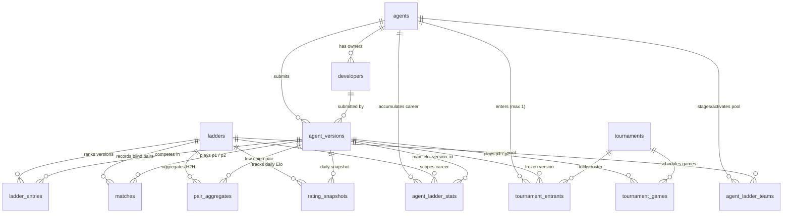

# Database Schema (`db/schema/`)

The **pkmn.ai** Arena server persists all account, ladder, rating, Discord, and tournament state in a single local SQLite database (`/var/lib/pkmn/arena.sqlite` in production, `private/arena.sqlite` in local development) accessed synchronously through Node's built-in `node:sqlite` (`DatabaseSync`) in WAL mode.

## Design Invariants

1. **Config-Driven Identity, Database-Driven State**:
   - [`config/ladders.yml`](../../config/ladders.yml) and [`static/projects.yml`](../../static/projects.yml) (`arena:` blocks) are declarative bootstrap sources synced into [`ladders`](ladders.sql), [`agents`](agents.sql), and [`developers`](developers.sql).
   - Mutable runtime state—OAuth identity bindings, encrypted pull tokens, smoke-test results, matches, Generalized Davidson ratings, reign clocks, and Discord notification flags—lives exclusively in SQLite.
2. **Bounded $O(M^3)$ Rating & Render Reads**:
   - Every completed ladder match writes to [`matches`](matches.sql) *and* atomically updates materialized sufficient statistics in [`ladder_entries`](ladder-entries.sql), [`pair_aggregates`](pair-aggregates.sql), [`agent_ladder_stats`](agent-ladder-stats.sql), and [`rating_snapshots`](rating-snapshots.sql).
   - Post-match rating solves and static HTML/JSON generation read only those compact summary tables ($M$ entries and $\le \binom{M}{2}$ pairs), never scanning the unbounded `matches` ledger.
3. **Anti-Scouting Privacy Boundary**:
   - Ladder tables intentionally store **no battle logs, replays, or raw team species** on public-facing rows: [`agent_ladder_teams`](agent-ladder-teams.sql) keeps submitted VGC team pools internal, and [`matches`](matches.sql) records only anonymized provenance labels (e.g. `'0 ERROR Team #4'`).
   - By contrast, [`tournament_games`](tournament-games.sql) stores public `p1_team` / `p2_team` packed sheets and links to public `.log` replays.
4. **Explicit Units & Casing**:
   - Time durations use `_millis` (milliseconds) or `_seconds` (seconds); timestamps (`*_at`) are Unix epoch seconds (`INTEGER`); memory footprints (`*ram`) are MiB.
   - `db/*.ts` translates SQL `snake_case` columns and `NULL` values at the database boundary into terse `camelCase` TypeScript objects using `undefined`.

## Entity-Relationship Diagram

## Table Directory

| Table | Schema File | Domain Role |
|---|---|---|
| `schema_migrations` | [`schema-migrations.sql`](schema-migrations.sql) | Tracks applied `db/migration/NNNN-*.sql` scripts for incremental upgrades. |
| `ladders` | [`ladders.sql`](ladders.sql) | Permanent and seasonal ladder epochs (`id` decoupled from URL `slot` for lossless rotation). |
| `agents` | [`agents.sql`](agents.sql) | Registered Arena projects from `static/projects.yml`, qualification status, and 14-day cooldown clock. |
| `developers` | [`developers.sql`](developers.sql) | Project co-owners with globally `UNIQUE` GitHub, Smogon, and Discord identities (1 project per human). |
| `discord_members` | [`discord-members.sql`](discord-members.sql) | Guild roster cache backing sub-millisecond `/auth/discord/validate` checks for `/chat/logs/`. |
| `agent_versions` | [`agent-versions.sql`](agent-versions.sql) | Submitted bundles/OCI images, one-time encrypted pull tokens, smoke-test telemetry, and DM state. |
| `agent_ladder_teams` | [`agent-ladder-teams.sql`](agent-ladder-teams.sql) | Pending and active 20-team rosters per `(agent_id, ladder_id)` for `pools`-mode ladders. |
| `ladder_entries` | [`ladder-entries.sql`](ladder-entries.sql) | Per-version MAP Davidson ratings, `champion`/`challenger`/`retired`/`quarantined` roles, 1500-Elo anchors, streaks, and reigns. |
| `agent_ladder_stats` | [`agent-ladder-stats.sql`](agent-ladder-stats.sql) | Cross-version project career peaks, streaks, and unbroken Top-$K$ reigns on each ladder. |
| `matches` | [`matches.sql`](matches.sql) | Append-only ledger of 2-game swapped-team blind-pair matches and runtime telemetry. |
| `pair_aggregates` | [`pair-aggregates.sql`](pair-aggregates.sql) | Canonical `low < high` 5-category Davidson counts (`ww/wt/split/tl/ll`), H2H streaks, and posterior LOS. |
| `rating_snapshots` | [`rating-snapshots.sql`](rating-snapshots.sql) | Daily UTC Elo/SE/LCB/GXE/rank snapshots powering ladder and profile rating charts. |
| `tournaments` | [`tournaments.sql`](tournaments.sql) | Cloud-GPU tournament configurations, hardware specs, and schedule lifecycle. |
| `tournament_entrants` | [`tournament-entrants.sql`](tournament-entrants.sql) | Locked tournament rosters (1 version per agent), match points, and Sonneborn-Berger tiebreakers. |
| `tournament_games` | [`tournament-games.sql`](tournament-games.sql) | Individual Round Robin / Superfinal games, public packed teams, and `.log` replay identifiers. |
