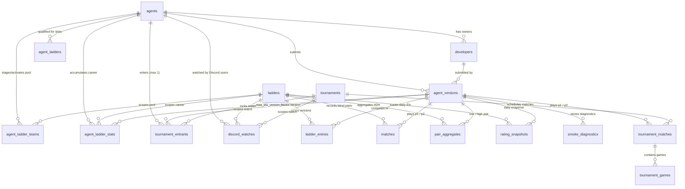

# Database Schema (`db/schema/`)

The **pkmn.ai** server stores all account, ladder, rating, Discord, and tournament state in one local
SQLite database (`/var/lib/pkmn/arena.sqlite` in prod, `db/data/arena.sqlite` in dev), accessed
synchronously via Node's `node:sqlite` (`DatabaseSync`) in WAL mode.

## Design Invariants

1. **Config-Driven Identity, DB-Driven State:** [`config/ladders.yml`](../../config/ladders.yml) and
   [`static/projects.yml`](../../static/projects.yml) (`arena:` blocks) bootstrap
   [`ladders`](ladders.sql), [`agents`](agents.sql), and [`developers`](developers.sql). Runtime
   state (OAuth links, encrypted pull tokens, smoke tests, matches, Davidson ratings, reigns, Discord
   flags) lives only in SQLite.
2. **Bounded $O(M^3)$ Reads:** Completed ladder matches write to [`matches`](matches.sql) and
   atomically update materialized summaries in [`ladder_entries`](ladder-entries.sql),
   [`pair_aggregates`](pair-aggregates.sql), [`agent_ladder_stats`](agent-ladder-stats.sql), and
   [`rating_snapshots`](rating-snapshots.sql). Rating solves and page renders read only those compact
   tables ($M$ entries, $\le \binom{M}{2}$ pairs), never scanning `matches`.
3. **Anti-Scouting Boundary:** Public ladder rows store no battle logs, replays, or raw species
   ([`agent_ladder_teams`](agent-ladder-teams.sql) is internal; [`matches`](matches.sql) stores
   anonymized provenance like `'0 ERROR Team #4'`). Conversely, [`tournament_matches`](tournament-matches.sql)
   stores public `p1_team`/`p2_team` sheets and [`tournament_games`](tournament-games.sql) stores
   per-game outcomes, telemetry, and `.log` replay IDs.
4. **Units & Casing:** Durations use `_millis` or `_seconds`; timestamps (`*_at`) are Unix epoch
   seconds (`INTEGER`); memory (`*ram`) is MiB. `db/*.ts` translates SQL `snake_case`/`NULL` at the
   row boundary to `camelCase`/`undefined`.

## Entity-Relationship Diagram

## Tables

| Table | File | Role |
|---|---|---|
| `schema_migrations` | [`schema-migrations.sql`](schema-migrations.sql) | Applied `db/migration/NNNN-*.sql` scripts. |
| `config` | [`config.sql`](config.sql) | Singleton operator-tunable Arena coordinator settings (smoke-test cadence). |
| `ladders` | [`ladders.sql`](ladders.sql) | Permanent/seasonal epochs (`id` decoupled from URL `slot` for rotation). |
| `agents` | [`agents.sql`](agents.sql) | Registered `projects.yml` Arena projects, derived qualification status, 14-day cooldown. |
| `agent_ladders` | [`agent-ladders.sql`](agent-ladders.sql) | Per-slot ladder qualification grants (`rby`/`adv`/`sv`/`rand`/`vgc`) in SQLite. |
| `developers` | [`developers.sql`](developers.sql) | Co-owners with globally `UNIQUE` GitHub, Smogon, and Discord IDs (1 project/human). |
| `discord_members` | [`discord-members.sql`](discord-members.sql) | Guild cache backing sub-ms `/auth/discord/validate` for `/chat/logs/`. |
| `discord_watches` | [`discord-watches.sql`](discord-watches.sql) | One-shot Discord `/watch` live match/tournament DM subscriptions. |
| `agent_versions` | [`agent-versions.sql`](agent-versions.sql) | Bundles/OCI images, one-time encrypted pull tokens, diagnostic/staged/activation lifecycle, DM state. |
| `smoke_diagnostics` | [`smoke-diagnostics.sql`](smoke-diagnostics.sql) | Private per-format self-play diagnostic replays (with `|ai|`), bounded 64 KiB `p1`/`p2` `stderr`, and CPU/RAM metrics. |
| `agent_ladder_teams` | [`agent-ladder-teams.sql`](agent-ladder-teams.sql) | Saved/pending/active 20-team rosters per `(agent_id, ladder_id)` for `pools` ladders. |
| `ladder_entries` | [`ladder-entries.sql`](ladder-entries.sql) | Per-version MAP Davidson ratings, roles (`champion`/`challenger`/`retired`/`quarantined`), 1500 anchors, CPU/fault aggregates, streaks, reigns. |
| `agent_ladder_stats` | [`agent-ladder-stats.sql`](agent-ladder-stats.sql) | Cross-version career peaks, streaks, and unbroken Top-$K$ reigns per ladder. |
| `matches` | [`matches.sql`](matches.sql) | Append-only ledger of 2-game swapped-team blind-pair matches and telemetry. |
| `pair_aggregates` | [`pair-aggregates.sql`](pair-aggregates.sql) | Canonical `low < high` 5-category Davidson counts (`ww/wt/split/tl/ll`), H2H streaks, LOS. |
| `rating_snapshots` | [`rating-snapshots.sql`](rating-snapshots.sql) | Daily UTC Elo/SE/LCB/GXE/rank snapshots for rating charts. |
| `tournaments` | [`tournaments.sql`](tournaments.sql) | Cloud-GPU tournament configs, hardware specs, schedule lifecycle. |
| `tournament_entrants` | [`tournament-entrants.sql`](tournament-entrants.sql) | Locked rosters (1 version/agent), match points, Sonneborn-Berger tiebreakers. |
| `tournament_matches` | [`tournament-matches.sql`](tournament-matches.sql) | Round Robin / Superfinal matches, public packed teams, series outcomes. |
| `tournament_games` | [`tournament-games.sql`](tournament-games.sql) | Per-game outcomes (1 for Bo1, up to $N$ for Bo$N$), telemetry, `.log` replay IDs. |
